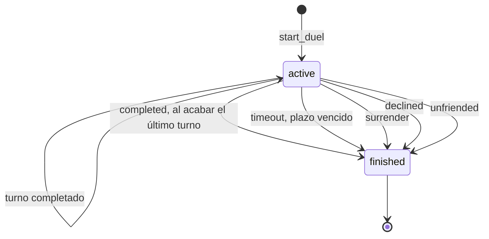

# Amigos, presencia y duelo por turnos

Este módulo reúne lo que la web necesita para jugar contra otra persona sin coincidir en el tiempo: la lista de amigos (búsqueda por nombre y solicitudes), la presencia "en línea" y el duelo por turnos asíncrono (3 o 6 rondas con ruleta de categorías y un plazo de 48 h por turno). Es servidor autoritativo: las tablas no tienen permisos para el cliente y el estado, los puntos y los turnos los calculan funciones `security definer` de Postgres; la web solo muestra. Vive en la migración [`friends_and_duels`](../../supabase/migrations/20261016165743_friends_and_duels.sql) y las posteriores, en `apps/web/src/features/{friends,duel,presence}`, en las rutas `/friends` y `/duel/[duelId]` y, para las reglas que necesita el cliente, en [`game-core/src/duel.ts`](../../packages/game-core/src/duel.ts). Los avisos de turno, el push y el aviso de plazo están en [avisos-pwa-y-push.md](avisos-pwa-y-push.md); el duelo en vivo, en [duelo-relampago.md](duelo-relampago.md). Las reglas aprobadas están en [CLAUDE.md](../../CLAUDE.md) ("Reglas del duelo aprobadas"); las convenciones de permisos y límites, en [base-de-datos.md](base-de-datos.md).

## Reglas

### Amigos

- Una sola relación por pareja, la haya pedido quien la haya pedido. Estados: `pending` y `accepted`.
- Búsqueda por prefijo del nombre de usuario, sin distinguir mayúsculas: mínimo 3 caracteres, máximo 10 resultados, orden alfabético. Solo se ve nombre, avatar, XP y la relación con quien busca. Límite: 30 búsquedas por minuto.
- Solicitudes: 20 nuevas por hora. Si la otra persona ya te había enviado una, enviarla de vuelta la acepta. Rechazar borra la solicitud (se puede volver a enviar). No hay bloqueo de usuarios.
- Eliminar un amigo (o cancelar una solicitud) borra la relación en cualquier sentido y cierra sus duelos por turnos activos sin ganador (`end_reason = 'unfriended'`). No avisa a nadie.

### Presencia

- El cliente da un latido cada 20 s mientras la pestaña está visible; "en línea" es haber dado un latido hace menos de 45 s.
- Tres estados, solo visibles para los amigos: `online`, `busy` ("Jugando": está en una partida) y `offline`.
- Interruptor "Mostrar cuando estoy en línea" en el perfil (`profiles.show_online`, activado por defecto), con reciprocidad: si lo apagas, nadie te ve conectado y tú tampoco ves a nadie. Es un dato personal nuevo: lo recoge la política de privacidad ([legal-y-privacidad.md](legal-y-privacidad.md)).

### Duelo por turnos

| Regla                | Valor                                                                                                   | Dónde se aplica                                                                  |
| -------------------- | ------------------------------------------------------------------------------------------------------- | -------------------------------------------------------------------------------- |
| Rondas               | 3 o 6 (6 por defecto); lo elige quien reta                                                              | CHECK `round_count in (3, 6)`; `DUEL.roundOptions` y `DUEL.defaultRounds`        |
| Turnos               | `round_count + 1` (4 o 7)                                                                               | `duels.turn_number`, `duel_next_action`                                          |
| Preguntas por ronda  | 3 para cada jugador, las mismas para los dos y en el idioma de cada uno                                 | `spin_duel_round`; `DUEL.questionsPerRound`                                      |
| Categoría            | La elige el servidor al azar (puede repetirse) entre las que aún tienen al menos 3 preguntas disponibles | `spin_duel_round`; la ruleta del cliente solo anima hasta ese segmento           |
| Dificultad           | La elige quien reta y vale para todo el duelo                                                           | `duels.difficulty`                                                               |
| Tiempo por pregunta  | 15 s, con 2 s extra de margen por latencia (una correcta hasta los 17 s aún puntúa; más tarde, 0)       | `answer_duel_question`                                                           |
| Puntos               | 15 si responde en menos de 3 s, 12 si es en menos de 7,5 s, 10 si es más lento; fallo o tiempo agotado: 0 | `answer_points` (la misma fórmula del modo rápido, [modo-rapido.md](modo-rapido.md)) |
| Plazo                | 48 h por turno; se reinicia cuando acaba un turno. Quien no juega a tiempo pierde                       | `turn_deadline`, `expire_duels`; `DUEL.turnHours` (sin uso en la web)            |
| Duelos activos       | 3 como máximo entre dos jugadores (cuente quien cuente como retador); sin límite global                 | `start_duel`; `DUEL.maxActivePerPair`                                            |
| Ganador              | Quien suma más puntos en todas las rondas; igualdad = empate (`winner_id` nulo)                         | `answer_duel_question`                                                           |
| Empieza              | Al momento: el retador juega primero y el rival no recibe aviso hasta que acaba el turno 1              | `start_duel`                                                                     |
| Rechazar             | Solo el rival y mientras no haya respondido ninguna pregunta. Sin ganador; sin los bonus de XP del final | `can_decline_duel`, `decline_duel`                                               |
| Rendirse             | Cualquiera de los dos, en cualquier momento; gana el otro                                               | `surrender_duel`                                                                 |
| Revancha             | Crea otro duelo con el mismo rival, la misma dificultad y las mismas rondas (quien la pide es el retador) | `rematch()` en `duel-game.tsx` + `start_duel`                                    |
| Límite de altas      | 20 duelos nuevos por hora                                                                               | trigger `duels_rate_limit`                                                       |

- Tras responder se enseña la correcta hasta que el jugador pulsa "Siguiente" (da tiempo a pensar o reportar). En el cliente, el temporizador da 0,5 s de gracia tras llegar a 0.
- Cuentan para las estadísticas por categoría y el % de acierto de cada pregunta ([progresion-y-estadisticas.md](progresion-y-estadisticas.md)) y dan XP al terminar (puntos de todas las rondas, +20 si acaba con normalidad, +30 si ganas, +10 si empatas).
- Animación de final (Victoria, Derrota, Empate o "Combate legendario") al abrir un duelo terminado, una vez por dispositivo; no sale si se rechazó o se canceló. Umbral legendario: 45 puntos en 3 rondas, 90 en 6 (`legendaryThreshold`).

## Cómo funciona

### Amigos

1. `/friends` exige perfil (`requireProfile`), llama a `list_friends` en el servidor y pasa las listas a `FriendsView`.
2. El buscador espera 300 ms tras la última tecla y llama a `search_players` (con menos de 3 letras no consulta). Según `relation`, cada resultado ofrece "Añadir" (`send_friend_request`), "Aceptar" (`respond_friend_request`), "Solicitud enviada" o "Amigo".
3. Debajo salen las solicitudes recibidas (Aceptar o Rechazar), la lista de amigos y las solicitudes enviadas (Cancelar es `remove_friend`).
4. Tras cada acción se repite la búsqueda activa y `router.refresh()` vuelve a ejecutar `list_friends`.
5. Cada amigo (`FriendRow`) ofrece **Retar** (panel con dificultad y rondas), el rayo del [duelo relámpago](duelo-relampago.md) (solo si `presence` es `online`) y **Eliminar** (con confirmación: "Los duelos en curso se cancelarán").
6. En la portada, el enlace "Amigos" lleva una insignia con las solicitudes recibidas. Los avisos de solicitud llegan en vivo por `NotificationToasts` y refrescan la página.

### Presencia

1. `PresenceHeartbeat` está en el layout raíz (solo con sesión). Llama a `touch_presence(is_busy)` al montarse, al cambiar de ruta, cada 20 s y al volver a mostrar la pestaña; solo envía si la pestaña está visible.
2. `is_busy` es verdadero cuando la ruta casa con `/play/quick/<id>`, `/duel/<id>` o `/live/<id>`.
3. `touch_presence` hace un upsert en `presence` (`last_seen_at = now()`, `busy`). Se escribe siempre, aunque `show_online` esté apagado: el interruptor solo enmascara la lectura.
4. `list_friends` calcula la presencia de cada amigo con `presence_of(quien_mira, amigo)`: `offline` si no hay fila, si el último latido tiene más de 45 s, o si cualquiera de los dos tiene `show_online` apagado; si no, `busy` cuando la fila lo marca y `online` en el resto. En las solicitudes la presencia sale siempre `offline`.
5. `PresenceDot` pinta el punto (verde en línea, rosa jugando; desconectado no se muestra). `OnlineToggle` actualiza `profiles.show_online` directamente (es la única escritura de este módulo que el cliente hace sin RPC).

### Duelo por turnos

**Crear.** "Retar" → `startDuel()` ([`start-duel.ts`](../../apps/web/src/features/duel/start-duel.ts)) → `start_duel` → fila en `duels` → `/duel/<id>`. Los hints `not_friends` y `too_many_duels` tienen texto propio; el resto, incluido `rate_limited`, sale como error genérico.

**Pantalla** (`DuelGame`). Fases: `loading` → `overview` → `spinning` → `question` → `reveal` (y vuelta a `question` con "Siguiente") → `overview`; `error` si algo falla.

1. Al entrar, `get_duel` y se muestra el resumen: marcador, una fila por ronda (categoría con su icono y puntos de cada uno) y, abajo, la acción que toca según `nextAction`.
2. `spin`: botón "Girar la ruleta" → `spin_duel_round` → la `Wheel` gira hasta el índice de `categoryId` (4 vueltas, 3,2 s) → 0,9 s después se pide la primera pregunta.
3. `answer`: botón "Jugar ronda N" (N sale de `duelPendingRound`) → `serve_duel_question`. Es idempotente: recargar devuelve la misma pregunta con el tiempo ya gastado.
4. `wait`: "Esperando a X · quedan N h" (el cliente calcula las horas con `hoursLeft`, que redondea hacia arriba, y su propio reloj).
5. Responder: el reloj se para al elegir; `answer_duel_question` devuelve la correcta, los puntos y `hitRate`. En `reveal` aparecen el mensaje de acierto o fallo, el botón de reportar la pregunta (`report_duel_question`) y "Siguiente".
6. "Siguiente" vuelve a cargar el duelo: si aún quedan preguntas se sirve la siguiente; si no, vuelve al resumen (turno acabado: toca girar o esperar).
7. Si el rival termina su turno mientras miras el resumen, el aviso en vivo (evento de ventana `trivia:notification`) recarga el duelo.
8. "Rendirse" pide confirmación; "Rechazar duelo" aparece solo si `canDecline` y no pide confirmación. Un duelo terminado muestra el resultado, el motivo, la XP ganada, "Revancha" e "Inicio".

**Turnos.** En el turno `t` (de 1 a `round_count + 1`) juega el retador si `t` es impar y el rival si es par. Primero responde las 3 preguntas de la ronda `t - 1` (la que giró el otro) y, si `t <= round_count`, gira la ronda `t` y responde sus 3 preguntas. Con 6 rondas:

| Turno | Juega   | Responde | Gira    |
| ----- | ------- | -------- | ------- |
| 1     | retador | nada     | ronda 1 |
| 2     | rival   | ronda 1  | ronda 2 |
| 3     | retador | ronda 2  | ronda 3 |
| 4     | rival   | ronda 3  | ronda 4 |
| 5     | retador | ronda 4  | ronda 5 |
| 6     | rival   | ronda 5  | ronda 6 |
| 7     | retador | ronda 6  | nada    |

Con 3 rondas son 4 turnos y el último (responder la ronda 3) es del rival. `spin_duel_round` crea a la vez las 6 jugadas de la ronda (3 por jugador); cada jugador recibe su propio `answer_order` y el `locale` de su perfil en ese momento. Al contestar la última pregunta del turno, `answer_duel_question` pasa el turno (`turn_number + 1`, plazo de 48 h, aviso `duel_turn`) o, en el último, cierra el duelo (aviso `duel_finished`).

**Estados.**

| `end_reason` | Lo provoca                                         | `winner_id`                          | `result` visto por cada jugador | Aviso que se crea                                  |
| ------------ | -------------------------------------------------- | ------------------------------------ | ------------------------------- | -------------------------------------------------- |
| `completed`  | `answer_duel_question` en el último turno          | quien suma más; nulo si hay empate   | `win`, `loss` o `draw`          | `duel_finished` al otro jugador (el que no ha jugado ese último turno) |
| `timeout`    | `expire_duels` (perezoso)                          | quien no tenía el turno              | `win` o `loss`                  | ninguno                                            |
| `surrender`  | `surrender_duel`                                   | el otro jugador                      | `win` o `loss`                  | `duel_finished` al otro                            |
| `declined`   | `decline_duel` (el rival)                          | nulo                                 | `cancelled`                     | `duel_finished` al retador                         |
| `unfriended` | `remove_friend`                                    | nulo                                 | `cancelled`                     | ninguno                                            |

**Caducidad perezosa.** No hay cron que venza los plazos: `expire_duels(uid)` se ejecuta al empezar un duelo, al consultar (`get_duel`, `list_duels`) y al jugar (`lock_active_duel`), y solo para los duelos del usuario que llama. `finished_at` es el momento en que se detecta, no el del vencimiento. El único proceso programado es el aviso de plazo ([avisos-pwa-y-push.md](avisos-pwa-y-push.md)).

## Base de datos

Las migraciones que definen todo esto son [`friends_and_duels`](../../supabase/migrations/20261016165743_friends_and_duels.sql) (base), [`duel_round_count_and_limit`](../../supabase/migrations/20261016191744_duel_round_count_and_limit.sql) (3 o 6 rondas y límite por pareja), [`scoring_10_points`](../../supabase/migrations/20261016192719_scoring_10_points.sql) (`answer_points`), [`question_pipeline`](../../supabase/migrations/20261018150834_question_pipeline.sql) (preguntas jugables, "actualidad"), [`push_notifications`](../../supabase/migrations/20261018174952_push_notifications.sql) (`deadline_warned_turn`), [`username_moderation_and_rate_limits`](../../supabase/migrations/20261018175651_username_moderation_and_rate_limits.sql) (límites), [`xp_and_levels`](../../supabase/migrations/20261020233725_xp_and_levels.sql), [`live_duels`](../../supabase/migrations/20261021141452_live_duels.sql) (presencia) y [`question_stats`](../../supabase/migrations/20261021152204_question_stats.sql) (`hitRate`). La lista completa y qué versión de cada función es la vigente está en [base-de-datos.md](base-de-datos.md).

Las cinco tablas del módulo (`friendships`, `presence`, `duels`, `duel_rounds` y `duel_plays`) llevan RLS activado, sin políticas, y `revoke all` para `anon` y `authenticated`: el cliente solo llega a ellas por las RPC de abajo. Los avisos (`notifications`) se documentan en [avisos-pwa-y-push.md](avisos-pwa-y-push.md). La única escritura directa del cliente es `profiles.show_online`, con `grant update (show_online)` para `authenticated` ([live_duels:22](../../supabase/migrations/20261021141452_live_duels.sql#L22)).

### `friendships`

Amistades y solicitudes ([friends_and_duels:75](../../supabase/migrations/20261016165743_friends_and_duels.sql#L75)). Las escriben `send_friend_request`, `respond_friend_request` y `remove_friend`.

| Columna        | Tipo          | Notas                                                                  |
| -------------- | ------------- | ---------------------------------------------------------------------- |
| `requester_id` | `uuid`        | Quien envía la solicitud. FK a `auth.users`, `on delete cascade`.      |
| `addressee_id` | `uuid`        | Quien la recibe. FK a `auth.users`, `on delete cascade`.               |
| `status`       | `text`        | `pending` (por defecto) o `accepted`.                                  |
| `created_at`   | `timestamptz` | `now()`.                                                               |
| `accepted_at`  | `timestamptz` | Nulo hasta aceptar.                                                    |

Clave primaria `(requester_id, addressee_id)`; CHECK `requester_id <> addressee_id`; índice único `friendships_pair_key` sobre `(least(...), greatest(...))` (una relación por pareja); índice `friendships_addressee_idx`. Trigger `friendships_rate_limit` (`before insert`, 20/h, [username_moderation:57](../../supabase/migrations/20261018175651_username_moderation_and_rate_limits.sql#L57)).

### `presence`

Último latido de cada cuenta ([live_duels:12](../../supabase/migrations/20261021141452_live_duels.sql#L12)). La escribe `touch_presence`.

| Columna        | Tipo          | Notas                                                          |
| -------------- | ------------- | -------------------------------------------------------------- |
| `user_id`      | `uuid`        | Clave primaria. FK a `auth.users`, `on delete cascade`.        |
| `last_seen_at` | `timestamptz` | Último latido.                                                 |
| `busy`         | `boolean`     | En una partida (rápida, turno de duelo o relámpago). Por defecto `false`. |

`profiles.show_online` (`boolean not null default true`) es la otra mitad: ver [perfil.md](perfil.md).

### `duels`

Un duelo entre dos jugadores ([friends_and_duels:262](../../supabase/migrations/20261016165743_friends_and_duels.sql#L262)). Lo escriben `start_duel`, `answer_duel_question`, `surrender_duel`, `decline_duel`, `expire_duels`, `remove_friend` y `warn_duel_deadlines`.

| Columna                | Tipo          | Notas                                                                                                         |
| ---------------------- | ------------- | ------------------------------------------------------------------------------------------------------------- |
| `id`                   | `uuid`        | Clave primaria (`gen_random_uuid()`).                                                                         |
| `challenger_id`        | `uuid`        | Quien reta. FK a `auth.users`, `on delete cascade`.                                                           |
| `opponent_id`          | `uuid`        | Rival. FK a `auth.users`, `on delete cascade`. CHECK `challenger_id <> opponent_id`.                          |
| `difficulty`           | `text`        | `easy`, `medium` o `hard`.                                                                                    |
| `round_count`          | `smallint`    | 3 o 6, por defecto 6 ([duel_round_count:4](../../supabase/migrations/20261016191744_duel_round_count_and_limit.sql#L4)). |
| `status`               | `text`        | `active` (por defecto) o `finished`.                                                                          |
| `end_reason`           | `text`        | `completed`, `timeout`, `surrender`, `declined` o `unfriended`. CHECK: nulo si y solo si está activo.         |
| `winner_id`            | `uuid`        | FK a `auth.users`, `on delete set null`. Nulo en un duelo terminado = empate o sin ganador.                   |
| `turn_number`          | `smallint`    | De 1 a `round_count + 1` (CHECK). Por defecto 1.                                                              |
| `turn_deadline`        | `timestamptz` | `now() + 48 h` al crear; se reinicia al pasar de turno.                                                       |
| `deadline_warned_turn` | `smallint`    | Último turno del que ya se avisó que vence ([push_notifications:15](../../supabase/migrations/20261018174952_push_notifications.sql#L15)). |
| `created_at`           | `timestamptz` | `now()`.                                                                                                      |
| `finished_at`          | `timestamptz` | Nulo mientras está activo.                                                                                    |

Índices `duels_challenger_idx (challenger_id, status)` y `duels_opponent_idx (opponent_id, status)`. Triggers: `duels_rate_limit` (`before insert`, 20/h, [username_moderation:61](../../supabase/migrations/20261018175651_username_moderation_and_rate_limits.sql#L61)) y `duels_grant_xp` (`after update of status`, al pasar de activo a terminado; reparte la XP, ver [progresion-y-estadisticas.md](progresion-y-estadisticas.md)).

### `duel_rounds`

Una fila por ronda girada ([friends_and_duels:282](../../supabase/migrations/20261016165743_friends_and_duels.sql#L282)). La crea `spin_duel_round`.

| Columna       | Tipo          | Notas                                                         |
| ------------- | ------------- | ------------------------------------------------------------- |
| `duel_id`     | `uuid`        | FK a `duels`, `on delete cascade`.                            |
| `round`       | `smallint`    | De 1 a 6 (CHECK). Clave primaria `(duel_id, round)`.          |
| `category_id` | `text`        | Categoría que salió en la ruleta. FK a `categories`.          |
| `created_at`  | `timestamptz` | `now()`.                                                      |

### `duel_plays`

Cada pregunta de cada jugador ([friends_and_duels:290](../../supabase/migrations/20261016165743_friends_and_duels.sql#L290)). La crea `spin_duel_round` (las dos copias a la vez); `serve_duel_question` fija `served_at` y `answer_duel_question` el resto.

| Columna        | Tipo          | Notas                                                                                                              |
| -------------- | ------------- | ------------------------------------------------------------------------------------------------------------------ |
| `duel_id`      | `uuid`        | Con `round`, FK compuesta a `duel_rounds` (`on delete cascade`).                                                   |
| `round`        | `smallint`    |                                                                                                                    |
| `slot`         | `smallint`    | De 1 a 3 (CHECK).                                                                                                  |
| `player_id`    | `uuid`        | FK a `auth.users`, `on delete cascade`. Clave primaria `(duel_id, round, slot, player_id)`.                        |
| `question_id`  | `uuid`        | FK a `questions`. Las dos copias de un slot llevan la misma pregunta.                                              |
| `locale`       | `text`        | `es` o `en`: idioma del jugador al girar; la pregunta se le sirve siempre en él.                                   |
| `answer_order` | `smallint[]`  | Orden mostrado, barajado en servidor y distinto para cada jugador: la respuesta en pantalla `i` es `answers[answer_order[i]]` (base 1; la 1 es la correcta). |
| `served_at`    | `timestamptz` | Nulo hasta servirla: arranca el reloj de 15 s.                                                                     |
| `answered_at`  | `timestamptz` | Nulo hasta responder.                                                                                              |
| `chosen`       | `smallint`    | Índice en pantalla (base 0); nulo = tiempo agotado.                                                                |
| `is_correct`   | `boolean`     |                                                                                                                    |
| `points`       | `smallint`    |                                                                                                                    |

Índices `duel_plays_question_idx (question_id)` y `duel_plays_player_idx (player_id)` ([question_stats:5](../../supabase/migrations/20261021152204_question_stats.sql#L5)). La vista interna `question_answers` las usa para las estadísticas.

### RPC

Son `security definer` con `set search_path = ''`, con `execute` solo para `authenticated`. Todas, salvo `report_duel_question` (que usa `auth.uid()`), fijan antes el usuario con `current_player_id()` (sin perfil: `insufficient_privilege`). Detalle de los hints en [base-de-datos.md](base-de-datos.md).

| Función | Argumentos | Devuelve | Quién la llama | Qué hace |
| ------- | ---------- | -------- | -------------- | -------- |
| `search_players` | `query text` | `jsonb`: lista de `{id, username, avatarId, xp, relation}` (máx. 10) | `friends-view.tsx` | Búsqueda por prefijo (minúsculas, sin espacios en los extremos; `%`, `_` y `\` escapados). Con menos de 3 caracteres devuelve `[]` sin contar para el límite. Excluye a quien busca. `relation`: `friend`, `outgoing`, `incoming` o `null`. Límite `search_players` 30/min (`rate_limited`); por eso es `volatile`. Vigente: [xp_and_levels:201](../../supabase/migrations/20261020233725_xp_and_levels.sql#L201). |
| `send_friend_request` | `target uuid` | `text`: `requested` o `friends` | `friends-view.tsx` | Crea la solicitud y avisa (`friend_request`). Si el otro ya la había enviado, la acepta (`friends`, aviso `friend_accepted` al otro). Si ya existe, devuelve su estado sin cambios. Error `jugador no válido` (`check_violation`) si es uno mismo o no existe. El límite de 20/h lo aplica el trigger. [friends_and_duels:151](../../supabase/migrations/20261016165743_friends_and_duels.sql#L151) |
| `respond_friend_request` | `requester uuid`, `accept boolean` | nada | `friends-view.tsx` | Aceptar pasa la solicitud a `accepted` y avisa al solicitante (`friend_accepted`). Rechazar borra la fila pendiente. Sin error si no hay solicitud. [friends_and_duels:184](../../supabase/migrations/20261016165743_friends_and_duels.sql#L184) |
| `remove_friend` | `other uuid` | nada | `friends-view.tsx` | Borra la relación (aceptada o pendiente, en cualquier sentido) y cierra los duelos activos entre ambos con `unfriended`. No avisa. [friends_and_duels:207](../../supabase/migrations/20261016165743_friends_and_duels.sql#L207) |
| `list_friends` | ninguno | `jsonb`: `{friends, incoming, outgoing}`, cada entrada `{id, username, avatarId, xp, presence}`, por nombre | páginas `/`, `/friends` y `/live` | `presence` solo se calcula en `friends`; en solicitudes es siempre `offline`. Vigente: [live_duels:59](../../supabase/migrations/20261021141452_live_duels.sql#L59). |
| `touch_presence` | `is_busy boolean` | nada | `presence-heartbeat.tsx` | Upsert de `presence` para quien llama. [live_duels:47](../../supabase/migrations/20261021141452_live_duels.sql#L47) |
| `start_duel` | `opponent uuid`, `duel_difficulty text`, `duel_round_count integer default 6` | `uuid` del duelo | `features/duel/start-duel.ts` | Exige amistad (`not_friends`), bloquea la pareja con un `pg_advisory_xact_lock`, vence los plazos propios y rechaza si ya hay 3 activos entre los dos (`too_many_duels`). Inserta el duelo (turno 1, plazo 48 h). Los CHECK validan dificultad y rondas (`check_violation`); el trigger, el límite (`rate_limited`). No avisa al rival. Vigente: [duel_round_count:33](../../supabase/migrations/20261016191744_duel_round_count_and_limit.sql#L33). |
| `spin_duel_round` | `duel_id uuid` | `jsonb`: `{round, categoryId}` | `duel-game.tsx` | Solo si `duel_next_action` es `spin` (`not_your_action`). Elige categoría al azar entre las que tienen al menos 3 candidatas (`duel_candidates` con los idiomas de ambos perfiles; si no hay, `not_enough_questions`), crea `duel_rounds` (ronda = `turn_number`) y las 3 jugadas de cada jugador. [friends_and_duels:413](../../supabase/migrations/20261016165743_friends_and_duels.sql#L413) |
| `serve_duel_question` | `duel_id uuid` | `jsonb`: `{round, slot, timeLimitMs: 15000, elapsedMs, category: {id, name, color}, topical, prompt, answers}` | `duel-game.tsx` | Solo si `duel_next_action` es `answer` (`not_your_action`). Toma la primera jugada sin responder (por ronda y slot), fija `served_at` si era nula y devuelve la pregunta en el idioma de la jugada, sin la correcta. Idempotente. Vigente: [question_pipeline:352](../../supabase/migrations/20261018150834_question_pipeline.sql#L352). |
| `answer_duel_question` | `duel_id uuid`, `question_round integer`, `question_slot integer`, `choice integer` | `jsonb`: `{correctIndex, isCorrect, points, turnEnded, finished, hitRate}` | `duel-game.tsx` | La jugada debe estar servida y sin responder (`question_unavailable`); `choice` es un índice en pantalla o nulo (tiempo agotado; fuera de rango: `check_violation`). Acierta si es la correcta y `elapsed_ms <= 17000`; puntos con `answer_points`. Si acaba el turno, lo pasa o cierra el duelo (ver "Turnos"). Vigente: [question_stats:136](../../supabase/migrations/20261021152204_question_stats.sql#L136). |
| `surrender_duel` | `duel_id uuid` | nada | `duel-game.tsx` | Cierra con `surrender`, gana el otro y le avisa (`duel_finished`). [friends_and_duels:605](../../supabase/migrations/20261016165743_friends_and_duels.sql#L605) |
| `decline_duel` | `duel_id uuid` | nada | `duel-game.tsx` | Solo si `can_decline_duel` (`not_your_action`). Cierra con `declined`, sin ganador, y avisa al retador. [friends_and_duels:636](../../supabase/migrations/20261016165743_friends_and_duels.sql#L636) |
| `get_duel` | `duel_id uuid` | `jsonb` o `null` | `duel-game.tsx` | Vence los plazos propios. Devuelve `null` si no existe o no participas. Claves: `id`, `difficulty`, `roundCount`, `status`, `endReason`, `result`, `turnNumber`, `deadline`, `nextAction`, `canDecline`, `xpGain`, `me` y `opponent` (`{id, username, avatarId, xp, score}`), `rounds` (`{round, category, myPoints, opponentPoints}`; los puntos son nulos hasta responder) y `categories` (los segmentos de la ruleta). Tipos en [`duel/types.ts`](../../apps/web/src/features/duel/types.ts). Vigente: [xp_and_levels:243](../../supabase/migrations/20261020233725_xp_and_levels.sql#L243). |
| `list_duels` | ninguno | `jsonb`: lista | `app/page.tsx` | Los duelos activos y los 5 últimos terminados. Cada entrada: `id`, `status`, `nextAction`, `result`, `endReason`, `round`, `roundCount`, `deadline`, `opponent` (`{username, avatarId, xp}`), `myScore` y `opponentScore`. Orden: primero los que te tocan, luego los activos por plazo más cercano, al final los terminados por fecha. Vigente: [xp_and_levels:317](../../supabase/migrations/20261020233725_xp_and_levels.sql#L317). |
| `report_duel_question` | `duel_id uuid`, `question_round integer`, `question_slot integer`, `reason text` | nada | `duel-game.tsx` | Reporta una pregunta ya respondida de tu duelo. Ver [contenido-y-admin.md](contenido-y-admin.md). [question_reports:65](../../supabase/migrations/20261018173937_question_reports_and_admin.sql#L65) |

`nextAction` y `result` toman estos valores: `nextAction` es `spin`, `answer`, `wait` o `done`; `result` es `win`, `loss`, `draw`, `cancelled` o nulo (activo).

### Funciones internas

Sin `execute` para el cliente (`revoke ... from public, anon, authenticated`); solo las llaman otras funciones.

| Función | Argumentos | Devuelve | Qué hace |
| ------- | ---------- | -------- | -------- |
| `current_player_id` | ninguno | `uuid` | `auth.uid()` si la cuenta tiene perfil; si no, `perfil no creado` (`insufficient_privilege`). [friends_and_duels:7](../../supabase/migrations/20261016165743_friends_and_duels.sql#L7) |
| `are_friends` | `a uuid`, `b uuid` | `boolean` | Hay una amistad `accepted` entre los dos. [friends_and_duels:93](../../supabase/migrations/20261016165743_friends_and_duels.sql#L93) |
| `presence_of` | `viewer uuid`, `target uuid` | `text` | `online`, `busy` u `offline` según las reglas de presencia. No comprueba la amistad: lo hace quien la llama. [live_duels:26](../../supabase/migrations/20261021141452_live_duels.sql#L26) |
| `expire_duels` | `uid uuid` | nada | Cierra con `timeout` los duelos activos de `uid` con `turn_deadline < now()`; gana quien no tenía el turno. [friends_and_duels:317](../../supabase/migrations/20261016165743_friends_and_duels.sql#L317) |
| `lock_active_duel` | `target uuid`, `uid uuid` | `duels` | Vence plazos y devuelve el duelo bloqueado (`for update`). Errores: `duelo no encontrado` (`no_data_found`) y `duel_finished`. [friends_and_duels:330](../../supabase/migrations/20261016165743_friends_and_duels.sql#L330) |
| `duel_next_action` | `d duels`, `uid uuid` | `text` | `done` si terminó; `wait` si no es tu turno. Si lo es: `answer` si tienes jugadas sin responder, `spin` si `turn_number <= round_count` y aún no se ha girado esa ronda, y `wait` en el resto. Vigente: [duel_round_count:11](../../supabase/migrations/20261016191744_duel_round_count_and_limit.sql#L11). |
| `duel_candidates` | `target duels`, `locale_a text`, `locale_b text` | tabla `(question_id, category_id)` | Preguntas jugables (`is_playable`) de la dificultad del duelo, en categoría activa, traducidas (pregunta y categoría) a los dos idiomas y aún no usadas en este duelo. Vigente: [question_pipeline:279](../../supabase/migrations/20261018150834_question_pipeline.sql#L279). |
| `can_decline_duel` | `d duels`, `uid uuid` | `boolean` | Activo, `uid` es el rival y no ha respondido nada. [friends_and_duels:624](../../supabase/migrations/20261016165743_friends_and_duels.sql#L624) |
| `duel_result` | `d duels`, `uid uuid` | `text` | Resultado visto por `uid`. [friends_and_duels:655](../../supabase/migrations/20261016165743_friends_and_duels.sql#L655) |
| `answer_points` | `hit boolean`, `elapsed_ms integer`, `time_limit_ms integer` | `integer` | 0 si falla; 15 si `elapsed_ms < 3000`; 12 si `< time_limit_ms / 2`; 10 en el resto. [scoring_10_points:5](../../supabase/migrations/20261016192719_scoring_10_points.sql#L5) |

Realtime: ninguna de estas tablas está publicada. Lo único que llega en vivo son los avisos de `notifications`.

## Código

| Archivo | Qué hace |
| ------- | -------- |
| [`app/friends/page.tsx`](../../apps/web/src/app/friends/page.tsx) | Página `/friends`: `list_friends` en servidor y `FriendsView`. |
| [`features/friends/friends-view.tsx`](../../apps/web/src/features/friends/friends-view.tsx) | Búsqueda con retardo de 300 ms, solicitudes, lista, `FriendRow` (retar, rayo en vivo, eliminar). |
| [`features/friends/types.ts`](../../apps/web/src/features/friends/types.ts) | Forma de lo que devuelven `list_friends` y `search_players` (`Friend`, `Presence`...). |
| [`app/duel/[duelId]/page.tsx`](../../apps/web/src/app/duel/[duelId]/page.tsx) | Página del duelo; `key={duelId}` para que la revancha empiece limpia. |
| [`features/duel/duel-game.tsx`](../../apps/web/src/features/duel/duel-game.tsx) | Pantalla del duelo: fases, ruleta, pregunta, reveal, resumen, rendirse, rechazar, revancha, animación de final. |
| [`features/duel/start-duel.ts`](../../apps/web/src/features/duel/start-duel.ts) | Llama a `start_duel` y traduce los hints a `StartDuelError`. |
| [`features/duel/duel-list.tsx`](../../apps/web/src/features/duel/duel-list.tsx) | "Tus duelos" de la portada; resalta los que te tocan. |
| [`features/duel/types.ts`](../../apps/web/src/features/duel/types.ts) | Forma de `get_duel`, `list_duels`, `serve_duel_question` y `answer_duel_question`. |
| [`components/wheel.tsx`](../../apps/web/src/components/wheel.tsx) | Ruleta presentacional: gira 4 vueltas (0 s con "reducir movimiento") hasta el segmento `target` que decide el servidor; para repetir el mismo segmento hay que pasar `null` entre giros. |
| [`features/presence/presence-heartbeat.tsx`](../../apps/web/src/features/presence/presence-heartbeat.tsx) | Latido de presencia y regla de "jugando" (`BUSY_PATH`). |
| [`features/presence/online-toggle.tsx`](../../apps/web/src/features/presence/online-toggle.tsx) | Interruptor "Mostrar cuando estoy en línea" del perfil. |
| [`features/live/presence-dot.tsx`](../../apps/web/src/features/live/presence-dot.tsx) | Punto de estado de un amigo. |
| [`game-core/src/duel.ts`](../../packages/game-core/src/duel.ts) | `DUEL` (espejo de las reglas de la migración), `hoursLeft` y `duelPendingRound`. |
| [`game-core/src/outcome.ts`](../../packages/game-core/src/outcome.ts) | `headToHeadOutcome` y `legendaryThreshold`, para la animación de final. |

Reutiliza `QuestionCard`, `useQuestionTimer`, `AnswerFeedback` y `ReportQuestion` del modo rápido ([modo-rapido.md](modo-rapido.md)), `LevelBadge` y `XpGain` ([progresion-y-estadisticas.md](progresion-y-estadisticas.md)) y `Avatar` ([perfil.md](perfil.md)). La ruleta y el reloj se ven en `/dev/ui` (solo en desarrollo).

## Tests

- **pgTAP** [`friends_duels.test.sql`](../../supabase/tests/friends_duels.test.sql) (37 comprobaciones; tres cuentas, 21 preguntas fáciles en es y en y 5 solo en es):
  - búsqueda: mínimo 3 caracteres, `_` sin valor de comodín, prefijo sin distinguir mayúsculas, solo nombre, avatar, XP y relación;
  - solicitudes: enviar, ver la entrante, aceptarla pidiéndola de vuelta; no se reta a quien no es amigo;
  - permisos: el cliente no lee `friendships` ni `duel_plays`, no llama a `notify` y solo ve sus avisos;
  - duelo de 6 rondas completo: empieza girando, sin pregunta antes de girar, el rival espera y no puede girar, un tercero no lo ve, el turno pasa y avisa, mismas preguntas para ambos en el idioma de cada uno, 7 turnos, 36 jugadas con 18 preguntas distintas, no sale una categoría sin traducción en el idioma del rival, ganador por puntos, un duelo terminado no sigue;
  - plazo de 48 h, duelo de 3 rondas (4 turnos) y CHECK de rondas, límite de 3 activos, rechazar, rendirse y eliminar amigo.
- Otros pgTAP que tocan el módulo: [`live_duels.test.sql`](../../supabase/tests/live_duels.test.sql) (presencia y reciprocidad), [`xp.test.sql`](../../supabase/tests/xp.test.sql) (XP de duelos), [`question_stats.test.sql`](../../supabase/tests/question_stats.test.sql) y [`question_reports_admin.test.sql`](../../supabase/tests/question_reports_admin.test.sql) (`report_duel_question`), [`moderation_rate_limits.test.sql`](../../supabase/tests/moderation_rate_limits.test.sql) (solo el límite de `search_players`).
- **Vitest** [`duel.test.ts`](../../packages/game-core/src/duel.test.ts) (`hoursLeft`, `duelPendingRound`) y [`outcome.test.ts`](../../packages/game-core/src/outcome.test.ts) (animación de final).
- Sin cubrir: rechazar una solicitud, el orden de `list_duels`, `can_decline_duel` tras responder, los límites `friend_request` y `start_duel`, el helper de la web `startDuel` y las pantallas.

## Detalles a tener en cuenta

- **Plazos perezosos.** Un duelo vencido sigue `active` en la BD hasta que uno de los dos lo consulta o juega. Al detectarlo no se avisa a nadie y la XP del final se concede en ese momento. `remove_friend` no vence antes los plazos: un duelo ya caducado acaba como `unfriended` en lugar de `timeout`. Una pregunta servida antes del plazo y respondida después falla con `duel_finished` (el cliente la trata como error genérico).
- **Idioma por jugada.** `duel_plays.locale` se fija al girar con el idioma del perfil de cada jugador en ese momento. Si alguien cambia de idioma a mitad de duelo, las jugadas ya creadas conservan el suyo y las rondas nuevas usan el nuevo. `duel_candidates` exige traducción de pregunta y categoría en los dos idiomas.
- **Cada jugador tiene su propio `answer_order`**, así que "la primera de la lista" no vale como pista entre ambos.
- **Los puntos del rival se ven pronto.** `get_duel` devuelve sus puntos de cada ronda en cuanto responde, aunque tú aún no la hayas jugado (quien juega después sabe lo que tiene que superar).
- **El duelo no prioriza preguntas no vistas** (elige al azar entre las no usadas en ese duelo), a diferencia de la rápida y el relámpago. Una pregunta ya asignada se sigue jugando aunque luego se rechace o caduque.
- **Preguntas insuficientes.** `start_duel` no comprueba que haya preguntas: si al girar ninguna categoría tiene 3 disponibles, `spin_duel_round` falla con `not_enough_questions` y el plazo acabará decidiendo.
- **Ruleta.** Muestra todas las categorías activas, pero el servidor solo puede elegir las que tienen preguntas suficientes en los dos idiomas. El nombre de la categoría se pinta al empezar el giro, no al terminar.
- **Borrado de cuenta.** Los duelos y las amistades de quien borra su cuenta desaparecen también para el rival (cascada). `xp_events.duel_id` queda nulo y los avisos con ese `duel_id` quedan colgando.
- **Presencia.** `/daily` no está en `BUSY_PATH`: quien juega el reto diario sale como "en línea" y se le puede retar en vivo. Un perfil sin crear (onboarding) también envía latidos y la RPC falla en silencio.
- **Revancha** también aparece en duelos cancelados; si el motivo era `unfriended`, falla con "solo puedes retar a tus amigos".
- **Límites sin texto propio.** `rate_limited` en `start_duel`, `send_friend_request` y `search_players` se muestra como error genérico o como "No hay jugadores con ese nombre"; solo el relámpago traduce el hint. Una solicitud rechazada puede reenviarse (hasta 20 por hora) y no hay bloqueo.
- **Sin índice para la búsqueda.** `search_players` usa `like` sobre `lower(username)`: recorre la tabla (está anotado como "shortcut" en la migración; añadir un índice `text_pattern_ops` si crece).
- **Comentario obsoleto.** El encabezado de la sección "Duelos" de la migración original describe la puntuación antigua (100 + hasta 50); la vigente es `answer_points`. No se edita una migración ya subida.
- **`DUEL` es un espejo**: si cambian las reglas en SQL hay que cambiarlas a mano en [`duel.ts`](../../packages/game-core/src/duel.ts). Hoy `turnHours` no lo lee nadie.
