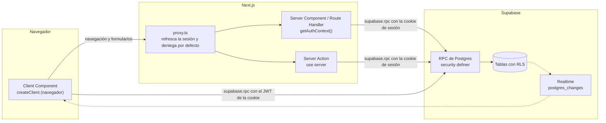

# Arquitectura

Mapa técnico de trivia-ajolote: qué hay en cada carpeta, cómo viaja una petición, cómo se aplican en el código los principios de [CLAUDE.md](../../CLAUDE.md) y cómo añadir pantallas, features y RPC. Es la puerta de entrada al resto de documentos de `docs/modulos/` (índice al final).

El proyecto es un monorepo pnpm con tres piezas: la web (`apps/web`, Next.js 16), las reglas de juego en TypeScript puro (`packages/game-core`) y la base de datos Supabase (`supabase/`), donde vive toda la lógica autoritativa en funciones RPC de Postgres. Las fases y su estado están en [CLAUDE.md > Hoja de ruta](../../CLAUDE.md); la visión original, en [vision.md](../vision.md).

## Mapa del monorepo

| Ruta                           | Qué hay                                                                                                                                                       |
| ------------------------------ | ------------------------------------------------------------------------------------------------------------------------------------------------------------- |
| `apps/web/`                    | La web (`@trivia/web`): Next.js 16 (App Router), React 19, Tailwind v4, next-intl, Motion. Ver [web.md](web.md).                                              |
| `apps/web/src/app/`            | Rutas (páginas, route handlers, manifest, iconos) y `globals.css` con los tokens visuales.                                                                    |
| `apps/web/src/components/`     | Componentes compartidos y presentacionales, e iconos SVG propios. Ver [sistema-visual.md](sistema-visual.md).                                                 |
| `apps/web/src/features/`       | Un directorio por feature (tabla de abajo).                                                                                                                   |
| `apps/web/src/i18n/`           | Idiomas, resolución del idioma de la petición. Los textos están en `apps/web/messages/{es,en}.json`.                                                          |
| `apps/web/src/lib/supabase/`   | Clientes de Supabase (servidor, navegador, proxy), lectura de variables y `database.types.ts` (generado).                                                     |
| `apps/web/src/proxy.ts`        | Refresca la sesión y deniega por defecto las rutas sin sesión.                                                                                                |
| `apps/web/src/instrumentation*.ts` | Errores a Sentry (servidor y navegador).                                                                                                                  |
| `packages/game-core/`          | `@trivia/game-core`: reglas de juego en TS puro, sin React ni Supabase, con tests. Sin build: la web lo transpila (`transpilePackages`). Ver [game-core.md](game-core.md). |
| `supabase/migrations/`         | 22 migraciones SQL (esquema, RLS, RPC, triggers, `pg_cron`). Ver [base-de-datos.md](base-de-datos.md).                                                        |
| `supabase/tests/`              | 12 archivos pgTAP (`*.test.sql`) que prueban RLS y RPC contra un Postgres real.                                                                               |
| `supabase/functions/push/`     | Edge Function (Deno) que envía los avisos push. Ver [avisos-pwa-y-push.md](avisos-pwa-y-push.md).                                                             |
| `supabase/seed/`               | `questions.json`: preguntas de ejemplo (es/en) que carga `pnpm db:seed`. Son públicas: no van a producción.                                                   |
| `supabase/config.toml`         | Configuración de Supabase local. Ver [infraestructura-y-ci.md](infraestructura-y-ci.md).                                                                      |
| `scripts/`                     | Scripts Node (`.mts`, Node 24 ejecuta TS): importación y procesos de preguntas, copia de seguridad, claves VAPID, cliente de administración.                  |
| `.claude/skills/`              | Skills de Claude Code `/questions-generate`, `/questions-translate` y `/questions-review`. Ver [contenido-y-admin.md](contenido-y-admin.md).                  |
| `.github/workflows/ci.yml`     | CI y despliegue de la BD. Ver [infraestructura-y-ci.md](infraestructura-y-ci.md).                                                                             |
| `docs/`                        | `vision.md`, `produccion.md`, `procesos-de-preguntas.md`, `superpowers/` (diseño y plan del duelo relámpago) y `modulos/` (estos documentos).                 |
| Raíz                           | `CLAUDE.md` (reglas y decisiones), `README.md` (arranque), `tsconfig.base.json`, `pnpm-workspace.yaml`, Prettier, `.nvmrc`, `.env.example`.                   |

## Features de la web

Cada carpeta de `apps/web/src/features/` agrupa pantallas, componentes, server actions y tipos de una parte del producto.

| Carpeta           | Qué hace                                                                                                                | Documento                                                     |
| ----------------- | ----------------------------------------------------------------------------------------------------------------------- | ------------------------------------------------------------- |
| `admin/`          | Cola de revisión de preguntas (`ReviewQueue`), solo para administradores.                                               | [contenido-y-admin.md](contenido-y-admin.md)                  |
| `auth/`           | Login social: server actions, proveedores habilitados, botones de entrar y salir.                                       | [auth-y-onboarding.md](auth-y-onboarding.md)                  |
| `daily/`          | Reto diario: tarjeta de la portada, resultados, cuadritos, imagen y botón de compartir.                                 | [reto-diario.md](reto-diario.md)                              |
| `duel/`           | Duelo por turnos: partida, lista "Tus duelos", crear y revancha.                                                        | [amigos-y-duelo.md](amigos-y-duelo.md)                        |
| `friends/`        | Búsqueda de jugadores, solicitudes, lista de amigos y retos.                                                            | [amigos-y-duelo.md](amigos-y-duelo.md)                        |
| `game/`           | Piezas comunes de partida (feedback, final animado, sonidos, temporizador, reporte, selector de dificultad) y `quick/`. | [modo-rapido.md](modo-rapido.md), [sistema-visual.md](sistema-visual.md) |
| `home/`           | Cabecera animada de la portada (`HomeIntro`).                                                                           | [web.md](web.md)                                              |
| `legal/`          | Textos de términos y privacidad, versión legal y enlaces.                                                               | [legal-y-privacidad.md](legal-y-privacidad.md)                |
| `live/`           | Duelo relámpago: invitación, partida en vivo, selector de amigos conectados.                                            | [duelo-relampago.md](duelo-relampago.md)                      |
| `notifications/`  | Avisos in-app en tiempo real (`NotificationToasts`).                                                                    | [avisos-pwa-y-push.md](avisos-pwa-y-push.md)                  |
| `preferences/`    | Preferencias de este dispositivo: tamaño de texto, sonido, vibración.                                                   | [sistema-visual.md](sistema-visual.md)                        |
| `presence/`       | Latido de presencia ("en línea") e interruptor para mostrarla.                                                          | [amigos-y-duelo.md](amigos-y-duelo.md)                        |
| `profile/`        | Perfil y onboarding: lecturas de sesión y perfil, formulario, avatares, nombre de usuario, borrar cuenta.               | [perfil.md](perfil.md)                                        |
| `progress/`       | XP: barra, tarjeta de nivel, insignia y ganancia tras la partida.                                                       | [progresion-y-estadisticas.md](progresion-y-estadisticas.md)  |
| `pwa/`            | Iconos de marca, registro del service worker y suscripción push.                                                        | [avisos-pwa-y-push.md](avisos-pwa-y-push.md)                  |
| `stats/`          | Estadísticas por categoría del perfil.                                                                                  | [progresion-y-estadisticas.md](progresion-y-estadisticas.md)  |

## Capas y flujo de una petición

Hay tres caminos hacia la base de datos, todos como el usuario con sesión (nunca con una clave privilegiada):

1. **Server Component o Route Handler.** La página llama a `getAuthContext()` ([profile/queries.ts](../../apps/web/src/features/profile/queries.ts), memoizado por petición con `cache`), que da el cliente de servidor y los `claims` del JWT. Lee con `supabase.rpc("list_friends")` y similares, y pasa el JSON a componentes cliente. Como los tipos generados solo dicen `Json`, cada feature declara a mano la forma de lo que devuelve la RPC en su `types.ts` y la página hace `data as unknown as Tipo`. Ejemplos: [app/page.tsx](../../apps/web/src/app/page.tsx), [app/friends/page.tsx](../../apps/web/src/app/friends/page.tsx).
2. **Server Action** (`"use server"`), para lo que necesita cookies o `redirect`: entrar y salir ([auth/actions.ts](../../apps/web/src/features/auth/actions.ts)), guardar perfil y borrar cuenta ([profile/actions.ts](../../apps/web/src/features/profile/actions.ts)), crear partida rápida ([game/quick/actions.ts](../../apps/web/src/features/game/quick/actions.ts)) y empezar el reto diario ([daily/actions.ts](../../apps/web/src/features/daily/actions.ts)). Vuelven a validar lo que llega del cliente y traducen `error.hint` a una clave de error de la interfaz.
3. **Componente cliente** con `createClient()` de [lib/supabase/client.ts](../../apps/web/src/lib/supabase/client.ts): los bucles de juego (`QuickGame`, `DuelGame`, `LiveGame`), amigos, presencia, suscripción push y el panel de administración. Usa el JWT de la cookie. Es también quien se suscribe a Realtime (solo `notifications` y `live_duels`).

La sesión viaja en cookies de Supabase Auth. [proxy.ts](../../apps/web/src/proxy.ts) la refresca en cada petición y redirige a `/` cuando no hay sesión (salvo rutas públicas); las páginas vuelven a exigirla con `requireProfile()`; y cada RPC identifica al usuario por `auth.uid()` (función interna `current_player_id()`), nunca por un id que mande el cliente. Detalle en [web.md](web.md).

## Cómo se aplican los principios

| Principio (CLAUDE.md)         | Cómo se cumple de verdad                                                                                                                                                                                                                                                                                                                                      |
| ----------------------------- | ------------------------------------------------------------------------------------------------------------------------------------------------------------------------------------------------------------------------------------------------------------------------------------------------------------------------------------------------------------- |
| Servidor autoritativo         | Las RPC `serve_*` devuelven `answers: string[]` en el orden barajado por el servidor y sin marca de correcta; el índice correcto (`correctIndex`) solo vuelve en la RPC de respuesta. Reloj, puntos y XP se calculan en SQL (`answer_points`, `clock_timestamp()`, triggers). El cliente solo muestra el tiempo: `useQuestionTimer` espera 0,5 s tras llegar a 0 antes de dar la pregunta por agotada. |
| RLS en todas las tablas       | Las 26 tablas de `public` tienen `enable row level security` y `revoke all` para `anon` y `authenticated`. El cliente solo tiene acceso directo a: `avatars` (select), `profiles` (select; insert de `id, username, avatar_id, locale, terms_version`; update de `username, avatar_id, locale, show_online`), `guests` (select, delete), `notifications` y `live_duels` (select, también para Realtime). Todo lo demás, por RPC. |
| Sin secretos en el cliente    | La web solo usa `NEXT_PUBLIC_*` (clave publicable). La clave secreta solo la leen `scripts/` desde el entorno; la Edge Function recibe `SUPABASE_SERVICE_ROLE_KEY` de la plataforma. Los `.env*` están ignorados salvo los `.env.example`.                                                                                                                  |
| Lógica en `game-core`         | `game-core` es TS puro. Contiene constantes que **espejan** las reglas que ejecuta SQL (`QUICK`, `SCORING`, `DUEL`, `LIVE`) y funciones puras que la web usa para mostrar (turnos y ranking, nivel y título, final de partida, categoría fuerte y débil). Las reglas viven por duplicado (SQL manda) y no hay test de paridad: al cambiar una, hay que cambiar la otra. |
| i18n                          | `next-intl` sin prefijo en la URL. `es.json` tipa las claves (`global.d.ts`). `es.json` y `en.json` tienen hoy las mismas 296 claves, pero nada lo comprueba automáticamente. Los textos legales van aparte (`features/legal/content`) y las preguntas tienen sus traducciones en BD. Fuera de `/dev/ui`, una búsqueda en el código no encuentra texto visible escrito a mano (solo nombres propios como "Google" y cada idioma en su lengua). |
| Móvil primero / PWA           | Pantallas de una columna (`max-w-md`, `min-h-dvh`), acciones principales abajo, sin estados `hover`. Manifest, iconos generados y service worker sin caché para instalar y recibir push. La lógica de negocio no depende de APIs del navegador: está en las RPC.                                                                                              |
| Sin emojis                    | Iconos SVG propios (`components/icons.tsx`, `category-icon.tsx`, `title-icon.tsx`) y mascota SVG. No hay emojis en el código fuente.                                                                                                                                                                                                                          |
| Privacidad                    | Borrado de cuenta por RPC, aceptación legal en el onboarding, Sentry sin datos personales. Ver [perfil.md](perfil.md) y [legal-y-privacidad.md](legal-y-privacidad.md).                                                                                                                                                                                       |

## Convenciones

- **Por feature.** Dentro de `features/<nombre>/`: `actions.ts` (server actions), `types.ts` (forma del JSON de las RPC; en `admin/` está dentro de `review-queue.tsx`), componentes en kebab-case (`quick-game.tsx`), hooks como `use-question-timer.ts`, tests junto al código (`username.test.ts`). `queries.ts` solo existe en `profile/` (lecturas de sesión y perfil). Hay importaciones entre features (p. ej. `progress` usa `game/sfx`).
- **Componentes compartidos** en `components/`: presentacionales, no deciden nada del juego; reciben estado y textos ya traducidos (`QuestionCard`, `BackLink`).
- **Alias** `@/` apunta a `apps/web/src/`; las reglas, a `@trivia/game-core`.
- **Idioma del código:** identificadores en inglés; comentarios, textos y commits (Conventional Commits) en español. Los atajos deliberados se marcan con un comentario que empieza por `shortcut:` (también en SQL).
- **Nombres de RPC** en snake_case con verbo: `get_`, `list_`, `serve_`, `answer_`, `start_`, `admin_`. Los argumentos también (`match_id`, `duel_id`).
- **Errores de negocio:** la RPC lanza `raise exception ... using hint = '<snake_case>'` y el cliente lee `error.hint` y lo traduce a una clave camelCase (`not_friends` pasa a `notFriends`). Hints en uso: `rate_limited`, `not_friends`, `too_many_duels`, `not_enough_questions`, `not_your_action`, `match_finished`, `duel_finished`, `question_unavailable`, `username_not_allowed`, `friend_offline`, `friend_busy`, `live_in_progress`, `live_not_started`, `live_not_active`, `live_time_up`, `invite_unavailable`, `daily_expired`.
- **Espacios de nombres i18n** en PascalCase (`Quick`, `Duel`), claves en camelCase; `Notifications` usa las mismas claves que el `kind` de la tabla.
- **TypeScript:** estricto y con `noUncheckedIndexedAccess` ([tsconfig.base.json](../../tsconfig.base.json)), por eso abundan los `!` tras indexar arrays.
- **Pantallas de juego** como máquina de fases en el cliente (`loading`, `question`, `reveal`, `results`...). Las páginas dinámicas pasan `key={id}` para que otra partida empiece con estado limpio.
- **Migraciones:** `pnpm exec supabase migration new <nombre>` (nombre con marca de tiempo), nunca editar una ya subida a `main`, avisar en el resumen y regenerar tipos con `pnpm db:types`.

## Guía rápida

### Añadir una pantalla

1. Crea `apps/web/src/app/<ruta>/page.tsx` como Server Component asíncrono. Queda protegida por defecto; solo si debe ser pública, añádela a `isPublicPath` en [proxy.ts](../../apps/web/src/proxy.ts).
2. Empieza con `const profile = await requireProfile()` (sin sesión va a `/`; sin perfil, a `/onboarding`) y toma el cliente con `const { supabase } = await getAuthContext()`.
3. Pide los datos en un `Promise.all` junto a `getTranslations("<Espacio>")` y convierte el JSON con el tipo de la feature.
4. Maqueta como las demás: `<main className="flex min-h-dvh flex-col items-center gap-8 p-6">`, cabecera con `BackLink` y `<h1 className="text-3xl font-bold">`, contenido con `max-w-md`.
5. Añade el espacio de nombres a `messages/es.json` **y** `messages/en.json`.
6. Si hay interacción, crea un componente cliente en `features/<feature>/` que llame a la RPC con `createClient()`, o una server action si necesita `redirect` o cookies.
7. Si añades una pieza visual compartida, enséñala en [`/dev/ui`](../../apps/web/src/app/dev/ui/showcase.tsx). Si la ruta no debe pasar por el proxy (estáticos, PWA), ajusta el `matcher`.

### Añadir una feature

1. Carpeta `features/<nombre>/` con `types.ts`, `actions.ts` si hace falta y los componentes.
2. Reglas puras y reutilizables (turnos, puntos mostrados, finales) en `packages/game-core/src/<modo>.ts`, exportadas desde `index.ts` y con su `<modo>.test.ts`.
3. Lógica autoritativa y datos en una migración, con su test pgTAP.
4. Textos en los dos JSON de `messages/`.
5. Respeta la fase actual (regla 3 de CLAUDE.md) y, si la decisión es estructural, añádela a "Decisiones". Actualiza el documento del módulo en esta carpeta.

### Añadir una RPC

1. `pnpm exec supabase migration new <nombre>`.
2. Función con `security definer` y `set search_path = ''`, nombres calificados (`public.`), usuario con `public.current_player_id()` (falla si no hay perfil) o `auth.uid()`. Errores con `using hint = '...'`. En operaciones sensibles, `perform public.check_rate_limit('<acción>', <máximo>, interval '<ventana>')` y la función no puede ser `stable`; para altas, un trigger con `public.rate_limit_trigger(...)` ([ejemplo](../../supabase/migrations/20261018175651_username_moderation_and_rate_limits.sql)).
3. Permisos: `revoke execute on function ... from public, anon;` y `grant execute ... to authenticated;`. Las funciones internas se revocan también a `authenticated` y no se conceden ([ejemplo](../../supabase/migrations/20261016165743_friends_and_duels.sql)).
4. Si crea una tabla: `enable row level security`, `revoke all ... from anon, authenticated` y solo los `grant` mínimos ([ejemplo](../../supabase/migrations/20261015231640_profiles.sql)).
5. Test en `supabase/tests/<tema>.test.sql` y `pnpm db:test`.
6. `pnpm db:types` y commitea `database.types.ts`.
7. En la web, declara la forma del JSON en `features/<f>/types.ts` y traduce los hints a claves de error (modelo: [live/invite.ts](../../apps/web/src/features/live/invite.ts)).
8. Si la regla se muestra en la interfaz y existe una constante espejo en `game-core`, cámbiala también.

## Índice de documentos

| Documento                                                    | Contenido                                                                                                       |
| ------------------------------------------------------------ | --------------------------------------------------------------------------------------------------------------- |
| [web.md](web.md)                                             | Rutas, layout raíz, proxy, clientes de Supabase, i18n, Sentry, `next.config.ts`, iconos y `/dev/ui`.            |
| [sistema-visual.md](sistema-visual.md)                       | Tokens, componentes compartidos, iconos, mascota, finales animados, sonido, preferencias y accesibilidad.       |
| [infraestructura-y-ci.md](infraestructura-y-ci.md)           | Scripts, arranque local, variables de entorno, CI, despliegue, copias, versiones, formato y lint.               |
| [base-de-datos.md](base-de-datos.md)                         | Convenciones de la BD: permisos, RLS, `security definer`, límites de peticiones, Realtime, `pg_cron`, migraciones. |
| [auth-y-onboarding.md](auth-y-onboarding.md)                 | Login social, callback OAuth, onboarding.                                                                       |
| [perfil.md](perfil.md)                                       | Perfil, avatares, nombre de usuario y su moderación, idioma, invitados, borrado de cuenta.                      |
| [legal-y-privacidad.md](legal-y-privacidad.md)               | Términos, privacidad, aceptación, edad mínima.                                                                  |
| [preguntas.md](preguntas.md)                                 | Modelo de preguntas, servirlas sin la correcta, importación, % de acierto por pregunta.                         |
| [contenido-y-admin.md](contenido-y-admin.md)                 | Procesos de generación, traducción y revisión, reportes y panel `/admin`.                                       |
| [progresion-y-estadisticas.md](progresion-y-estadisticas.md) | XP, niveles, títulos y estadísticas por categoría.                                                              |
| [game-core.md](game-core.md)                                 | Reglas de juego en TS puro y cuándo sale cada final animado.                                                    |
| [modo-rapido.md](modo-rapido.md)                             | Preguntas rápidas en solitario y local por turnos.                                                              |
| [reto-diario.md](reto-diario.md)                             | Reto diario compartible.                                                                                        |
| [amigos-y-duelo.md](amigos-y-duelo.md)                       | Amigos, presencia "en línea" y duelo por turnos.                                                                |
| [duelo-relampago.md](duelo-relampago.md)                     | Duelo 1 contra 1 en vivo de 60 s.                                                                               |
| [avisos-pwa-y-push.md](avisos-pwa-y-push.md)                 | Avisos in-app, PWA, push web y aviso de plazo.                                                                  |

Documentos anteriores a esta carpeta: [vision.md](../vision.md), [produccion.md](../produccion.md), [procesos-de-preguntas.md](../procesos-de-preguntas.md) y el [diseño del duelo relámpago](../superpowers/specs/2026-10-21-duelo-relampago-design.md).

## Detalles a tener en cuenta

- **Reglas duplicadas SQL y TS.** Los comentarios de `game-core` dicen "si cambian allí, cambian aquí", pero nada lo verifica. Cambiar, por ejemplo, el tiempo por pregunta exige tocar la migración, la constante (`QUICK`, `LIVE`) y los tests de ambos lados. Dónde está cada una:

  | Regla | SQL | `game-core` |
  | --- | --- | --- |
  | Modo rápido (hasta 6 jugadores, 7 preguntas por jugador, 15 s) | [quick_matches](../../supabase/migrations/20261016143214_quick_matches.sql) | `QUICK` |
  | Puntos del acierto (10, 12 en menos de la mitad del tiempo, 15 en menos de 3 s) | `answer_points` en [scoring_10_points](../../supabase/migrations/20261016192719_scoring_10_points.sql) | `SCORING` y `speedTier` |
  | Duelo por turnos (3 o 6 rondas, plazo de 48 h, 3 duelos activos por pareja) | [friends_and_duels](../../supabase/migrations/20261016165743_friends_and_duels.sql), [duel_round_count_and_limit](../../supabase/migrations/20261016191744_duel_round_count_and_limit.sql) | `DUEL` |
  | Duelo relámpago (60 s, 6 s por pregunta, 10 o 13 puntos, invitación de 30 s, cuenta atrás de 3 s) | [live_duels](../../supabase/migrations/20261021141452_live_duels.sql), [live_clock_pause](../../supabase/migrations/20261021144234_live_clock_pause.sql) | `LIVE` |

  Las migraciones de la tabla son donde nació cada regla; las funciones que la aplican hoy se redefinieron después en otras migraciones. La lista exacta, con la versión vigente de cada función, está en [game-core.md](game-core.md#1-espejos-existen-en-ts-y-en-sql). La XP no está duplicada: la cantidad se decide en SQL (triggers) y la curva de niveles solo existe en `game-core` (`LEVELS`).
- **Tipos de las RPC a mano.** Los `types.ts` de cada feature no se validan en ejecución: si una RPC cambia su JSON, el compilador no avisa.
- **Componente genérico fuera de `components/`.** `SegmentedPicker` vive en `features/game/difficulty-picker.tsx` y lo usan también `friends` y `preferences`; sería candidato a `components/`.
- **Todas las páginas son dinámicas:** el layout raíz lee cookies (idioma, tamaño de texto y sesión).
- **Estado de las fases y pendientes** (textos legales, producción, pruebas en móvil real): siempre en [CLAUDE.md > Estado y pendientes](../../CLAUDE.md), no aquí.
