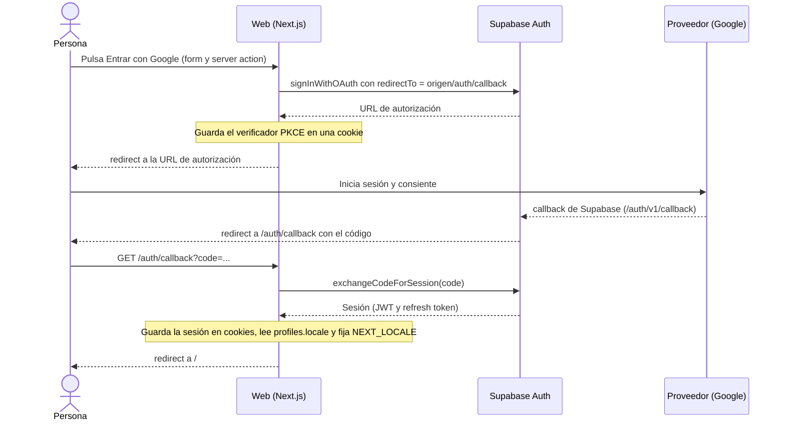
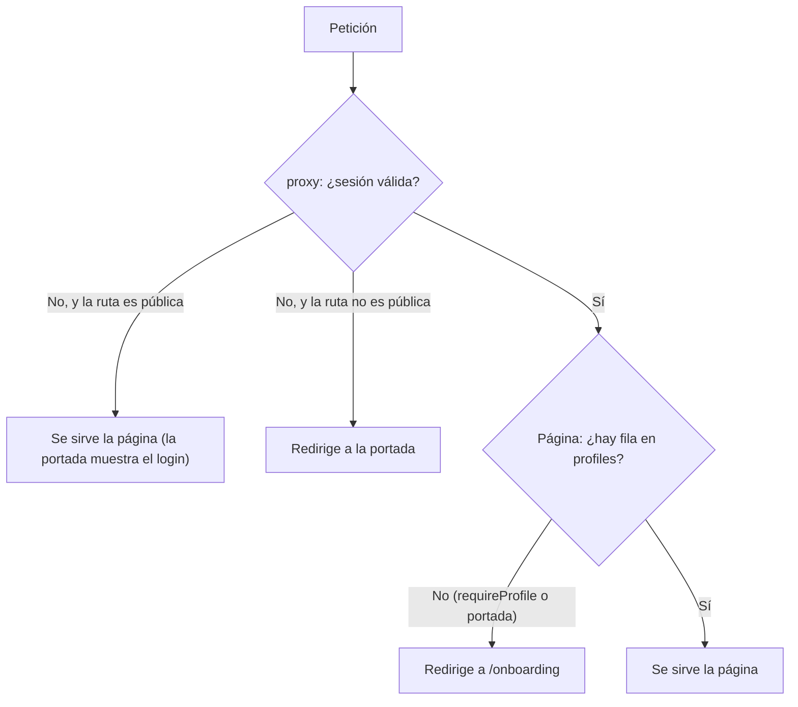

# Autenticación y onboarding

Cómo entra una persona en la web, cómo se mantiene su sesión, cómo se protege cada ruta y cómo completa el onboarding que crea su perfil. El login es solo social (hoy, Google) con el flujo OAuth PKCE de Supabase Auth; la sesión vive en cookies que renueva `src/proxy.ts`. El código está en `apps/web/src/features/auth`, `apps/web/src/app/auth/callback`, `apps/web/src/app/onboarding`, `apps/web/src/proxy.ts` y `apps/web/src/lib/supabase`; la configuración de Auth, en `supabase/config.toml`. La identidad (email y cuenta del proveedor) la guarda Supabase en `auth.users`; el perfil (`public.profiles`) se documenta en [perfil.md](perfil.md) y los textos que se aceptan en el onboarding, en [legal-y-privacidad.md](legal-y-privacidad.md). Decisiones aprobadas en [CLAUDE.md](../../CLAUDE.md): "Auth solo social", "Denegación por defecto en `src/proxy.ts`", "Perfil = onboarding completado" e "Idioma sin prefijo en la URL".

## Reglas

| Concepto | Valor |
| --- | --- |
| Cuenta | Obligatoria. Solo login social: el registro por email y por SMS está desactivado (`enable_signup = false` en `[auth.email]` y `[auth.sms]`) y no hay inicios de sesión anónimos. |
| Proveedor activo | Google. |
| Proveedores preparados | Discord (a la espera de credenciales), Apple y Facebook (a la espera de cuentas de desarrollador). Constan con `enabled: false` en `AUTH_PROVIDERS` y con `enabled = false` en `config.toml`. |
| Rutas sin sesión | `/`, `/auth/*` y `/legal/*`. Cualquier otra ruta que pase por el proxy redirige a `/`. |
| Cuenta sin perfil | La portada y las páginas que exigen perfil (`requireProfile()`) redirigen a `/onboarding`. |
| Tras iniciar sesión | Siempre a `/`: no se recuerda la página que se pedía. |
| Sesión | JWT de acceso de 1 h (`jwt_expiry = 3600`) con rotación de refresh tokens (`refresh_token_reuse_interval = 10`). Son los valores de `config.toml` (local); en Supabase Cloud se fijan en el panel. |
| Idioma de la interfaz | Cookie `NEXT_LOCALE` > cabecera `Accept-Language` > `es`. Sin prefijo en la URL. |

## Cómo funciona

### Login con OAuth (PKCE)

1. **Portada sin sesión** ([`app/page.tsx`](../../apps/web/src/app/page.tsx)): mascota, título, mensaje de error si la URL lleva `?error=auth`, `LoginButtons` y los enlaces legales. [`LoginButtons`](../../apps/web/src/features/auth/login-buttons.tsx) pinta un `<form>` por proveedor activo (`enabledProviders`); el texto sale de `Auth.signInWith` con el nombre del proveedor (`label`, que no se traduce).
2. **Server action [`signInWithProvider`](../../apps/web/src/features/auth/actions.ts#L8-L24)**:
   - Valida el proveedor con `isEnabledProvider`: el argumento llega del cliente. Si no es uno activo, redirige a `/?error=auth`.
   - Lee la cabecera `Origin` (sin ella, `/?error=auth`). Next ya rechaza las acciones cuyo `Origin` no coincide con el `Host`.
   - Llama a `signInWithOAuth({ provider, options: { redirectTo: `${origin}/auth/callback` } })`. `@supabase/ssr` usa PKCE: guarda el verificador del código en una cookie y devuelve la URL de autorización, a la que la acción redirige.
3. **Autenticación en el proveedor.** Hay dos callbacks distintos, no se deben confundir. El del proveedor hacia Supabase (`<URL de Supabase>/auth/v1/callback`) es el que se registra en la consola de Google o Discord. El de Supabase hacia la web (`/auth/callback`) es el que debe constar en la lista de redirecciones permitidas de Supabase (`additional_redirect_urls` en local; _Redirect URLs_ en el panel de producción).
4. **[`GET /auth/callback`](../../apps/web/src/app/auth/callback/route.ts)**: intercambia el `code` por la sesión (`exchangeCodeForSession`; la librería borra el verificador PKCE al terminar, bien o mal). Si funciona, consulta `profiles.locale` de la cuenta y, si ya hay perfil, fija la cookie `NEXT_LOCALE` con ese idioma (el idioma del perfil manda sobre el del navegador). Redirige a `/`. Si falta `code` o el intercambio falla, redirige a `/?error=auth`.
5. En `/`, si la cuenta no tiene fila en `profiles`, la portada redirige a `/onboarding`.

### Sesión y protección de rutas

- **El proxy** ([`src/proxy.ts`](../../apps/web/src/proxy.ts)) es la convención de Next 16 (antes `middleware`). En cada petición llama a [`updateSession`](../../apps/web/src/lib/supabase/proxy.ts) (crea un cliente de servidor con las cookies de la petición y llama a `getClaims()`) y devuelve `isAuthenticated`. Sin sesión y fuera de las rutas públicas redirige a `/`: cualquier ruta nueva queda protegida sin hacer nada (denegación por defecto).
- **Rutas públicas y por qué** (`isPublicPath`): `/` es la pantalla de login; `/auth/*` contiene el callback del flujo OAuth; `/legal/*` debe poder leerse antes de aceptar los términos (la casilla del onboarding y la portada enlazan a ellos). CLAUDE.md lo recoge en dos decisiones: la de la denegación por defecto (2026-10-16) y la de los textos legales (2026-10-19).
- **Refresco de la sesión.** `getClaims()` verifica el JWT y, si el token de acceso ha caducado, lo renueva con el refresh token. Las cookies nuevas y las cabeceras anti-caché que devuelve `@supabase/ssr` se acumulan en la respuesta para que ninguna CDN sirva la sesión de una persona a otra. No se debe ejecutar código entre `createServerClient` y `getClaims()` (provoca cierres de sesión aleatorios, según la nota del código).
- **Qué no pasa por el proxy** (el `matcher` de `proxy.ts` lo excluye, así que se sirve sin sesión): `_next/static`, `_next/image`, `favicon.ico`, `manifest.webmanifest`, `sw.js`, `lagoon` (túnel de Sentry), `icon/`, `apple-icon*` y cualquier ruta que termine en `svg`, `png`, `jpg`, `jpeg`, `gif` o `webp`. Son lo que el navegador pide para instalar la PWA y lo que permite recibir también los errores de quien no ha iniciado sesión.
- **En las páginas.** [`getAuthContext()`](../../apps/web/src/features/profile/queries.ts#L7-L11) devuelve el cliente de servidor y los `claims` del JWT (`sub` es el id de la cuenta); está memoizada por petición con `cache`. [`requireProfile()`](../../apps/web/src/features/profile/queries.ts#L25-L31) redirige a `/` sin sesión y a `/onboarding` sin perfil; la usan `/profile`, `/admin`, `/daily`, `/friends`, `/live`, `/live/[duelId]`, `/duel/[duelId]`, `/play/quick` y `/play/quick/[matchId]`. La portada hace la misma comprobación a mano.
- **En la base de datos.** La seguridad real no depende de la web: las tablas del cliente tienen RLS por `auth.uid()` y las RPC comprueban quién llama (`current_player_id()`, o la misma comprobación a mano, lanza `perfil no creado` si la cuenta no tiene perfil). Ver [base-de-datos.md](base-de-datos.md#cómo-está-montada-la-seguridad).
- **Dos clientes de Supabase** en [`lib/supabase`](../../apps/web/src/lib/supabase): [`server.ts`](../../apps/web/src/lib/supabase/server.ts) (uno por petición, nunca global; si lo llama un Server Component no puede escribir cookies y lo ignora, porque el refresco es cosa del proxy) y [`client.ts`](../../apps/web/src/lib/supabase/client.ts) (navegador: lo usan el cierre de sesión, la presencia, los avisos en vivo y el interruptor de "en línea"). Solo usan las variables públicas ([`env.ts`](../../apps/web/src/lib/supabase/env.ts)): la clave secreta nunca llega a la web.
- **Qué monta el layout solo con sesión** ([`app/layout.tsx`](../../apps/web/src/app/layout.tsx)): los avisos en vivo y el latido de presencia. El registro del service worker se monta siempre.

### Onboarding

[`/onboarding`](../../apps/web/src/app/onboarding/page.tsx) crea el perfil. Es la única página que exige sesión pero no perfil.

1. Si la cuenta ya tiene perfil, redirige a `/`.
2. Carga en paralelo los avatares activos (`getActiveAvatarIds`, lectura directa de `avatars` con RLS) y una sugerencia de nombre (`suggestUsername`, ver [perfil.md](perfil.md)).
3. Pinta [`ProfileForm`](../../apps/web/src/features/profile/profile-form.tsx) en modo `create`. Pide:
   - Nombre de usuario (3 a 20 caracteres: letras sin tildes, números y `_`), con la sugerencia ya escrita.
   - Avatar (el primero del catálogo viene marcado).
   - Idioma (`es` o `en`; marcado el de la interfaz en ese momento).
   - Casilla obligatoria con edad mínima (14 años), términos y privacidad, con enlaces a `/legal/terms` y `/legal/privacy` que se abren en una pestaña nueva. Solo existe en modo `create`.
4. Al enviar, la server action `saveProfile` ([`profile/actions.ts`](../../apps/web/src/features/profile/actions.ts#L21-L48)) valida el nombre y el idioma, comprueba la casilla (`acceptTerms`) e inserta en `profiles` con `id = claims.sub`, el nombre, el avatar, el idioma y `terms_version = LEGAL.version`. La BD vuelve a validarlo todo (CHECK, triggers y RLS); ver [perfil.md](perfil.md) para el detalle y los errores.
5. Si va bien, fija `NEXT_LOCALE` con el idioma elegido y redirige a `/`.

La aceptación de términos (qué se guarda y por qué la fecha la pone la BD) está en [legal-y-privacidad.md](legal-y-privacidad.md).

### Idioma de la interfaz

[`i18n/request.ts`](../../apps/web/src/i18n/request.ts) resuelve el idioma en cada petición: cookie `NEXT_LOCALE` si es `es` o `en`; si no, la primera entrada de `Accept-Language` cuyo idioma principal se soporte (se recorren en el orden de la cabecera, sin ordenar por `q`); si no, `es`. La cookie (`path=/`, un año, `SameSite=Lax`; [`i18n/config.ts`](../../apps/web/src/i18n/config.ts)) la escriben el callback de login y `saveProfile`; no se borra al cerrar sesión. Se copia desde el perfil para no consultar la BD en cada petición.

### Cierre de sesión

El botón "Cerrar sesión" ([`SignOutButton`](../../apps/web/src/features/auth/sign-out-button.tsx)) solo está al final de la portada con sesión (ni el perfil ni el onboarding lo ofrecen). Al pulsarlo:

1. `disablePush` (en el navegador, errores ignorados): borra la suscripción push de este dispositivo (RPC `delete_push_subscription`) y la anula en el navegador, porque el navegador puede ser compartido.
2. La server action `signOut` llama a `supabase.auth.signOut()` y redirige a `/`. Con el alcance por defecto (`global`) revoca los refresh tokens de **todos** los dispositivos de la cuenta y borra las cookies de sesión de este.

Qué queda: las cookies `NEXT_LOCALE` y `TEXT_SIZE` y el `localStorage` del dispositivo (sonido, vibración y marcas de animaciones de final ya vistas), que son preferencias del dispositivo, no de la sesión.

### Activar Discord, Apple o Facebook

1. Crear la aplicación en la consola del proveedor y registrar como redirección la URL de callback **de Supabase** (en local `http://127.0.0.1:54321/auth/v1/callback`; en producción `https://<ref>.supabase.co/auth/v1/callback`). Pasos de Discord en el [README](../../README.md#login-social-en-local).
2. Poner `SUPABASE_AUTH_EXTERNAL_<PROVEEDOR>_CLIENT_ID` y `..._SECRET` en `supabase/.env` (copia de [`supabase/.env.example`](../../supabase/.env.example), que solo lista Google y Discord; los nombres de Apple y Facebook están en `config.toml`). Nunca en el repo.
3. `enabled = true` en `[auth.external.<proveedor>]` de [`supabase/config.toml`](../../supabase/config.toml).
4. `enabled: true` en `AUTH_PROVIDERS` ([`providers.ts`](../../apps/web/src/features/auth/providers.ts#L5-L10)). El `id` debe ser un `Provider` válido de Supabase; el `label` es lo que se lee en el botón.
5. Reiniciar Supabase: `pnpm db:stop && pnpm db:start`. Abrir la web en `http://localhost:3000`.
6. Producción: activar el proveedor en el panel de Supabase (Authentication, Sign In / Providers) y añadir su callback en la consola del proveedor. El CI no aplica `config.toml` a Supabase Cloud (solo `db push` y la función `push`), así que la configuración de Auth de producción se cambia a mano en el panel. Guía en [produccion.md](../produccion.md) (sección "Login").
7. Si el job `database` del CI falla al arrancar por credenciales vacías, añadir valores de relleno de las variables nuevas en [`ci.yml`](../../.github/workflows/ci.yml), que hoy solo define las de Google.

Apple es obligatorio en iOS cuando haya app en tiendas (Fase 8 de [CLAUDE.md](../../CLAUDE.md)).

## Base de datos

El módulo no tiene tablas propias: la identidad vive en el esquema `auth` de Supabase (no está en nuestras migraciones) y el perfil, en `public.profiles` ([perfil.md](perfil.md)). Lo único propio es la puerta de entrada de las RPC y la configuración de Auth.

| Función | Argumentos | Devuelve | Quién la llama | Qué hace |
| --- | --- | --- | --- | --- |
| `current_player_id` | ninguno | `uuid` | Otras funciones `security definer`: las RPC de amigos, duelos, relámpago, reto diario y push | Devuelve `auth.uid()` solo si esa cuenta tiene fila en `profiles`. Si no hay sesión o no hay perfil, lanza `perfil no creado` con `errcode = insufficient_privilege`. `stable`, `security definer`; `execute` revocado a `public`, `anon` y `authenticated`. |

Definida en [`friends_and_duels.sql`](../../supabase/migrations/20261016165743_friends_and_duels.sql#L7-L21) y sin redefiniciones. `start_quick_match` hace la misma comprobación por su cuenta y con el mismo error: sin onboarding no se juega (probado en [`quick_matches.test.sql`](../../supabase/tests/quick_matches.test.sql#L232)).

**Configuración de Auth** (`supabase/config.toml`, local; en Supabase Cloud se cambia en el panel):

| Clave | Valor | Para qué |
| --- | --- | --- |
| `[auth] site_url` | `http://localhost:3000` | Base de redirecciones. |
| `[auth] additional_redirect_urls` | `["http://localhost:3000/auth/callback"]` | URLs a las que Supabase puede devolver a la persona tras el login. |
| `[auth] enable_signup` | `true` | Se pueden crear usuarios nuevos (por OAuth). |
| `[auth] enable_anonymous_sign_ins`, `enable_manual_linking` | `false` | Sin sesiones anónimas ni enlazado manual de identidades. |
| `[auth] jwt_expiry` | `3600` | Vida del JWT de acceso, en segundos. |
| `[auth] enable_refresh_token_rotation`, `refresh_token_reuse_interval` | `true`, `10` | Rotación de refresh tokens; margen de reutilización en segundos. |
| `[auth.email]`, `[auth.sms]` `enable_signup` | `false` | Sin registro por email ni por SMS. |
| `[auth.external.google] enabled` | `true` | Credenciales por `env(SUPABASE_AUTH_EXTERNAL_GOOGLE_CLIENT_ID)` y `..._SECRET`. |
| `[auth.external.discord] / apple / facebook` `enabled` | `false` | Mismo esquema de variables `env(...)`. |
| `[auth.rate_limit] sign_in_sign_ups`, `token_refresh` | `30`, `150` | Límites propios de Supabase Auth por IP en 5 minutos. Distintos de `check_rate_limit` ([base-de-datos.md](base-de-datos.md#límites-de-peticiones)). |

## Código

- [`features/auth/providers.ts`](../../apps/web/src/features/auth/providers.ts): `AUTH_PROVIDERS` (id, etiqueta y si está activo), `enabledProviders` e `isEnabledProvider`.
- [`features/auth/actions.ts`](../../apps/web/src/features/auth/actions.ts): server actions `signInWithProvider` y `signOut`.
- [`features/auth/login-buttons.tsx`](../../apps/web/src/features/auth/login-buttons.tsx): un botón por proveedor activo.
- [`features/auth/sign-out-button.tsx`](../../apps/web/src/features/auth/sign-out-button.tsx): da de baja el push de este dispositivo y cierra la sesión.
- [`app/auth/callback/route.ts`](../../apps/web/src/app/auth/callback/route.ts): intercambia el código por la sesión y fija el idioma.
- [`proxy.ts`](../../apps/web/src/proxy.ts) y [`lib/supabase/proxy.ts`](../../apps/web/src/lib/supabase/proxy.ts): rutas públicas, `matcher` y refresco de la sesión.
- [`lib/supabase/server.ts`](../../apps/web/src/lib/supabase/server.ts), [`client.ts`](../../apps/web/src/lib/supabase/client.ts) y [`env.ts`](../../apps/web/src/lib/supabase/env.ts): clientes de Supabase y variables públicas.
- [`i18n/config.ts`](../../apps/web/src/i18n/config.ts) y [`i18n/request.ts`](../../apps/web/src/i18n/request.ts): idiomas, cookie y resolución del idioma.
- [`app/onboarding/page.tsx`](../../apps/web/src/app/onboarding/page.tsx): pantalla del onboarding.
- [`features/profile/queries.ts`](../../apps/web/src/features/profile/queries.ts): `getAuthContext`, `getOwnProfile`, `requireProfile`, `getActiveAvatarIds` y `suggestUsername`.
- [`features/profile/profile-form.tsx`](../../apps/web/src/features/profile/profile-form.tsx) y [`actions.ts`](../../apps/web/src/features/profile/actions.ts): formulario y `saveProfile` (ver [perfil.md](perfil.md)).
- [`app/page.tsx`](../../apps/web/src/app/page.tsx): login para quien no tiene sesión y redirección al onboarding.
- Textos: `Auth` y `Profile` en [`messages/es.json`](../../apps/web/messages/es.json) y [`en.json`](../../apps/web/messages/en.json).

## Tests

No hay tests automáticos del flujo de login, del callback, del proxy ni de la denegación por defecto. Lo que cubre el resto del módulo:

- pgTAP [`profiles_guests.test.sql`](../../supabase/tests/profiles_guests.test.sql): `anon` no lee perfiles y cada cuenta solo crea el suyo ([perfil.md](perfil.md)).
- pgTAP [`quick_matches.test.sql`](../../supabase/tests/quick_matches.test.sql#L232): sin perfil no se puede jugar (`perfil no creado`).

## Detalles a tener en cuenta

- **Dos sitios para activar un proveedor, más el panel.** `providers.ts` (la web) y `config.toml` (Supabase local) deben coincidir; en producción manda el panel de Supabase.
- **Usar `localhost`, no `127.0.0.1`.** `redirectTo` se construye con el `Origin` de la petición y en local solo `http://localhost:3000/auth/callback` está en la lista permitida. Con otro host el flujo falla.
- **Un solo destino tras el login.** El callback siempre redirige a `/`; no se vuelve a la página que se pedía.
- **`getClaims()` valida el JWT, no la cuenta.** Un token ya emitido sigue valiendo hasta que caduca (hasta 1 h) aunque se haya cerrado la sesión en otro dispositivo o se haya borrado la cuenta; después el refresco falla. Si el proyecto firmara con secreto simétrico, la librería recurriría a `getUser()` (una llamada a Auth por petición).
- **El cierre de sesión es global.** `signOut()` usa el alcance por defecto de supabase-js (`global`), así que cierra la sesión en todos los dispositivos. Solo se da de baja el push del dispositivo actual: los demás dispositivos conservan su suscripción en `push_subscriptions` y siguen recibiendo avisos hasta que se vuelva a iniciar sesión en ellos y se desactiven, o hasta que el navegador anule la suscripción (la función `push` la borra al recibir 404 o 410). CLAUDE.md dice que las suscripciones "se dan de baja al cerrar sesión", lo que solo es cierto para el dispositivo desde el que se cierra; el alcance global del cierre no figura como decisión.
- **Cookies de sesión sin `HttpOnly`.** Son las de `@supabase/ssr` (`SameSite=Lax`, duración de 400 días): el cliente del navegador las necesita. El JWT de la cookie lleva el email y los metadatos del proveedor.
- **Onboarding sin salida.** La pantalla no ofrece cerrar sesión ni usar otra cuenta.
- **`getOwnProfile` ignora el error de la consulta.** Un fallo puntual se interpreta como "sin perfil" y manda a `/onboarding`; si la persona enviara el formulario, el insert chocaría con la clave primaria (`23505`) y la web mostraría "nombre ya cogido".
- **Idioma de la interfaz frente al de las preguntas.** La cookie solo se actualiza en el callback de login y al guardar el perfil. Si se cambia el idioma en otro dispositivo, este conserva su cookie hasta el siguiente inicio de sesión, mientras las preguntas se sirven con `profiles.locale`.
- **El email nunca se lee.** Ningún código de la web ni de la BD usa el email ni el nombre real de la cuenta; solo el alias público del proveedor (`preferred_username` o `user_name`) para sugerir el nombre de usuario.
