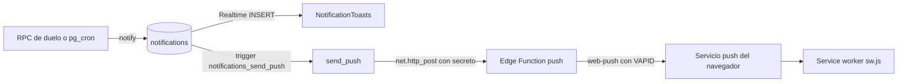

# Avisos in-app, PWA y push web

Cómo se entera una persona de que algo le toca: avisos dentro de la web en tiempo real (tabla `notifications` + Realtime), app instalable (PWA: manifiesto, iconos y service worker) y avisos push al dispositivo cuando le toca en un duelo o su plazo está a punto de vencer. Lo escriben las RPC de amigos y duelos, `pg_cron` y un trigger que llama a una Edge Function; lo muestran `NotificationToasts` y el service worker. Vive en las migraciones [`friends_and_duels`](../../supabase/migrations/20261016165743_friends_and_duels.sql) (avisos) y [`push_notifications`](../../supabase/migrations/20261018174952_push_notifications.sql) (push y plazo), en `apps/web/src/features/{notifications,pwa}`, en `apps/web/src/app/{sw.js,manifest.ts,icon.tsx,apple-icon.tsx}` y en [`supabase/functions/push`](../../supabase/functions/push/index.ts). Qué pasa en cada duelo está en [amigos-y-duelo.md](amigos-y-duelo.md) y [duelo-relampago.md](duelo-relampago.md); las convenciones generales (Realtime, Vault, `pg_cron`), en [base-de-datos.md](base-de-datos.md); el despliegue de la función, en [infraestructura-y-ci.md](infraestructura-y-ci.md) y [../produccion.md](../produccion.md) (sección "Avisos push").

## Reglas

### Qué avisos hay

Toda fila nace en `notify(...)`. El texto de cada uno está en `messages/*.json` > `Notifications` (`{name}` es el nombre de quien lo provoca).

| `kind`            | Cuándo se crea                                                                                          | Receptor                              | `actor_name`                | `duel_id`                | Push | Al pulsarlo               |
| ----------------- | ------------------------------------------------------------------------------------------------------- | ------------------------------------- | --------------------------- | ------------------------ | ---- | ------------------------- |
| `friend_request`  | `send_friend_request` crea una solicitud                                                                | Quien la recibe                       | Quien la envía              | nulo                     | no   | `/friends`                |
| `friend_accepted` | `respond_friend_request` acepta, o `send_friend_request` cuando ya existía la solicitud inversa          | Quien envió la solicitud original     | Quien acepta                | nulo                     | no   | `/friends`                |
| `duel_turn`       | `answer_duel_question` completa un turno que no es el último                                            | El rival                              | Quien acaba de jugar        | duelo por turnos         | sí   | `/duel/<id>`              |
| `duel_finished`   | `answer_duel_question` (último turno), `surrender_duel` (al otro) y `decline_duel` (al retador)          | El otro jugador                       | Quien provoca el final      | duelo por turnos         | no   | `/duel/<id>`              |
| `duel_deadline`   | `warn_duel_deadlines` (cada 15 min)                                                                     | A quien le toca jugar                 | Su rival                    | duelo por turnos         | sí   | `/duel/<id>`              |
| `live_invite`     | `invite_live_duel`                                                                                      | El invitado                           | Quien reta                  | duelo relámpago          | no   | Aceptar y Rechazar en el aviso |

No generan aviso: crear un duelo, que venza un plazo (`timeout`), eliminar a un amigo, rechazar una solicitud ni el resultado de un relámpago.

### Avisos dentro de la web

- Salen arriba, sobre cualquier pantalla, mientras haya sesión. Duran 6 s, como mucho 3 a la vez (si llega un cuarto, desaparece el más antiguo). La invitación `live_invite` dura lo que le quede de sus 30 s (`LIVE.inviteSeconds`).
- Cada aviso lleva a su pantalla y se cierra con la cruz.
- Los avisos solo avisan: el estado real (a quién le toca, solicitudes pendientes) se consulta siempre con `list_duels` y `list_friends`.
- Se purgan a las 24 h: al crear un aviso nuevo para alguien, `notify` borra los de ese destinatario con más de 1 día. No hay otro proceso de limpieza (ver "Detalles").

### Push

- Solo `duel_turn` y `duel_deadline` (te toca; tu turno vence en menos de 6 h). Los demás avisos son solo in-app.
- Es opt-in y por dispositivo: se activa en el perfil, pide permiso al navegador y guarda la suscripción de ese dispositivo. Máximo 10 dispositivos por cuenta (se conservan los más recientes).
- Al cerrar sesión, el dispositivo se da de baja. Un navegador compartido pasa a la cuenta que lo vuelve a registrar.
- El texto sale en el idioma del perfil (`locale` va en la carga) y lo compone el service worker. Un aviso nuevo del mismo duelo sustituye al anterior (misma `tag`). Caducidad del mensaje: 24 h (`TTL`).
- Aviso de plazo: cada 15 min, a quien le toca en un duelo cuyo turno vence en menos de 6 h, una sola vez por turno.
- Sin configurar (sin los secretos del Vault, sin clave VAPID pública, sin función desplegada) no se envía ni se ofrece nada y el resto funciona igual.

## Cómo funciona

### Avisos in-app

1. Una RPC (o el cron) llama a `notify(target, kind, actor, duel_id)`: purga los avisos viejos del destinatario e inserta la fila copiando el nombre de usuario del actor (si el actor no tiene perfil, no inserta nada).
2. La tabla está publicada en Realtime y la RLS deja pasar solo las filas del propio usuario.
3. [`NotificationToasts`](../../apps/web/src/features/notifications/notification-toasts.tsx) está en el layout raíz (solo con sesión) y escucha `INSERT` en el canal `notifications:<userId>` con el filtro `user_id=eq.<id>`. Por cada aviso: lo añade, programa su cierre, **reemite el evento de ventana `trivia:notification`** (`NOTIFICATION_EVENT`, con la fila en `detail`) y llama a `router.refresh()` para recargar los datos de servidor de la página actual (lista de duelos, solicitudes...).
4. Quien necesite reaccionar escucha ese evento. Hoy solo lo hace `DuelGame`: si el aviso es de su duelo y está en el resumen, vuelve a cargar el duelo.
5. `live_invite` se pinta distinto: Aceptar llama a `answer_live_invite` y navega a `/live/<id>`; Rechazar solo llama a la RPC.

### Aviso de plazo

`pg_cron` ejecuta cada 15 min `warn_duel_deadlines()`: actualiza `duels.deadline_warned_turn = turn_number` en los duelos activos con `turn_deadline` dentro de las próximas 6 h y aún sin aviso en ese turno, y para cada uno llama a `notify(a quien le toca, 'duel_deadline', su rival, duelo)`. Como el aviso entra en `notifications`, sale también como aviso in-app y, si hay suscripciones, como push. No avisa de duelos ya vencidos (el plazo se aplica de forma perezosa) y la hora real del aviso varía hasta 15 min.

### Push

1. El `INSERT` en `notifications` dispara `notifications_send_push` solo si el `kind` es `duel_turn` o `duel_deadline`.
2. `send_push()` lee del Vault la URL de la función y el secreto compartido. Si falta alguno, o el destinatario no tiene suscripciones, termina sin hacer nada.
3. Si no, `net.http_post` (`pg_net`, asíncrono: se envía tras confirmar la transacción) llama a la Edge Function con `Authorization: Bearer <secreto>` y el cuerpo `{userId, kind, actorName, duelId, locale}`.
4. La función [`push`](../../supabase/functions/push/index.ts) comprueba el secreto (si no, 401), lee con la clave de servicio las suscripciones del usuario y envía a cada una con `web-push` (VAPID, `TTL` de 24 h) la carga `{kind, actorName, duelId, locale}`. Las suscripciones que responden 404 o 410 (permiso retirado, app desinstalada) se borran. Devuelve `{sent, removed}`. No reintenta.
5. El servicio push del navegador entrega el mensaje al service worker, que muestra la notificación.

### PWA y service worker

- **Manifiesto** ([`manifest.ts`](../../apps/web/src/app/manifest.ts)): servido en `/manifest.webmanifest`; nombre y descripción en el idioma de quien lo pide (`Metadata`); `start_url: "/"`, `display: "standalone"`, color de fondo y de tema `BRAND_BG`, e iconos de 192 y 512 px en `/icon/<tamaño>` como `any` y como `maskable`.
- **Iconos**: [`icon.tsx`](../../apps/web/src/app/icon.tsx) (192 y 512, vía `generateImageMetadata`) y [`apple-icon.tsx`](../../apps/web/src/app/apple-icon.tsx) (180) se dibujan con [`brandIcon`](../../apps/web/src/features/pwa/brand-icon.tsx): la mascota al 60 % central sobre `BRAND_BG`, de modo que el mismo icono sirve como `maskable`. `BRAND_BG` repite el valor de `--color-bg` de `globals.css` porque `ImageResponse` no lee variables CSS.
- **Layout** ([`layout.tsx`](../../apps/web/src/app/layout.tsx)): `viewport.themeColor`, `appleWebApp: { capable: true }` (iOS abre la app instalada a pantalla completa, requisito de los avisos push) y `RegisterServiceWorker`, que registra `/sw.js` con `updateViaCache: "none"` para todos los visitantes.
- **Proxy** ([`proxy.ts`](../../apps/web/src/proxy.ts)): el matcher deja fuera `manifest.webmanifest`, `sw.js`, `icon/` y `apple-icon`, que el navegador pide sin sesión.
- **Service worker** ([`app/sw.js/route.ts`](../../apps/web/src/app/sw.js/route.ts)): es un Route Handler `force-static` que genera el JavaScript en el build con los textos `Metadata.title` y `Notifications` de todos los idiomas incrustados (cabecera `Cache-Control: no-cache`). Hace cuatro cosas:
  - `install`: `skipWaiting`; `activate`: `clients.claim`.
  - `push`: elige el texto según `locale` (si no existe, el idioma por defecto), sustituye `{name}` por `actorName` y llama a `showNotification(título, { body, icon: "/icon/192", tag: duelId o kind, data: { url } })`, con `url` = `/duel/<duelId>` o `/`.
  - `notificationclick`: cierra el aviso y enfoca una ventana con esa URL o abre una nueva.
  - No intercepta peticiones (sin `fetch`): no hay caché offline; solo sirve para instalar la app y recibir avisos.
- **Instalar**: lo ofrece el navegador (en iPhone y iPad, Compartir > Añadir a pantalla de inicio); no hay pantalla propia. Pendiente de comprobar en un móvil real ([CLAUDE.md](../../CLAUDE.md), Fase 4 tarea 2).

### Activar los avisos push

[`PushToggle`](../../apps/web/src/features/pwa/push-toggle.tsx) (en el perfil) no muestra nada si falta `NEXT_PUBLIC_VAPID_PUBLIC_KEY` o mientras comprueba. Estados:

| Estado        | Cuándo                                                                                         | Qué muestra                                         |
| ------------- | ---------------------------------------------------------------------------------------------- | --------------------------------------------------- |
| `unsupported` | El navegador no tiene `serviceWorker`, `PushManager` o `Notification` (p. ej. iPhone sin instalar la app) | Texto con las instrucciones para instalarla         |
| `denied`      | `Notification.permission` es `denied`                                                          | Texto para permitirlo en los ajustes del navegador  |
| `off`         | Sin suscripción                                                                                | Botón "Activar avisos"                              |
| `on`          | Con suscripción                                                                                | Botón "Desactivar avisos"                           |

[`push.ts`](../../apps/web/src/features/pwa/push.ts): `enablePush` pide permiso, espera al service worker, suscribe con la clave pública VAPID y llama a `save_push_subscription`; `disablePush` llama a `delete_push_subscription` y cancela la suscripción del navegador. Al abrir el perfil con una suscripción existente se vuelve a guardar, para que un navegador compartido pase a la cuenta actual. [`SignOutButton`](../../apps/web/src/features/auth/sign-out-button.tsx) llama a `disablePush` antes de cerrar sesión.

### Configuración

Solo nombres; los valores nunca van al repo.

| Dato                                                                     | Dónde vive                                                                                          | Quién lo usa                                  |
| ------------------------------------------------------------------------ | --------------------------------------------------------------------------------------------------- | --------------------------------------------- |
| `NEXT_PUBLIC_VAPID_PUBLIC_KEY`                                           | `apps/web/.env.local` y variables de Vercel (Production)                                            | `features/pwa/push.ts`                        |
| `VAPID_PUBLIC_KEY`, `VAPID_PRIVATE_KEY`, `VAPID_SUBJECT`, `PUSH_WEBHOOK_SECRET` | `supabase/functions/.env` (local, ignorado por git; plantilla en `.env.example`) y secretos de la función en Supabase | Edge Function                                 |
| `SUPABASE_URL`, `SUPABASE_SERVICE_ROLE_KEY`                              | No están en la plantilla: las aporta el runtime de Supabase                                         | Edge Function                                 |
| Secretos del Vault `push_function_url` y `push_webhook_secret`           | Se crean a mano con SQL (`vault.create_secret`); en local `pnpm db:reset` los borra                | Trigger `send_push`                           |
| `[functions.push] verify_jwt = false`                                    | `supabase/config.toml`: la función se autentica con el secreto compartido, no con un JWT            | Supabase                                      |

Las claves VAPID se generan con `pnpm push:keys` ([`vapid-keys.mts`](../../scripts/vapid-keys.mts)): crea un par EC `prime256v1` e imprime `VAPID_PUBLIC_KEY` (punto sin comprimir en base64url, el formato que esperan los navegadores) y `VAPID_PRIVATE_KEY`. Pasos completos en [README](../../README.md#app-instalable-y-avisos-push) (local) y en [../produccion.md](../produccion.md) (producción; no reutilices las claves de local). Si está configurado, el job `deploy-supabase` del CI redespliega la función en cada push a `main`.

## Base de datos

`notifications` y `live_duels` son las dos tablas publicadas en Realtime; `push_subscriptions` solo se toca por RPC. Convenciones de permisos en [base-de-datos.md](base-de-datos.md).

### `notifications`

Avisos in-app ([friends_and_duels:28](../../supabase/migrations/20261016165743_friends_and_duels.sql#L28)). Solo la escribe `notify`.

| Columna      | Tipo          | Notas                                                                                                                                         |
| ------------ | ------------- | --------------------------------------------------------------------------------------------------------------------------------------------- |
| `id`         | `bigint`      | Clave primaria (identidad).                                                                                                                   |
| `user_id`    | `uuid`        | Receptor. FK a `auth.users`, `on delete cascade`.                                                                                             |
| `kind`       | `text`        | CHECK `notifications_kind_check`: `friend_request`, `friend_accepted`, `duel_turn`, `duel_finished`, `duel_deadline` o `live_invite`.        |
| `actor_name` | `text`        | Nombre de usuario de quien lo provoca, copiado al crearlo para no hacer más consultas.                                                        |
| `duel_id`    | `uuid`        | Sin clave foránea: duelo por turnos o, en `live_invite`, duelo relámpago. Nulo en los de amistad.                                            |
| `created_at` | `timestamptz` | `now()`.                                                                                                                                      |

Índice `notifications_user_idx (user_id, created_at)`. Permisos: política `notifications: lectura de los propios` (`select`, `user_id = (select auth.uid())`) y `grant select` para `authenticated`; sin escritura. Publicada en `supabase_realtime` solo si la publicación existe ([L52](../../supabase/migrations/20261016165743_friends_and_duels.sql#L52); el CI, que solo arranca Postgres, no la tiene). El CHECK se ha ampliado dos veces (se borra y se recrea con la lista completa): nació con 4 tipos en `friends_and_duels`, `duel_deadline` se añadió en [push_notifications:10](../../supabase/migrations/20261018174952_push_notifications.sql#L10) y `live_invite` en [live_duels:179](../../supabase/migrations/20261021141452_live_duels.sql#L179). Vigente: la de `live_duels`.

### `push_subscriptions`

Un dispositivo suscrito ([push_notifications:19](../../supabase/migrations/20261018174952_push_notifications.sql#L19)). Escriben `save_push_subscription`, `delete_push_subscription` y la Edge Function (borra las anuladas).

| Columna      | Tipo          | Notas                                                                                           |
| ------------ | ------------- | ----------------------------------------------------------------------------------------------- |
| `endpoint`   | `text`        | Clave primaria: URL del servicio push del navegador, que identifica el dispositivo. CHECK `^https://` y máximo 1000 caracteres (`push_subscriptions_endpoint_check`). |
| `user_id`    | `uuid`        | Cuenta. FK a `auth.users`, `on delete cascade`.                                                 |
| `p256dh`     | `text`        | Clave pública del navegador. Entre 1 y 200 caracteres.                                          |
| `auth`       | `text`        | Secreto de autenticación. Entre 1 y 100 caracteres.                                             |
| `created_at` | `timestamptz` | `clock_timestamp()`; se renueva al volver a guardarla.                                          |

Índice `push_subscriptions_user_idx (user_id, created_at)`. RLS activado, sin políticas y `revoke all`: ni siquiera el dueño la lee. También se añadió `duels.deadline_warned_turn` (`smallint`, nulo) en esa migración ([L15](../../supabase/migrations/20261018174952_push_notifications.sql#L15)); ver [amigos-y-duelo.md](amigos-y-duelo.md).

### RPC

| Función | Argumentos | Devuelve | Quién la llama | Qué hace |
| ------- | ---------- | -------- | -------------- | -------- |
| `save_push_subscription` | `sub_endpoint text`, `sub_p256dh text`, `sub_auth text` | nada | `features/pwa/push.ts` | Upsert por `endpoint`: si el dispositivo ya existía pasa a la cuenta que llama (navegador compartido). Después deja solo las 10 suscripciones más recientes de la cuenta. Los CHECK de la tabla rechazan endpoints que no sean `https://` o valores demasiado largos (`check_violation`). [push_notifications:34](../../supabase/migrations/20261018174952_push_notifications.sql#L34) |
| `delete_push_subscription` | `sub_endpoint text` | nada | `features/pwa/push.ts` | Borra esa suscripción solo si es de quien llama (`auth.uid()`); si es de otra cuenta, no hace nada. [push_notifications:54](../../supabase/migrations/20261018174952_push_notifications.sql#L54) |

Ambas con `execute` solo para `authenticated`. No tienen límite de peticiones.

### Funciones internas, trigger y cron

Sin `execute` para el cliente (`revoke ... from public, anon, authenticated`).

| Función | Argumentos | Devuelve | Qué hace |
| ------- | ---------- | -------- | -------- |
| `notify` | `target uuid`, `notification_kind text`, `actor uuid`, `related_duel uuid default null` | nada | Borra los avisos de `target` con más de 1 día e inserta uno nuevo con el nombre de `actor`. La llaman `send_friend_request`, `respond_friend_request`, `answer_duel_question`, `surrender_duel`, `decline_duel`, `warn_duel_deadlines` e `invite_live_duel`. [friends_and_duels:60](../../supabase/migrations/20261016165743_friends_and_duels.sql#L60) |
| `send_push` | ninguno (trigger) | `trigger` | Ver "Push", pasos 2 y 3. [push_notifications:66](../../supabase/migrations/20261018174952_push_notifications.sql#L66) |
| `warn_duel_deadlines` | ninguno | `integer` (avisos creados) | Ver "Aviso de plazo". [push_notifications:104](../../supabase/migrations/20261018174952_push_notifications.sql#L104) |

- Trigger `notifications_send_push`: `after insert on notifications for each row when (new.kind in ('duel_turn', 'duel_deadline'))` ([L95](../../supabase/migrations/20261018174952_push_notifications.sql#L95)). Si añades un tipo con push, hay que recrearlo.
- pg_cron: job `warn-duel-deadlines`, `*/15 * * * *`, `select public.warn_duel_deadlines()` ([L131](../../supabase/migrations/20261018174952_push_notifications.sql#L131)). Es la única tarea programada del proyecto.
- Extensiones: `pg_net` y `pg_cron` (esta con `schema pg_catalog`), creadas en la misma migración ([L6](../../supabase/migrations/20261018174952_push_notifications.sql#L6)).
- Vault: la URL de la función y el secreto compartido, leídos de `vault.decrypted_secrets` por nombre (`push_function_url`, `push_webhook_secret`).

## Código

| Archivo | Qué hace |
| ------- | -------- |
| [`features/notifications/notification-toasts.tsx`](../../apps/web/src/features/notifications/notification-toasts.tsx) | Avisos en vivo, `NOTIFICATION_EVENT`, tipo `NotificationRow` y el aviso con Aceptar y Rechazar de `live_invite`. |
| [`app/layout.tsx`](../../apps/web/src/app/layout.tsx) | Monta `NotificationToasts` (con sesión) y `RegisterServiceWorker`; `viewport` y `appleWebApp`. |
| [`features/pwa/register-service-worker.tsx`](../../apps/web/src/features/pwa/register-service-worker.tsx) | Registra `/sw.js`. |
| [`app/sw.js/route.ts`](../../apps/web/src/app/sw.js/route.ts) | Genera el service worker con los textos de `messages/*.json`. |
| [`app/manifest.ts`](../../apps/web/src/app/manifest.ts), [`app/icon.tsx`](../../apps/web/src/app/icon.tsx), [`app/apple-icon.tsx`](../../apps/web/src/app/apple-icon.tsx), [`features/pwa/brand-icon.tsx`](../../apps/web/src/features/pwa/brand-icon.tsx) | Manifiesto e iconos de la app instalada. |
| [`features/pwa/push.ts`](../../apps/web/src/features/pwa/push.ts) | Soporte, suscribir, guardar y dar de baja; clave pública VAPID. |
| [`features/pwa/push-toggle.tsx`](../../apps/web/src/features/pwa/push-toggle.tsx) | Interruptor del perfil. |
| [`features/auth/sign-out-button.tsx`](../../apps/web/src/features/auth/sign-out-button.tsx) | Da de baja el dispositivo al cerrar sesión. |
| [`supabase/functions/push/index.ts`](../../supabase/functions/push/index.ts) | Edge Function (Deno): envía el push a cada dispositivo del usuario y limpia las suscripciones anuladas. |
| [`scripts/vapid-keys.mts`](../../scripts/vapid-keys.mts) | `pnpm push:keys`: genera las claves VAPID. |
| [`apps/web/messages/es.json`](../../apps/web/messages/es.json), [`en.json`](../../apps/web/messages/en.json) | `Notifications`, `Push` y `Metadata`: textos de avisos, del interruptor y del título de la app. |

### Añadir un aviso nuevo

1. Migración nueva que recree `notifications_kind_check` con la lista completa y, si lleva push, el trigger `notifications_send_push` con el tipo añadido.
2. Llamar a `notify(...)` desde la función que lo provoca.
3. Texto en `Notifications` de `es.json` y `en.json` (lo usan los avisos in-app y el service worker; solo admite el marcador `{name}`).
4. Añadir el tipo a `NotificationRow["kind"]` en `notification-toasts.tsx` y decidir adónde lleva.

## Tests

- **pgTAP** [`push_notifications.test.sql`](../../supabase/tests/push_notifications.test.sql) (11 comprobaciones): alice se suscribe, solo se admiten endpoints `https://`, el cliente no lee `push_subscriptions`, un dispositivo pasa a la cuenta que lo registra, máximo 10 por cuenta conservando los más recientes, no se borra la suscripción de otra cuenta, `warn_duel_deadlines` avisa solo de los turnos que vencen en menos de 6 h, a quien le toca y con el nombre del rival, una sola vez por turno y otra en el turno siguiente.
- **pgTAP** [`friends_duels.test.sql`](../../supabase/tests/friends_duels.test.sql) y [`live_duels.test.sql`](../../supabase/tests/live_duels.test.sql): el cliente no puede llamar a `notify`, cada uno ve solo sus avisos, y se crean `friend_request`, `friend_accepted`, `duel_turn` y `live_invite`.
- Sin test: `send_push` (necesita el Vault y `pg_net`), la Edge Function, el service worker, `PushToggle`, `NotificationToasts`, la purga de 24 h, que el job de cron esté programado y los avisos `duel_finished`.

## Detalles a tener en cuenta

- **La purga de 24 h es perezosa.** Solo ocurre dentro de `notify`, para el destinatario del aviso nuevo. Quien no recibe avisos conserva los viejos (nombre del rival y tipo) hasta que llegue uno, o hasta que borre su cuenta (cascada). La política de privacidad dice "se borran a las 24 horas" ([legal-y-privacidad.md](legal-y-privacidad.md)): para cumplirlo al pie de la letra haría falta un job de `pg_cron`.
- **Los avisos no se resincronizan.** Si Realtime se corta o la pestaña estuvo en segundo plano, los avisos perdidos no se recuperan; la pantalla se pone al día al navegar o recargar (las listas se consultan siempre al servidor).
- **Los avisos tapan la cabecera** de la pantalla mientras están visibles. Lo que queda de vida a un `live_invite` se calcula con el reloj del cliente frente al `created_at` del servidor.
- **`duel_id` sirve para dos tipos de duelo.** En `live_invite` guarda un relámpago, y `DuelGame` reacciona a cualquier aviso cuyo `duel_id` sea el suyo (los uuid no chocan). Si se borra una cuenta, los avisos del rival con ese `duel_id` quedan apuntando a un duelo que ya no existe (la pantalla dice "No hemos encontrado este duelo").
- **Push de lo que ya estás viendo.** `duel_turn` genera aviso in-app y push aunque la persona tenga la app abierta. Un `duel_deadline` y un `duel_turn` del mismo duelo comparten `tag`: el segundo sustituye al primero.
- **Sin reintentos ni cola.** `pg_net` es asíncrono y la función no reintenta: si falla, ese push se pierde y el juego no se entera. Si faltan los secretos del Vault, `send_push` sale sin hacer nada (pasa en el CI y en un entorno sin configurar).
- **El endpoint de la suscripción solo se valida como `https://`.** Un usuario con sesión puede registrar cualquier URL https y la Edge Function le enviará un POST cifrado cuando le toque en un duelo (SSRF ciego y acotado: máximo 10 por cuenta y solo con sus propios avisos). Si se quisiera cerrar, habría que limitar los hosts a los servicios push de los navegadores.
- **La función arranca fallando si falta una variable.** `env()` lanza una excepción al cargar el módulo si no existe alguna de las seis; el secreto se compara con `!==` simple.
- **iPhone y iPad.** Hay que instalar la app en la pantalla de inicio y abrirla desde ahí; en el navegador normal `PushToggle` muestra el texto `Push.unsupported` ("Este navegador no admite avisos...").
- **Cambiar un texto de aviso** exige redesplegar la web: el service worker es estático y se genera en el build (el navegador lo revalida porque se sirve con `no-cache`).
- **Local.** `pnpm db:reset` borra los secretos del Vault: hay que volver a crearlos. La URL local de la función y el resto de pasos están en el [README](../../README.md#app-instalable-y-avisos-push).
