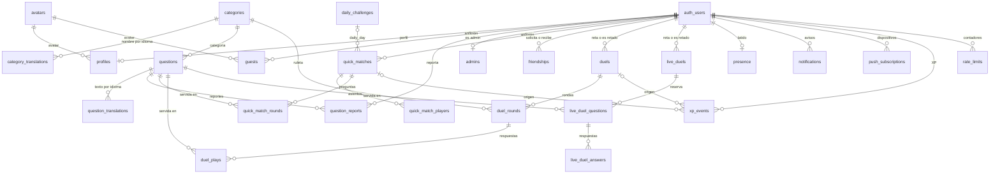

# Base de datos

Postgres 17 de Supabase. Todo el esquema sale de las 22 migraciones de [`supabase/migrations`](../../supabase/migrations). En producción las aplica el CI (ver [infraestructura-y-ci.md](infraestructura-y-ci.md)). Este documento recoge lo transversal: cómo está montada la seguridad, los límites de peticiones, los códigos de error y el mapa de tablas y funciones. El detalle de cada tabla y de cada RPC está en el documento de su módulo.

## Visión general

| Objeto                  | Cantidad | Notas                                                                           |
| ----------------------- | -------- | ------------------------------------------------------------------------------- |
| Tablas (`public`)       | 26       | Todas con RLS. El cliente solo puede tocar 5 directamente (ver más abajo).      |
| Vistas                  | 1        | `question_answers`, interna (sin permisos para el cliente).                     |
| Funciones               | 80       | 38 RPC para el cliente, 5 solo para `service_role`, 30 internas y 7 de trigger. |
| Triggers                | 11       | Límites de peticiones, XP, nombres de usuario, push y `updated_at`.             |
| Políticas RLS           | 8        | Solo en las 5 tablas que el cliente lee o escribe directamente.                 |
| Tareas de pg_cron       | 1        | `warn-duel-deadlines`, cada 15 min.                                             |
| Tablas en Realtime      | 2        | `notifications` y `live_duels`.                                                 |
| Extensiones del esquema | 2        | `pg_net` (push) y `pg_cron` (aviso de plazo).                                   |

Los secretos del push viven en el Vault de Supabase con los nombres `push_function_url` y `push_webhook_secret`. Sin ellos no se envía ningún push y el resto funciona igual ([avisos-pwa-y-push.md](avisos-pwa-y-push.md)).

## Mapa de tablas

| Tabla                                                         | Para qué                                                                 | Documento                                                      |
| ------------------------------------------------------------- | ------------------------------------------------------------------------ | -------------------------------------------------------------- |
| `profiles`                                                    | Perfil de cada cuenta: nombre, avatar, idioma, XP, términos, `show_online` | [perfil.md](perfil.md)                                         |
| `avatars`                                                     | Catálogo de avatares (datos, el dibujo vive en la web)                   | [perfil.md](perfil.md)                                         |
| `guests`                                                      | Invitados locales del anfitrión                                          | [perfil.md](perfil.md)                                         |
| `blocked_username_terms`                                      | Términos prohibidos en los nombres de usuario                            | [perfil.md](perfil.md)                                         |
| `categories`, `category_translations`                         | Categorías y su nombre en cada idioma                                    | [preguntas.md](preguntas.md)                                   |
| `questions`, `question_translations`                          | Preguntas y su texto en cada idioma                                      | [preguntas.md](preguntas.md)                                   |
| `question_reports`                                            | Reportes de preguntas hechos por jugadores                               | [contenido-y-admin.md](contenido-y-admin.md)                   |
| `admins`                                                      | Cuentas con acceso al panel `/admin`                                     | [contenido-y-admin.md](contenido-y-admin.md)                   |
| `quick_matches`, `quick_match_players`, `quick_match_rounds`  | Partida rápida (también la del reto diario)                              | [modo-rapido.md](modo-rapido.md)                               |
| `daily_challenges`                                            | Las 7 preguntas de cada día                                              | [reto-diario.md](reto-diario.md)                               |
| `friendships`                                                 | Amistades y solicitudes                                                  | [amigos-y-duelo.md](amigos-y-duelo.md)                         |
| `presence`                                                    | Último latido de cada cuenta ("en línea", "jugando")                     | [amigos-y-duelo.md](amigos-y-duelo.md)                         |
| `duels`, `duel_rounds`, `duel_plays`                          | Duelo por turnos                                                         | [amigos-y-duelo.md](amigos-y-duelo.md)                         |
| `live_duels`, `live_duel_questions`, `live_duel_answers`      | Duelo relámpago                                                          | [duelo-relampago.md](duelo-relampago.md)                       |
| `notifications`                                               | Avisos in-app (purga perezosa de los de más de 24 h)                     | [avisos-pwa-y-push.md](avisos-pwa-y-push.md)                   |
| `push_subscriptions`                                          | Dispositivos suscritos al push web                                       | [avisos-pwa-y-push.md](avisos-pwa-y-push.md)                   |
| `xp_events`                                                   | Ledger de XP: una fila por jugador y partida                             | [progresion-y-estadisticas.md](progresion-y-estadisticas.md)   |
| `rate_limits`                                                 | Contadores de los límites de peticiones                                  | Este documento                                                 |

## Relaciones

Claves foráneas principales. No se dibujan, para no enredar el diagrama, las respuestas que apuntan al jugador (`duel_plays.player_id` y `live_duel_answers.player_id` hacia `auth.users`) ni `blocked_username_terms`, que no se relaciona con nada. `daily_challenges.question_ids` es un array sin clave foránea (las preguntas no se borran; como mucho se rechazan).



Casi todo cuelga de `auth.users` con `on delete cascade`: borrar la cuenta (`delete_own_account`) arrastra sus datos. Eso incluye los duelos por turnos y relámpago en los que participó, que desaparecen también para el rival, y con ellos las respuestas del rival en esos duelos (dejan de contar en sus estadísticas). `xp_events.quick_match_id`/`duel_id` pasan a `null`, así que el rival conserva la XP ganada. `duels.winner_id` también es `set null`, pero no llega a aplicarse porque el duelo ya se borra por la cascada del retador o del rival. Las claves de las partidas hacia `questions` y `categories`, y las de perfiles, invitados y asientos hacia `avatars`, no tienen cascada: una pregunta ya jugada no se puede borrar (por eso se rechaza en vez de borrarse). Las traducciones y los reportes sí se borran con su pregunta. El inventario de datos personales está en [legal-y-privacidad.md](legal-y-privacidad.md).

## Cómo está montada la seguridad

### Tablas: denegar por defecto

Patrón de todas las tablas:

1. `alter table ... enable row level security`.
2. `revoke all on ... from anon, authenticated`.
3. Solo si el cliente necesita la tabla: `grant` de las columnas justas y políticas que filtran por `auth.uid()`.

Solo 5 tablas tienen permisos para el cliente (`authenticated`; `anon` no tiene ninguno):

| Tabla           | Permisos                                                                                                                 | Políticas RLS                                         |
| --------------- | ------------------------------------------------------------------------------------------------------------------------ | ----------------------------------------------------- |
| `profiles`      | `select`; `insert (id, username, avatar_id, locale, terms_version)`; `update (username, avatar_id, locale, show_online)` | Lectura, creación y edición solo de la fila propia    |
| `avatars`       | `select`                                                                                                                 | Solo los activos                                      |
| `guests`        | `select`, `delete`                                                                                                       | Solo los propios                                      |
| `notifications` | `select` (para Realtime)                                                                                                 | Solo los propios                                      |
| `live_duels`    | `select` (para Realtime)                                                                                                 | Solo los dos participantes                            |

Ejemplo completo en [`20261015231640_profiles.sql`](../../supabase/migrations/20261015231640_profiles.sql#L50-L73). Las columnas que no deben tocarse desde el cliente (`xp`, `terms_accepted_at`…) simplemente no están en los `grant`.

El resto de tablas (21) no tiene ningún permiso para el cliente: preguntas, partidas, duelos, amigos, XP… solo se leen y escriben a través de funciones. Por eso el linter de Supabase avisa de "RLS Enabled No Policy" en esas 21 tablas: es intencionado.

### Funciones: `security definer` con permisos explícitos

- Las RPC son `security definer` con `set search_path = ''`, así que dentro todo va cualificado (`public.profiles`, `auth.uid()`). Se saltan RLS porque se ejecutan como su dueño: **cada RPC debe comprobar ella misma quién llama y qué puede hacer**.
- Permisos de cada función, siempre explícitos:
  - RPC del cliente: `revoke execute ... from public, anon` y `grant execute ... to authenticated`.
  - Internas: `revoke execute ... from public, anon, authenticated` (por ejemplo `notify`, `grant_xp`, `expire_duels`).
  - Solo para scripts: `grant execute ... to service_role` (`import_questions`, `export_questions`, `review_questions`, `mark_untranslatable`, `retention_stats`).
- Postgres concede `execute` a `public` al crear una función. Por eso **toda función nueva necesita su `revoke`**; si no, cualquiera podría llamarla por `/rest/v1/rpc/...`.
- El linter de Supabase avisa de las 38 RPC con "Signed-In Users Can Execute SECURITY DEFINER Function": también es intencionado, porque son la API del juego.

### Quién llama

- `auth.uid()` identifica la cuenta. Sin sesión, las RPC fallan o no hacen nada.
- [`current_player_id()`](../../supabase/migrations/20261016165743_friends_and_duels.sql#L7) devuelve `auth.uid()` solo si la cuenta ya tiene perfil; si no, lanza `perfil no creado` (`insufficient_privilege`). La usan la mayoría de las RPC de juego; alguna, como `start_quick_match`, hace la misma comprobación por su cuenta. Sin onboarding no se juega.
- Admin: `require_admin()` lanza `solo administradores` (`insufficient_privilege`) si la cuenta no está en `admins` ([contenido-y-admin.md](contenido-y-admin.md)).

### El cliente nunca ve la respuesta correcta

En `question_translations.answers` la primera respuesta es la correcta. Cada ronda guarda un `answer_order` barajado y el cliente solo recibe el orden mostrado; la corrección y los puntos se calculan en SQL. Detalle en [preguntas.md](preguntas.md).

## Límites de peticiones

Tabla [`rate_limits`](../../supabase/migrations/20261018175651_username_moderation_and_rate_limits.sql#L7): un contador por cuenta y acción con ventana fija.

| Columna        | Tipo          | Notas                                                             |
| -------------- | ------------- | ----------------------------------------------------------------- |
| `user_id`      | `uuid`        | Cuenta. FK a `auth.users` con `on delete cascade`.                |
| `action`       | `text`        | Nombre de la acción. Clave primaria `(user_id, action)`.          |
| `window_start` | `timestamptz` | Inicio de la ventana actual.                                      |
| `hits`         | `integer`     | Peticiones dentro de la ventana.                                  |

[`check_rate_limit(limited_action text, max_hits integer, per interval)`](../../supabase/migrations/20261018175651_username_moderation_and_rate_limits.sql#L18) (interna):

- Suma 1 al contador de la acción. Si la ventana ha caducado, la reinicia.
- Si se supera el máximo, lanza `demasiadas peticiones` con `errcode = 'P0001'` y `hint = 'rate_limited'`. La excepción deshace el incremento, así que el contador no crece mientras sigas bloqueado.
- Sin usuario (`auth.uid()` nulo: scripts con la clave secreta, tareas internas) no hay límite.

Se aplica de dos formas:

- En las altas, con el trigger genérico [`rate_limit_trigger('<acción>', '<máximo>', '<ventana>')`](../../supabase/migrations/20261018175651_username_moderation_and_rate_limits.sql#L45) `before insert`.
- Dentro de las RPC de consulta, llamando a `check_rate_limit`. Por eso esas RPC son `volatile` aunque solo lean.

| Acción              | Máximo | Ventana | Dónde                                                                                                                       |
| ------------------- | ------ | ------- | --------------------------------------------------------------------------------------------------------------------------- |
| `friend_request`    | 20     | 1 hora  | Trigger en `friendships` ([L57](../../supabase/migrations/20261018175651_username_moderation_and_rate_limits.sql#L57))       |
| `start_duel`        | 20     | 1 hora  | Trigger en `duels` ([L61](../../supabase/migrations/20261018175651_username_moderation_and_rate_limits.sql#L61))             |
| `start_quick_match` | 60     | 1 hora  | Trigger en `quick_matches` ([L65](../../supabase/migrations/20261018175651_username_moderation_and_rate_limits.sql#L65))     |
| `live_invite`       | 30     | 1 hora  | Trigger en `live_duels` ([live_duels L175](../../supabase/migrations/20261021141452_live_duels.sql#L175))                    |
| `change_username`   | 5      | 1 día   | Trigger `check_username` al cambiar el nombre                                                                               |
| `username_check`    | 30     | 1 min   | `is_username_available`                                                                                                     |
| `search_players`    | 30     | 1 min   | `search_players` (versión vigente en [`20261020233725_xp_and_levels.sql`](../../supabase/migrations/20261020233725_xp_and_levels.sql)) |

Los reportes de preguntas tienen su propio límite dentro de `file_question_report` (mismo hint, mensaje `demasiados reportes`; ver [contenido-y-admin.md](contenido-y-admin.md)). El README resume los límites en "Moderación y límites" ([README](../../README.md)).

## Códigos de error

Las funciones lanzan `raise exception '<mensaje>' using errcode = ..., hint = '<código>'`. La web decide qué mostrar según el `hint`; el mensaje solo sirve para depurar y no se enseña al jugador. Los `errcode` que se usan son `P0001` (regla de juego), `check_violation` (dato no válido), `no_data_found` (no existe o no es tuyo) e `insufficient_privilege` (sin perfil o sin permiso).

| Hint                   | Mensaje                                                    | Lo lanzan                                                                         | Lo trata la web en                                                                                                                                                                     |
| ---------------------- | ---------------------------------------------------------- | --------------------------------------------------------------------------------- | -------------------------------------------------------------------------------------------------------------------------------------------------------------------------------------- |
| `not_enough_questions` | no hay suficientes preguntas                               | `start_quick_match`, `spin_duel_round`, `invite_live_duel`, `ensure_daily_challenge` | [quick/actions.ts](../../apps/web/src/features/game/quick/actions.ts), [duel-game.tsx](../../apps/web/src/features/duel/duel-game.tsx), [live/invite.ts](../../apps/web/src/features/live/invite.ts) |
| `question_unavailable` | pregunta no disponible                                     | `answer_quick_question`, `answer_duel_question`, `answer_live_question`           | [live-game.tsx](../../apps/web/src/features/live/live-game.tsx)                                                                                                                        |
| `match_finished`       | partida terminada                                          | `serve_quick_question`                                                            | —                                                                                                                                                                                      |
| `daily_expired`        | reto caducado                                              | `serve_quick_question`                                                            | —                                                                                                                                                                                      |
| `not_friends`          | solo puedes retar a tus amigos                             | `start_duel`, `invite_live_duel`                                                  | [start-duel.ts](../../apps/web/src/features/duel/start-duel.ts), [live/invite.ts](../../apps/web/src/features/live/invite.ts)                                                           |
| `too_many_duels`       | ya tenéis 3 duelos en curso                                | `start_duel`                                                                      | [start-duel.ts](../../apps/web/src/features/duel/start-duel.ts)                                                                                                                        |
| `not_your_action`      | no te toca girar                                           | `spin_duel_round`, `serve_duel_question`, `decline_duel`                          | —                                                                                                                                                                                      |
| `duel_finished`        | duelo terminado                                            | `lock_active_duel`                                                                | — (no confundir con el tipo de aviso `duel_finished` de `notifications`)                                                                                                               |
| `friend_offline`       | no está conectado                                          | `invite_live_duel`                                                                | [live/invite.ts](../../apps/web/src/features/live/invite.ts)                                                                                                                           |
| `friend_busy`          | está jugando                                               | `invite_live_duel`                                                                | [live/invite.ts](../../apps/web/src/features/live/invite.ts)                                                                                                                           |
| `live_in_progress`     | ya tienes un duelo relámpago                               | `invite_live_duel`                                                                | [live/invite.ts](../../apps/web/src/features/live/invite.ts)                                                                                                                           |
| `invite_unavailable`   | invitación no disponible                                   | `answer_live_invite`                                                              | —                                                                                                                                                                                      |
| `live_not_started`     | aún no ha empezado                                         | `serve_live_question`                                                             | [live-game.tsx](../../apps/web/src/features/live/live-game.tsx)                                                                                                                        |
| `live_not_active`      | duelo no activo                                            | `serve_live_question`, `answer_live_question`                                     | [live-game.tsx](../../apps/web/src/features/live/live-game.tsx)                                                                                                                        |
| `live_time_up`         | se acabó tu tiempo                                         | `serve_live_question`                                                             | [live-game.tsx](../../apps/web/src/features/live/live-game.tsx)                                                                                                                        |
| `username_not_allowed` | nombre de usuario no permitido                             | trigger `check_username`                                                          | [profile/actions.ts](../../apps/web/src/features/profile/actions.ts)                                                                                                                   |
| `rate_limited`         | demasiadas peticiones (o demasiados reportes)              | `check_rate_limit`, `file_question_report`                                        | [profile/actions.ts](../../apps/web/src/features/profile/actions.ts), [live/invite.ts](../../apps/web/src/features/live/invite.ts)                                                      |

"—" significa que la web no busca ese hint por nombre: lo trata como un error genérico o lo evita antes de llamar. Si añades un hint nuevo, añádelo aquí y en la pantalla que deba reaccionar.

## Tiempo, procesos perezosos y tareas programadas

- **Sin cron, salvo una tarea.** Las caducidades se aplican de forma perezosa: al consultar o jugar, las RPC llaman primero a [`expire_duels`](../../supabase/migrations/20261016165743_friends_and_duels.sql#L317) (plazos de 48 h del duelo), [`settle_live_duels`](../../supabase/migrations/20261021141452_live_duels.sql#L223) (invitaciones y relámpagos terminados) o [`ensure_daily_challenge`](../../supabase/migrations/20261021155309_daily_challenge.sql#L43) (crea el reto del día al primero que lo pide). Los avisos también: `notify` borra los de más de 24 h de una cuenta al crearle uno nuevo, así que quien no recibe avisos conserva los viejos. La única tarea de `pg_cron` es `warn-duel-deadlines` (cada 15 min, [L131](../../supabase/migrations/20261018174952_push_notifications.sql#L131)), porque un aviso de plazo tiene que llegar aunque nadie consulte.
- **Reloj del servidor.** Los modos con tiempo guardan cuándo se sirvió cada pregunta y calculan en SQL si la respuesta llegó a tiempo. El duelo relámpago usa `clock_timestamp()` y devuelve los tiempos relativos al servidor ([duelo-relampago.md](duelo-relampago.md)).
- **Zona horaria.** El reto diario cambia a las 00:00 de España y la retención cuenta días en hora de Madrid.

## Realtime, push y vista interna

- **Realtime.** La publicación `supabase_realtime` incluye `notifications` ([L55](../../supabase/migrations/20261016165743_friends_and_duels.sql#L55)) y `live_duels` ([L170](../../supabase/migrations/20261021141452_live_duels.sql#L170)). Realtime respeta RLS, así que cada cliente solo recibe sus filas. Realtime envía la fila entera, así que esas tablas no guardan nada secreto: las preguntas y respuestas del relámpago van en tablas aparte.
- **Push.** Al insertar un aviso de tipo `duel_turn` o `duel_deadline` en `notifications`, el trigger `notifications_send_push` ([L95](../../supabase/migrations/20261018174952_push_notifications.sql#L95)) llama a `send_push`. Esta lee los dos secretos del Vault (si falta alguno, no hace nada) y llama a la Edge Function `push` con `pg_net`, de forma asíncrona y tras el commit. El resto de avisos, como la invitación al relámpago, no generan push. Ver [avisos-pwa-y-push.md](avisos-pwa-y-push.md).
- **Vista [`question_answers`](../../supabase/migrations/20261021152204_question_stats.sql#L10)** (`security_invoker`): une las respuestas de los tres modos (tiempo agotado = fallo). La usan `category_stats`, `question_hit_rate` y `export_questions`. No tiene permisos para el cliente. Ver [progresion-y-estadisticas.md](progresion-y-estadisticas.md) y [preguntas.md](preguntas.md).
- **Ledger de XP.** `xp_events` guarda una fila por jugador y partida; `profiles.xp` es una copia del total para no sumarlo en cada lista. Solo lo escriben los triggers de fin de partida.

## Funciones por documento

Cada función está documentada en el documento de su módulo. Leyenda: RPC = la llama la web; interna = solo otras funciones; script = solo `service_role`; trigger = función de trigger.

| Documento                                                    | RPC                                                                                                                                                                                                                                     | Internas, scripts y triggers                                                                                                                                                  |
| ------------------------------------------------------------ | --------------------------------------------------------------------------------------------------------------------------------------------------------------------------------------------------------------------------------------- | ----------------------------------------------------------------------------------------------------------------------------------------------------------------------------- |
| [perfil.md](perfil.md)                                       | `is_username_available`, `remember_guest`, `delete_own_account`                                                                                                                                                                         | `is_username_allowed`; triggers `check_username`, `check_avatar_is_active`, `set_updated_at`                                                                                 |
| [legal-y-privacidad.md](legal-y-privacidad.md)               | —                                                                                                                                                                                                                                       | script `retention_stats`                                                                                                                                                      |
| [preguntas.md](preguntas.md)                                 | —                                                                                                                                                                                                                                       | `is_playable`, `question_hit_rate`; scripts `import_questions`, `export_questions`                                                                                           |
| [contenido-y-admin.md](contenido-y-admin.md)                 | `report_quick_question`, `report_duel_question`, `is_admin`, `admin_review_queue`, `admin_review_question`, `admin_update_question`                                                                                                     | `file_question_report`, `require_admin`; scripts `review_questions`, `mark_untranslatable`                                                                                   |
| [modo-rapido.md](modo-rapido.md)                             | `start_quick_match`, `get_quick_match`, `serve_quick_question`, `answer_quick_question`                                                                                                                                                 | `answer_points` (fórmula de puntos, también la usa el duelo)                                                                                                                  |
| [reto-diario.md](reto-diario.md)                             | `start_daily_match`, `get_daily`                                                                                                                                                                                                        | `ensure_daily_challenge`, `daily_today`, `daily_result`                                                                                                                       |
| [amigos-y-duelo.md](amigos-y-duelo.md)                       | `search_players`, `send_friend_request`, `respond_friend_request`, `remove_friend`, `list_friends`, `touch_presence`, `start_duel`, `spin_duel_round`, `serve_duel_question`, `answer_duel_question`, `get_duel`, `list_duels`, `decline_duel`, `surrender_duel` | `are_friends`, `presence_of`, `can_decline_duel`, `duel_candidates`, `duel_next_action`, `duel_result`, `expire_duels`, `lock_active_duel`                                   |
| [duelo-relampago.md](duelo-relampago.md)                     | `invite_live_duel`, `answer_live_invite`, `cancel_live_duel`, `get_live_duel`, `serve_live_question`, `answer_live_question`                                                                                                             | `live_busy`, `live_clock_end`, `live_ms`, `live_player_done`, `live_player_summary`, `live_points`, `settle_live_duels`                                                      |
| [avisos-pwa-y-push.md](avisos-pwa-y-push.md)                 | `save_push_subscription`, `delete_push_subscription`                                                                                                                                                                                    | `notify`, `warn_duel_deadlines` (pg_cron); trigger `send_push`                                                                                                                |
| [progresion-y-estadisticas.md](progresion-y-estadisticas.md) | `category_stats`                                                                                                                                                                                                                        | `grant_xp`, `xp_gain`; triggers `quick_match_grant_xp`, `duel_grant_xp`                                                                                                      |
| Este documento                                               | —                                                                                                                                                                                                                                       | `current_player_id`, `check_rate_limit`; trigger `rate_limit_trigger`                                                                                                        |

### Funciones redefinidas: cuál es la versión vigente

Muchas funciones se redefinen (`create or replace`) en migraciones posteriores. **La que vale es la de la última migración que la define.** Para encontrarla:

```bash
grep -l "function public.answer_quick_question" supabase/migrations/*.sql | tail -1
```

| Función                                                                                          | Definida en                    | Versión vigente en                  |
| ------------------------------------------------------------------------------------------------ | ------------------------------ | ----------------------------------- |
| `answer_duel_question` (4 versiones)                                                             | `friends_and_duels`            | `question_stats`                    |
| `answer_quick_question` (3)                                                                      | `quick_matches`                | `question_stats`                    |
| `export_questions` (4)                                                                           | `question_pipeline`            | `question_stats`                    |
| `get_duel` (3), `list_duels` (3), `search_players` (3)                                           | `friends_and_duels`            | `xp_and_levels`                     |
| `get_quick_match`                                                                                | `quick_matches`                | `xp_and_levels`                     |
| `list_friends` (3)                                                                               | `friends_and_duels`            | `live_duels`                        |
| `serve_quick_question` (3)                                                                       | `quick_matches`                | `daily_challenge`                   |
| `start_quick_match` (3)                                                                          | `quick_matches`                | `question_pipeline`                 |
| `serve_duel_question`, `duel_candidates`                                                         | `friends_and_duels`            | `question_pipeline`                 |
| `start_duel`, `duel_next_action`                                                                 | `friends_and_duels`            | `duel_round_count_and_limit`        |
| `import_questions`                                                                               | `questions`                    | `question_pipeline`                 |
| `review_questions`                                                                               | `question_pipeline`            | `question_reports_and_admin`        |
| `is_username_available`                                                                          | `profiles`                     | `username_moderation_and_rate_limits` |
| `is_username_allowed`                                                                            | `username_moderation_and_rate_limits` | `username_literal_match`     |
| `retention_stats`                                                                                | `retention_stats`              | `live_duels`                        |
| `live_clock_end`                                                                                 | `live_duels`                   | `live_clock_pause`                  |
| `quick_match_grant_xp`                                                                           | `xp_and_levels`                | `quick_xp_halved`                   |

## Migraciones

Nunca se edita una migración ya subida: cualquier cambio va en una nueva. Si redefines una función, copia su última versión y cámbiala.

| #   | Migración                                                                                                                                       | Qué hace                                                                                         |
| --- | ----------------------------------------------------------------------------------------------------------------------------------------------- | ------------------------------------------------------------------------------------------------ |
| 1   | [`20261015231640_profiles`](../../supabase/migrations/20261015231640_profiles.sql)                                                              | Perfiles y catálogo de avatares. El perfil se crea en el onboarding.                             |
| 2   | [`20261015232505_guests`](../../supabase/migrations/20261015232505_guests.sql)                                                                  | Invitados locales del anfitrión (se conservan los 10 más recientes).                             |
| 3   | [`20261016143211_questions`](../../supabase/migrations/20261016143211_questions.sql)                                                            | Categorías, preguntas y traducciones, solo accesibles por RPC.                                   |
| 4   | [`20261016143214_quick_matches`](../../supabase/migrations/20261016143214_quick_matches.sql)                                                    | Partida rápida en solitario y local, con reloj y puntuación en SQL.                              |
| 5   | [`20261016154009_quick_match_fresh_questions`](../../supabase/migrations/20261016154009_quick_match_fresh_questions.sql)                        | Prioriza las preguntas que la cuenta nunca ha visto.                                             |
| 6   | [`20261016165743_friends_and_duels`](../../supabase/migrations/20261016165743_friends_and_duels.sql)                                            | Amigos, duelo por turnos y avisos in-app.                                                        |
| 7   | [`20261016191744_duel_round_count_and_limit`](../../supabase/migrations/20261016191744_duel_round_count_and_limit.sql)                          | Duelos de 3 o 6 rondas y máximo 3 activos por pareja.                                            |
| 8   | [`20261016192719_scoring_10_points`](../../supabase/migrations/20261016192719_scoring_10_points.sql)                                            | Puntuación 10 (+5 o +2 por rapidez), en una sola función: `answer_points`.                       |
| 9   | [`20261018150834_question_pipeline`](../../supabase/migrations/20261018150834_question_pipeline.sql)                                            | Actualidad con caducidad, revisión periódica y exportación para los procesos de contenido.       |
| 10  | [`20261018151706_question_untranslatable`](../../supabase/migrations/20261018151706_question_untranslatable.sql)                                | Idiomas a los que una pregunta no se traduce.                                                    |
| 11  | [`20261018173937_question_reports_and_admin`](../../supabase/migrations/20261018173937_question_reports_and_admin.sql)                          | Reportes de jugadores y panel de administración.                                                 |
| 12  | [`20261018174952_push_notifications`](../../supabase/migrations/20261018174952_push_notifications.sql)                                          | Push web (trigger, `pg_net` y Edge Function) y aviso de plazo con `pg_cron`.                     |
| 13  | [`20261018175651_username_moderation_and_rate_limits`](../../supabase/migrations/20261018175651_username_moderation_and_rate_limits.sql)        | Términos prohibidos en los nombres y límites de peticiones.                                      |
| 14  | [`20261019132233_username_literal_match`](../../supabase/migrations/20261019132233_username_literal_match.sql)                                  | El término prohibido se busca tal cual, sin normalizar.                                          |
| 15  | [`20261019180736_legal_acceptance`](../../supabase/migrations/20261019180736_legal_acceptance.sql)                                              | Versión de los términos aceptada y fecha de aceptación (la pone la BD).                          |
| 16  | [`20261019234434_retention_stats`](../../supabase/migrations/20261019234434_retention_stats.sql)                                                | Retención D1/D7 calculada con la actividad de juego (solo para el equipo).                       |
| 17  | [`20261020233725_xp_and_levels`](../../supabase/migrations/20261020233725_xp_and_levels.sql)                                                    | Ledger de XP y total en el perfil.                                                               |
| 18  | [`20261021124431_quick_xp_halved`](../../supabase/migrations/20261021124431_quick_xp_halved.sql)                                                | La partida rápida da la mitad de XP.                                                             |
| 19  | [`20261021141452_live_duels`](../../supabase/migrations/20261021141452_live_duels.sql)                                                          | Duelo relámpago y presencia.                                                                     |
| 20  | [`20261021144234_live_clock_pause`](../../supabase/migrations/20261021144234_live_clock_pause.sql)                                              | El reloj del relámpago se para solo lo que tarda de verdad la siguiente pregunta (máx. 1 s).     |
| 21  | [`20261021152204_question_stats`](../../supabase/migrations/20261021152204_question_stats.sql)                                                  | Vista de respuestas, estadísticas por categoría y % de acierto de cada pregunta.                 |
| 22  | [`20261021155309_daily_challenge`](../../supabase/migrations/20261021155309_daily_challenge.sql)                                                | Reto diario como partida rápida enlazada al día.                                                 |

## Trabajar con la base de datos

| Tarea                         | Cómo                                                                                                                         |
| ----------------------------- | ---------------------------------------------------------------------------------------------------------------------------- |
| Arrancar Supabase local       | `pnpm db:start` (necesita Docker). API en `127.0.0.1:54321`, Postgres en `54322`, Studio en `http://127.0.0.1:54323`.        |
| Reaplicar todo desde cero     | `pnpm db:reset`: borra la BD local, aplica las migraciones y carga el seed de preguntas.                                     |
| Cargar el seed en una BD nueva | `pnpm db:seed`                                                                                                               |
| Crear una migración           | `pnpm exec supabase migration new <nombre_en_snake_case>` y probarla con `pnpm db:reset`.                                   |
| Regenerar los tipos de la web | `pnpm db:types` (desde la BD local) → [`database.types.ts`](../../apps/web/src/lib/supabase/database.types.ts).              |
| Tests de la BD                | `pnpm db:test` (pgTAP; cada archivo se deshace al terminar).                                                                 |
| Desplegar a producción        | Lo hace el CI al subir a `main`: `supabase db push` y la función `push`. Ver [infraestructura-y-ci.md](infraestructura-y-ci.md). |
| Copia de producción           | `pnpm db:backup` (ver [../produccion.md](../produccion.md#copias-de-seguridad)).                                             |

Para comprobar que producción coincide con el repo, compara `select version from supabase_migrations.schema_migrations order by version` con los archivos de `supabase/migrations`. No cambies el esquema de producción a mano desde Studio: la siguiente migración no lo sabría.

## Tests (pgTAP)

236 comprobaciones en [`supabase/tests`](../../supabase/tests). Se ejecutan con `pnpm db:test` y en el job `database` del CI, que levanta solo Postgres. Cada archivo trabaja dentro de una transacción que se deshace al final.

| Archivo                                                                               | Pruebas | Qué cubre                                                         |
| ------------------------------------------------------------------------------------- | ------- | ----------------------------------------------------------------- |
| [`profiles_guests.test.sql`](../../supabase/tests/profiles_guests.test.sql)            | 13      | RLS y permisos de perfiles, avatares e invitados                  |
| [`moderation_rate_limits.test.sql`](../../supabase/tests/moderation_rate_limits.test.sql) | 13   | Moderación de nombres y límites de peticiones                     |
| [`quick_matches.test.sql`](../../supabase/tests/quick_matches.test.sql)                | 37      | Preguntas, importación y RPC del modo rápido                      |
| [`friends_duels.test.sql`](../../supabase/tests/friends_duels.test.sql)                | 37      | Amigos, duelo por turnos y avisos                                 |
| [`live_duels.test.sql`](../../supabase/tests/live_duels.test.sql)                      | 37      | Duelo relámpago y presencia                                       |
| [`question_pipeline.test.sql`](../../supabase/tests/question_pipeline.test.sql)        | 19      | Actualidad, caducidad, exportación, revisión y "no traducible"    |
| [`question_reports_admin.test.sql`](../../supabase/tests/question_reports_admin.test.sql) | 21   | Reportes de preguntas y panel de revisión                         |
| [`question_stats.test.sql`](../../supabase/tests/question_stats.test.sql)              | 12      | Estadísticas por categoría y % de acierto de cada pregunta        |
| [`xp.test.sql`](../../supabase/tests/xp.test.sql)                                      | 14      | XP al terminar cada partida rápida o duelo                        |
| [`daily_challenge.test.sql`](../../supabase/tests/daily_challenge.test.sql)            | 17      | Reto diario                                                       |
| [`push_notifications.test.sql`](../../supabase/tests/push_notifications.test.sql)      | 11      | Suscripciones push y aviso de plazo                               |
| [`retention_stats.test.sql`](../../supabase/tests/retention_stats.test.sql)            | 5       | Retención D1/D7                                                   |

## Detalles a tener en cuenta

- **Avisos del linter de Supabase.** "RLS Enabled No Policy" (21 tablas) y "Signed-In Users Can Execute SECURITY DEFINER Function" (38 RPC) son intencionados: no los "arregles". "Extension in Public" avisa de que `pg_net` está en el esquema `public` porque se creó sin `with schema extensions` ([L6](../../supabase/migrations/20261018174952_push_notifications.sql#L6)); es un aviso menor y moverla exige una migración nueva. "Leaked Password Protection Disabled" no aplica: solo hay login social.
- **Toda RPC nueva:** `security definer`, `set search_path = ''`, comprobar al llamante (`current_player_id()` o `require_admin()`), `revoke execute ... from public, anon` y `grant execute ... to authenticated`. Si es interna, quítasela también a `authenticated`.
- **No guardes secretos en tablas publicadas en Realtime**: se envía la fila entera a quien pueda leerla.
- **Las preguntas de producción no se suben al repo** (es público): el seed es solo para desarrollo y el contenido real se genera en producción con los procesos ([contenido-y-admin.md](contenido-y-admin.md)).
- **Si cambias el esquema, regenera los tipos** (`pnpm db:types`) en el mismo commit; la web los usa para tipar las llamadas.
