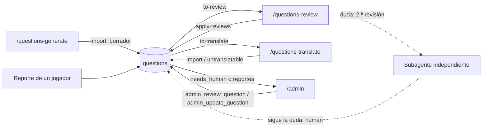

# Contenido y panel de administración

Cómo entran, se traducen, se revisan y se corrigen las preguntas. Tres skills de Claude Code (`/questions-generate`, `/questions-translate`, `/questions-review`) deciden; el script [`scripts/questions.mts`](../../scripts/questions.mts) lee y escribe la BD con la clave secreta; los jugadores reportan preguntas desde las partidas; y un panel solo para administradores (`/admin`) resuelve las dudas que la revisión automática no puede. Viven en `.claude/skills/`, `scripts/`, las migraciones `question_pipeline`, `question_untranslatable` y `question_reports_and_admin`, y `apps/web/src/features/admin/`. El modelo de datos de las preguntas está en [preguntas.md](preguntas.md). Esta página explica el funcionamiento interno; la guía de uso (ejecutar a mano, programar, modificar los procesos, problemas frecuentes) está en [procesos-de-preguntas.md](../procesos-de-preguntas.md) y no se repite aquí.

## Reglas

**Calidad de una pregunta** (fuente única: [`criteria.md`](../../.claude/skills/questions-generate/criteria.md), la leen los tres procesos):

| Aspecto | Regla |
| --- | --- |
| Forma | 4 respuestas: 1 correcta y 3 incorrectas del mismo tipo y formato; enunciado idealmente de 120 caracteres o menos (máximo 300), respuestas de 40 o menos (máximo 120); sin "todas las anteriores" ni negativas |
| Idioma | Español de España neutro (con `¿?`, tildes) e inglés internacional neutro |
| Contenido | Una única correcta, indiscutible y verificable; hechos estables (sin "actualmente" salvo en actualidad); encaja en su categoría; apta para todos los públicos. Quedan fuera: tragedias y muertes recientes, delitos, política partidista, religión polémica, contenido sexual, menores, bulos de salud y estereotipos. Nunca se nombran las marcas prohibidas (ver [CLAUDE.md](../../CLAUDE.md)) |
| Dificultad | `easy` la acierta la mayoría (~70 % o más), `medium` ~40-70 %, `hard` ~15-40 % (difícil pero no un dato oscuro) |
| Actualidad | Algo de los últimos ~60 días, confirmado por al menos dos fuentes fiables **buscadas en la web** (nunca de memoria), que siga siendo cierto hasta caducar; `expiresAt` 90 días por defecto, antes si deja de ser noticia |

**Aprobación** (aprobado el 2026-10-18, ver [CLAUDE.md](../../CLAUDE.md)): las preguntas se aprueban solas tras la revisión automática; una duda pasa por una segunda revisión independiente y solo si persiste queda para una persona (`needs_human`). Idiomas `es` y `en`. Sin API de pago: se ejecutan con Claude Code y el plan de suscripción (no debe haber `ANTHROPIC_API_KEY` en el entorno). Objetivo de la beta: 1.500 aprobadas por idioma (pendiente de ejecutar los procesos).

**Cuándo se revisa una pregunta** (`reviewReason()` y constantes de [`questions.mts`](../../scripts/questions.mts#L35)):

| Motivo (`reason`) | Condición |
| --- | --- |
| `nueva` | `status = draft` y sin `needs_human` |
| `reportada: <motivo> (<idioma>), ...` | Aprobada con reportes sin resolver. Va primero, y antes cuantos más reportes tenga |
| `caduca pronto` | De actualidad con `expiresAt` a menos de 14 días (`EXPIRY_WARNING_DAYS`), o ya pasada |
| `una incorrecta se elige más que la correcta` | Al menos 20 respuestas (`MIN_ANSWERS_FOR_STATS`) y `topWrong > correct` |
| `acierto del N%, raro para "<dificultad>"` | Al menos 20 respuestas y el acierto fuera de la banda esperada (`EXPECTED_HIT_RATE`): `easy` 50-100 %, `medium` 25-90 %, `hard` 0-85 % |
| `auditoría` | El resto del cupo, entre las aprobadas, empezando por las revisadas hace más tiempo o nunca |

Las `draft` con `needs_human` y las `rejected` no se ofrecen a la revisión automática. Proporción de actualidad que se intenta mantener: 10 % de las aprobadas (`TOPICAL_SHARE`).

**Reportes de jugadores** (aprobado el 2026-10-19):

| Motivo | Significa |
| --- | --- |
| `wrong_answer` | La respuesta correcta está mal |
| `ambiguous` | Confusa o con más de una válida |
| `typo` | Errata o mala traducción |
| `offensive` | Ofensiva |

Un reporte por jugador y pregunta (reportar de nuevo cambia el motivo y lo reabre), como mucho 30 al día por cuenta, solo de preguntas ya respondidas en una partida propia. Una pregunta reportada **se sigue jugando** hasta que se revisa; cualquier veredicto cierra sus reportes.

## Cómo funciona

### Visión general



Reparto: Claude decide (escribe, juzga, traduce); `questions.mts` hace la parte mecánica; la BD valida todo lo que entra (`import_questions`).

### Comandos `pnpm questions <comando>`

Con `--local` usa Supabase local (`pnpm exec supabase status -o json`, hace falta Docker) y también es lo que ocurre si `SUPABASE_URL` no está definida. Si lo está, usa `SUPABASE_URL` y `SUPABASE_SECRET_KEY` (con producción montada se ponen en el bloque `env` de `.claude/settings.local.json`; ver [produccion.md](../produccion.md), "Después del primer despliegue"). Los archivos de trabajo van a `.content/`.

| Comando | Qué hace | Salida |
| --- | --- | --- |
| `status` | Por categoría y dificultad: aprobadas, borradores (sin `needs_human`) y `needs_human`. Después: total de aprobadas, actualidad vigentes, reportadas, aprobadas sin traducir a `es` y a `en`, y la línea "Siguiente": actualidad si las vigentes son menos del 10 % de las aprobadas; si no, la combinación con menos aprobadas más borradores | Consola |
| `existing <categoría>` | Lista las de esa categoría (`[dificultad, estado] enunciado → correcta`, con "actualidad" si procede) para no repetir al generar | Consola |
| `to-translate <idioma> [n=30]` | Aprobadas sin ese idioma y no marcadas como no traducibles en él, con solo su traducción de origen (`es` si existe) | `.content/to-translate-<idioma>.json` |
| `to-review [n=15]` | Hasta `n` candidatas con su `reason`, sus traducciones y sus estadísticas: primero las que tienen motivo, luego la auditoría | `.content/to-review.json` |
| `import <archivo>` | Importa un array con `import_questions` **quitando siempre `status`** (alta como borrador; las existentes conservan el suyo) y poniendo `externalId = ai-<uuid>` si falta | Consola |
| `untranslatable <idioma> <archivo>` | Marca como no traducibles a ese idioma los `externalId` de un array (`mark_untranslatable`) | Consola |
| `apply-reviews <archivo>` | Primero importa las correcciones (`fixed`), después aplica los veredictos con `review_questions` | Consola |

Código en [`questions.mts`](../../scripts/questions.mts): `status` (L73), `toTranslate` (L121), `reviewReason` (L137), `toReview` (L155), `importFile` (L181), `applyReviews` (L204).

### Skills

Los tres tienen `disable-model-invocation: true` (solo se ejecutan cuando alguien los invoca, a mano o programados) y una lista `allowed-tools` con lo que pueden usar sin pedir permiso: `Bash(pnpm -s questions *)` (por eso llaman siempre con `pnpm -s`), `Read` y `Edit`/`Write` solo en `./.content/**`; generar y revisar añaden `WebSearch` y `WebFetch`. Trabajan desatendidos.

| Skill | Argumentos | Pasos | Escribe |
| --- | --- | --- | --- |
| [`/questions-generate`](../../.claude/skills/questions-generate/SKILL.md) | Opcionales: categoría o `actualidad`, dificultad (`easy`, `medium`, `hard`) y cantidad (20 por defecto); sin argumentos, lo que diga "Siguiente" | Elegir qué hace falta, `existing` para no repetir, buscar noticias (actualidad), escribir, repasar contra los criterios, importar | `.content/generated.json` (solo `es`, sin `externalId` ni `status`) |
| [`/questions-translate`](../../.claude/skills/questions-translate/SKILL.md) | `[idioma=en] [cantidad=30]` | `to-translate`, traducir de forma natural **conservando el orden de `wrong`**, anotar las no traducibles, importar y marcar | `.content/translated-<idioma>.json`, `.content/untranslatable-<idioma>.json` |
| [`/questions-review`](../../.claude/skills/questions-review/SKILL.md) | `[cantidad=15]` | `to-review`, primera revisión (con búsqueda web siempre en actualidad y en los motivos de estadísticas), veredicto, segunda revisión de las dudas, aplicar | `.content/reviews.json` |

Veredictos de la revisión: `approve`, `approve` con `fixed` (corrige redacción, dificultad o traducción), `reject` y duda. **Segunda revisión:** por cada duda, un subagente recibe solo el enunciado, las respuestas y la ruta de los criterios (nunca el veredicto ni las razones, para que sea independiente) y devuelve `approve`, `reject` o `duda`; si también duda, el veredicto es `human` con una nota que resume las dos dudas. Es un protocolo del skill: la BD solo ve el veredicto final.

Formato de `reviews.json` (un objeto por pregunta):

```json
{
  "externalId": "…",
  "verdict": "approve | reject | human",
  "note": "obligatoria en reject y human según el skill",
  "expiresAt": "solo al renovar una de actualidad (ISO 8601)",
  "fixed": { "difficulty": "solo si cambia", "translations": { "es": { "prompt": "…", "correct": "…", "wrong": ["…", "…", "…"] } } }
}
```

`apply-reviews` parte de la pregunta actual (`export_questions`) y le superpone `fixed`; solo se sustituyen los idiomas incluidos. A la RPC `review_questions` llega solo `externalId`, `verdict`, `note` y `expiresAt`.

### Carpeta `.content/`

Ignorada por git (`.gitignore`): los archivos llevan las respuestas y **el repo es público**. Se crea sola en la carpeta desde la que se ejecuta el comando (la raíz del repo). Contiene `generated.json`, `to-translate-<idioma>.json`, `translated-<idioma>.json`, `untranslatable-<idioma>.json`, `to-review.json` y `reviews.json`; el camino antiguo sin panel usaba además `human.json` ([procesos-de-preguntas.md](../procesos-de-preguntas.md), apartado 6).

### Reportar una pregunta

1. Tras responder en la rápida o en el duelo por turnos, aparece "Reportar pregunta" ([`ReportQuestion`](../../apps/web/src/features/game/report-question.tsx#L16)) junto a "Siguiente", con los cuatro motivos (`REPORT_REASONS`).
2. El navegador llama a `report_quick_question(match_id, question_position, reason)` ([`quick-game.tsx`](../../apps/web/src/features/game/quick/quick-game.tsx#L100)) o a `report_duel_question(duel_id, question_round, question_slot, reason)` ([`duel-game.tsx`](../../apps/web/src/features/duel/duel-game.tsx#L124)).
3. La RPC comprueba que la pregunta ya está respondida y es de una partida propia (así no se reporta para ver la correcta antes de tiempo) y delega en `file_question_report`, que aplica el límite de 30 en 24 h y hace el *upsert* en `question_reports`.
4. La pregunta sigue en juego. Entra en la cola de `/admin` y `export_questions` la devuelve con `reports` (solo los abiertos), así que `to-review` la pone la primera con motivo `reportada: ...`.
5. Cualquier veredicto (`review_questions`, también desde el panel) rellena `resolved_at` de sus reportes abiertos.

El duelo relámpago no ofrece reportar: `live-game.tsx` no usa `ReportQuestion` y no existe una RPC equivalente.

### Panel `/admin`

1. El perfil muestra el enlace al final solo si `is_admin()` devuelve `true` ([`profile/page.tsx`](../../apps/web/src/app/profile/page.tsx#L48)).
2. [`app/admin/page.tsx`](../../apps/web/src/app/admin/page.tsx#L8): `requireProfile()` (sin sesión va a `/`, sin perfil a `/onboarding`), `is_admin()` y, si no es admin, `notFound()`; si lo es, `admin_review_queue()` y [`ReviewQueue`](../../apps/web/src/features/admin/review-queue.tsx#L30).
3. Cada tarjeta ([`ReviewCard`](../../apps/web/src/features/admin/review-queue.tsx#L44)) muestra categoría (su `id` y su color), dificultad, estado, "Actualidad", la etiqueta "Revisión humana", la nota de revisión, los reportes agrupados (`motivo (idioma) xN`) y cada traducción con la correcta resaltada. Hay un campo de nota (hasta 500 caracteres).
4. Acciones:
   - **Aprobar** y **Rechazar**: `admin_review_question(question_id, verdict, note)`.
   - **Corregir**: abre el editor (dificultad, enunciado y respuestas de cada idioma). "Guardar y aprobar" llama primero a `admin_update_question(question_id, question_difficulty, translations)` y, si no hay error, a `admin_review_question(..., 'approve')`. Mientras se edita no se puede rechazar.
5. Si la BD rechaza algo (p. ej. `respuestas repetidas`), el panel muestra el mensaje tal cual; si todo va bien, `router.refresh()` vuelve a pedir la cola, ya sin esa pregunta.

**Por qué responde 404 a quien no es admin:** la cuenta es obligatoria, pero el panel no debe delatar su existencia. La página llama a `notFound()` y las RPC `admin_*` vuelven a comprobar con `require_admin()` (error `42501`), así que saltarse la página no da acceso. Nadie puede hacerse admin desde la web: `admins` no tiene políticas ni permisos para el cliente.

**Dar de alta un administrador** (SQL con permisos de servicio: Studio > SQL Editor; guía de producción en [produccion.md](../produccion.md), "Después del primer despliegue"; también en el [README](../../README.md)):

```sql
insert into public.admins (user_id) select id from public.profiles where username = 'tu_usuario';
```

## Base de datos

### `question_reports`

Un reporte por jugador y pregunta. Solo se escribe vía `file_question_report`. RLS activado, sin políticas, `revoke all` a `anon` y `authenticated`. [Migración](../../supabase/migrations/20261018173937_question_reports_and_admin.sql#L6).

| Columna | Tipo | Notas |
| --- | --- | --- |
| `question_id` | uuid | FK a `questions(id)`, `on delete cascade` |
| `reporter_id` | uuid | FK a `auth.users(id)`, `on delete cascade` |
| `locale` | text | `es` o `en`: idioma en que se vio (el fallo puede estar solo en una traducción) |
| `reason` | text | `wrong_answer`, `ambiguous`, `typo` u `offensive` (`question_reports_reason_check`) |
| `created_at` | timestamptz | `now()`; se renueva al volver a reportar |
| `resolved_at` | timestamptz | Nulo = abierto. Lo rellena `review_questions`; reportar de nuevo lo vuelve a poner a nulo |

PK `(question_id, reporter_id)`; índice `question_reports_reporter_idx (reporter_id, created_at)` para el límite diario.

### `admins`

| Columna | Tipo | Notas |
| --- | --- | --- |
| `user_id` | uuid | PK, FK a `auth.users(id)`, `on delete cascade` |
| `created_at` | timestamptz | `now()` |

RLS activado, sin políticas, `revoke all` a `anon` y `authenticated`. El alta es solo por SQL.

### Columnas de revisión de `questions`

`topical`, `expires_at`, `reviewed_at`, `needs_human`, `review_note` y `untranslatable` están descritas en [preguntas.md](preguntas.md). `untranslatable` guarda los idiomas a los que una pregunta no se traduce porque solo tiene sentido en el original (juegos de palabras, cultura muy local): `to-translate` y `status` no vuelven a proponerlos.

### Funciones

`import_questions`, `export_questions`, `is_playable` y `question_hit_rate` están en [preguntas.md](preguntas.md).

| Función | Argumentos | Devuelve | Quién la llama | Qué hace |
| --- | --- | --- | --- | --- |
| `review_questions` | `items jsonb` | `integer` | `service_role` (`apply-reviews`); `admin_review_question` por dentro | Por elemento `{externalId, verdict, note?, expiresAt?}`: `approve` pasa a `approved`, `reject` a `rejected`, `human` a `draft`; `needs_human = (verdict = 'human')`; `review_note = left(note, 500)`; `reviewed_at = now()`; `expires_at = coalesce(expiresAt, expires_at)`; cierra los reportes abiertos de la pregunta. Todo el lote en una transacción. Versión vigente: [`reports_and_admin.sql`](../../supabase/migrations/20261018173937_question_reports_and_admin.sql#L85) |
| `mark_untranslatable` | `external_ids text[], target_locale text` | `integer` (marcadas) | `service_role` (`untranslatable`) | Añade el idioma, sin duplicar, a las preguntas que existen (ignora el resto). [`untranslatable.sql`](../../supabase/migrations/20261018151706_question_untranslatable.sql#L8) |
| `file_question_report` | `question uuid, reporter uuid, report_locale text, report_reason text` | `void` | Interna (las dos `report_*`) | Con 30 o más reportes del jugador en las últimas 24 h lanza `P0001` (`demasiados reportes`, hint `rate_limited`). Si no, *upsert* por `(question_id, reporter_id)`: actualiza `locale` y `reason`, `created_at = now()` y `resolved_at = null`. [L24](../../supabase/migrations/20261018173937_question_reports_and_admin.sql#L24) |
| `report_quick_question` | `match_id uuid, question_position integer, reason text` | `void` | Navegador (`quick-game.tsx`) | Busca la ronda de una partida propia ya respondida; el idioma es el de la partida. Si no, `no_data_found` (`pregunta no encontrada`). [L43](../../supabase/migrations/20261018173937_question_reports_and_admin.sql#L43) |
| `report_duel_question` | `duel_id uuid, question_round integer, question_slot integer, reason text` | `void` | Navegador (`duel-game.tsx`) | Igual con una jugada propia ya respondida del duelo por turnos; idioma de la jugada. [L65](../../supabase/migrations/20261018173937_question_reports_and_admin.sql#L65) |
| `is_admin` | ninguno | `boolean` | Servidor de Next (`/admin`, `/profile`) | ¿Está `auth.uid()` en `admins`? |
| `require_admin` | ninguno | `void` | Interna (todas las `admin_*`) | Si no es admin: `42501` (`solo administradores`) |
| `admin_review_queue` | ninguno | `jsonb` | Servidor de Next (`/admin`) | Hasta 50 preguntas no rechazadas con `needs_human` o con reportes abiertos, primero las de revisión humana y por antigüedad. Cada una: `id`, `category` {`id`, `color`}, `difficulty`, `status`, `topical`, `expiresAt`, `createdAt`, `needsHuman`, `reviewNote`, `translations` y `reports` agrupados por motivo e idioma con `count` |
| `admin_review_question` | `question_id uuid, verdict text, note text default null` | `void` | Navegador (panel) | Solo `approve` o `reject` (otro valor: `check_violation`). Nota por defecto `panel de revisión`. Aplica el veredicto con `review_questions` (cierra los reportes) |
| `admin_update_question` | `question_id uuid, question_difficulty text, translations jsonb` | `void` | Navegador (panel) | Llama a `import_questions` con los datos actuales de la pregunta (categoría, origen, actualidad, caducidad) más la dificultad y las traducciones nuevas: mismas validaciones, solo se sustituyen los idiomas incluidos, no cambia el estado. Inexistente: `no_data_found` |

Permisos: `review_questions` y `mark_untranslatable` solo para `service_role`; `report_quick_question`, `report_duel_question`, `is_admin` y las `admin_*` para `authenticated` (sin `anon`); `file_question_report` y `require_admin` sin `execute` para el cliente. Todas las `security definer` llevan `set search_path = ''`. Las `admin_*` y `is_admin` se llaman con la sesión del propio usuario: no se usa la clave de servicio en la web.

## Código

| Archivo | Para qué |
| --- | --- |
| [`.claude/skills/questions-generate/SKILL.md`](../../.claude/skills/questions-generate/SKILL.md) | Pasos de la generación |
| [`.claude/skills/questions-generate/criteria.md`](../../.claude/skills/questions-generate/criteria.md) | Criterios de calidad comunes a los tres skills |
| [`.claude/skills/questions-translate/SKILL.md`](../../.claude/skills/questions-translate/SKILL.md) | Pasos de la traducción |
| [`.claude/skills/questions-review/SKILL.md`](../../.claude/skills/questions-review/SKILL.md) | Pasos de la revisión y la segunda revisión |
| [`scripts/questions.mts`](../../scripts/questions.mts) | Comandos `pnpm questions`, umbrales de revisión y tipo `Question` |
| [`scripts/lib/supabase-admin.mts`](../../scripts/lib/supabase-admin.mts) | `rpc()` con la clave secreta (local o por entorno) e `importQuestions()` por lotes |
| [`apps/web/src/app/admin/page.tsx`](../../apps/web/src/app/admin/page.tsx) | Página del panel: comprueba admin y pide la cola |
| [`apps/web/src/features/admin/review-queue.tsx`](../../apps/web/src/features/admin/review-queue.tsx) | `ReviewQueue` y `ReviewCard` (cliente): aprobar, rechazar, corregir |
| [`apps/web/src/features/game/report-question.tsx`](../../apps/web/src/features/game/report-question.tsx) | Botón y selector de motivo del reporte |
| `apps/web/messages/*.json` | Textos en `Admin` y `Report` |
| [`supabase/migrations/20261018150834_question_pipeline.sql`](../../supabase/migrations/20261018150834_question_pipeline.sql), [`…151706_question_untranslatable.sql`](../../supabase/migrations/20261018151706_question_untranslatable.sql), [`…173937_question_reports_and_admin.sql`](../../supabase/migrations/20261018173937_question_reports_and_admin.sql) | Funciones y tablas de este módulo |

## Tests

- [`supabase/tests/question_pipeline.test.sql`](../../supabase/tests/question_pipeline.test.sql) (19): veredictos `approve`, `reject` y `human` y su efecto en `status` y `needs_human`, fecha de revisión, renovar la caducidad, veredicto o pregunta inválidos, `mark_untranslatable` (solo las que existen, sin duplicar), el cliente no exporta ni revisa.
- [`supabase/tests/question_reports_admin.test.sql`](../../supabase/tests/question_reports_admin.test.sql) (21): reportar desde la rápida y desde el duelo (solo preguntas respondidas y propias), reportar de nuevo cambia el motivo, motivo desconocido rechazado, el cliente no lee reportes, un jugador no es admin ni accede a la cola ni a las RPC `admin_*` (`42501`), la cola agrupa por motivo e idioma, `admin_update_question` cambia textos y dificultad sin tocar el estado y conserva el otro idioma, `admin_review_question` saca la pregunta de la cola, guarda nota y estado y resuelve los reportes.
- Sin cubrir: el límite de 30 reportes al día, el veredicto no válido de `admin_review_question`, el panel web y `scripts/` (no pertenecen a ningún workspace, así que ni lint ni typecheck ni tests los recorren).

## Detalles a tener en cuenta

- **Lo generado entra siempre como borrador.** `importFile` descarta `status` a propósito (también en las traducciones y correcciones, que así no cambian el estado). No quitar esa protección ([procesos-de-preguntas.md](../procesos-de-preguntas.md), apartado 9).
- **`apply-reviews` no es atómico entre sus dos pasos:** primero importa las correcciones (lotes de 500, cada uno una transacción) y luego llama una vez a `review_questions` (todo o nada). Si el segundo paso falla, las correcciones ya están; repetir el comando es seguro (todo es idempotente). Si una revisión trae `fixed` y su `externalId` no existe, se salta la corrección y el veredicto falla con `pregunta inexistente`.
- **El veredicto `human` quita de juego una aprobada** (`status` pasa a `draft`) hasta que decide una persona. Una reportada, en cambio, sigue jugándose mientras no haya veredicto.
- **Corregir un número de respuestas** de una pregunta en uso puede desajustar el `answer_order` de partidas en curso (ver [preguntas.md](preguntas.md), "Detalles"). Corregir solo textos, no.
- **Nota obligatoria solo en el skill.** `review_note` es nulo si no se envía; la BD no obliga a justificar `reject` ni `human`.
- **El límite de reportes es propio, no `check_rate_limit`:** cuenta filas de `question_reports` de las últimas 24 h dentro de `file_question_report`. Es coherente con el README, pero distinto del resto de límites (ver [base-de-datos.md](base-de-datos.md)).
- **Skill de revisión y `Agent`.** El paso 4 de `questions-review` lanza un subagente con la herramienta Agent, pero `allowed-tools` de su cabecera no la incluye: una ejecución programada depende de haber marcado "always allow" la primera vez. El ejemplo de `claude -p` de [procesos-de-preguntas.md](../procesos-de-preguntas.md) sí la lista.
- **Comportamientos menores de `questions.mts`:** `to-translate` también propone aprobadas de actualidad ya caducadas; `status` solo lista categorías que ya tienen preguntas (una categoría nueva sin ninguna no aparece como "Siguiente"); `["es", "en"]` está fijo en `status`; `reviewReason` no mira `reviewed_at`, así que una aprobada con estadísticas raras que la revisión deja tal cual vuelve a salir en cada ejecución (y ocupa cupo antes que la auditoría) hasta que se corrija su dificultad o cambien sus estadísticas.
- **El panel tiene límites conocidos:** 50 preguntas por carga sin paginar (`shortcut` de la función), y la tarjeta enseña el `id` de la categoría, no su nombre.
- **Producción:** con `SUPABASE_URL` y `SUPABASE_SECRET_KEY` en el entorno de Claude Code, **todo** lo que hacen los comandos va a producción (con `--local`, a la BD local). La clave secreta nunca va al repo ni a la web.
- **Escala:** cada comando descarga el banco entero con `export_questions`; basta para decenas de miles de preguntas.
