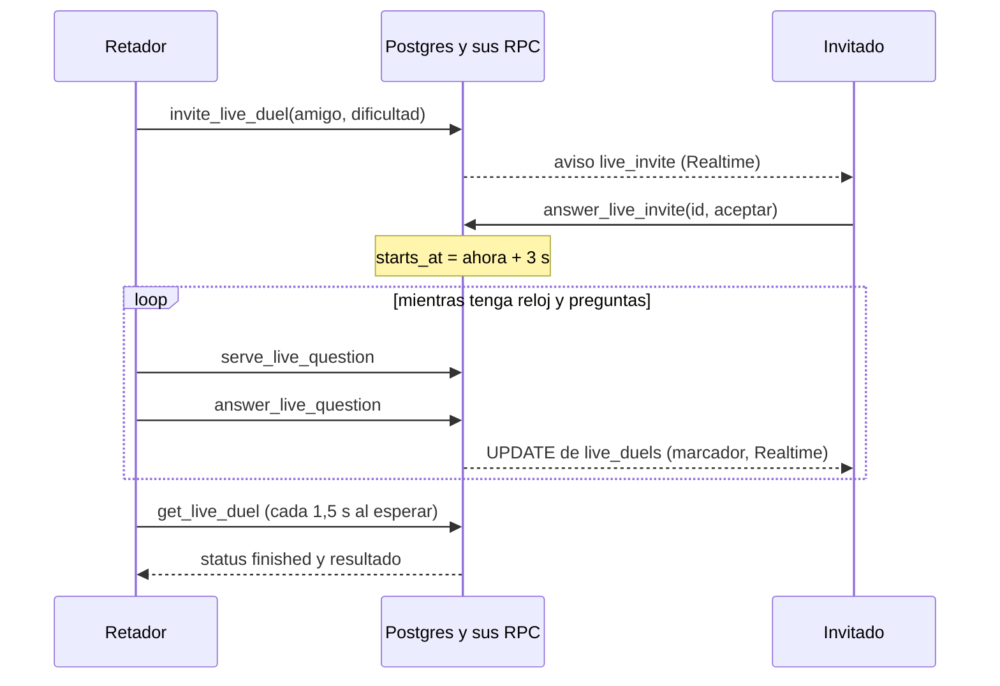
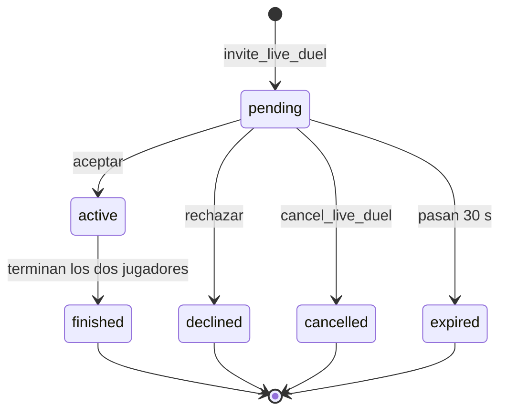

# Duelo relámpago

Partida 1 contra 1 en vivo entre dos amigos conectados: 60 segundos de juego para cada uno, las mismas preguntas en el mismo orden, cada uno a su ritmo, y gana quien suma más puntos. Es servidor autoritativo como el resto de modos: las preguntas y las respuestas no tienen permisos para el cliente (de `live_duels` solo puede leer el marcador de sus partidas) y el reloj, la puntuación y el cierre los calculan funciones `security definer` de Postgres con `clock_timestamp()`. Realtime solo acelera el marcador y los cambios de estado. Vive en la migración [`live_duels`](../../supabase/migrations/20261021141452_live_duels.sql) (más [`live_clock_pause`](../../supabase/migrations/20261021144234_live_clock_pause.sql)), en `apps/web/src/features/live`, en las rutas `/live` y `/live/[duelId]` y en [`game-core/src/live.ts`](../../packages/game-core/src/live.ts). La presencia ("en línea") que decide a quién se puede retar se documenta en [amigos-y-duelo.md](amigos-y-duelo.md#presencia); el aviso de invitación, en [avisos-pwa-y-push.md](avisos-pwa-y-push.md). El diseño aprobado está en [la especificación](../superpowers/specs/2026-10-21-duelo-relampago-design.md) y las reglas, en [CLAUDE.md](../../CLAUDE.md) ("Duelo relámpago aprobado"); aquí solo se resume lo que el código hace.

## Reglas

| Regla                 | Valor                                                                                                                                            | Dónde se aplica                                                              |
| --------------------- | ------------------------------------------------------------------------------------------------------------------------------------------------ | ---------------------------------------------------------------------------- |
| Con quién             | Solo amigos con presencia `online` (ni `busy` ni `offline`). Una sola partida pendiente o activa por persona, en cualquiera de los dos lados     | `invite_live_duel`, `live_busy`                                              |
| Dificultad            | La elige quien reta (Fácil, Normal o Difícil; "Normal" por defecto en la pantalla)                                                                | `LiveChallenge`                                                              |
| Invitación            | Caduca a los 30 s. El invitado la ve como aviso con Aceptar y Rechazar; quien reta puede cancelarla                                               | `settle_live_duels`; `LIVE.inviteSeconds`                                    |
| Cuenta atrás          | 3 s desde que se acepta; los dos empiezan a la vez por el reloj del servidor                                                                      | `answer_live_invite`; `LIVE.countdownMs` (sin uso)                           |
| Reloj de partida      | 60 s para cada jugador, cada uno el suyo                                                                                                         | `live_clock_end`; `LIVE.matchMs`                                             |
| Pausa tras responder  | El reloj se detiene lo que tarde en llegar la pregunta siguiente, con un máximo de 1 s por respuesta. El destello y la petición no descuentan; si el jugador se va, su reloj sigue | `live_clock_end`; `LIVE.maxPauseMs` (sin uso)                |
| Tiempo por pregunta   | 6 s como mucho, o lo que quede de reloj si es menos                                                                                              | `serve_live_question`, `answer_live_question`; `LIVE.questionMs` (sin uso)   |
| Puntos                | Acierto 10; acierto en menos de 3 s, 13; fallo o tiempo agotado, 0                                                                                | `live_points`; `LIVE.correct`, `fastBonus`, `fastMs` (sin uso)               |
| Margen de latencia    | En el servidor, una correcta que llega hasta 1 s fuera de plazo aún cuenta (sin bonus). El cliente da 0,5 s de gracia antes de dar el tiempo por agotado | `answer_live_question` (`grace_ms`), `useQuestionTimer`        |
| Preguntas             | Las mismas y en el mismo orden para los dos, con el mismo orden de respuestas; cada jugador las ve en su idioma; categorías mezcladas            | `invite_live_duel`                                                           |
| Reserva               | Hasta 60 preguntas por partida con traducción (pregunta y categoría) a los idiomas de los dos; mínimo 20 o no se puede retar. Primero las que ninguno ha visto en vivo | `invite_live_duel`                                             |
| Destello              | 0,7 s con acierto o fallo y la correcta; pasa sola a la siguiente                                                                                | `LIVE.revealMs` (solo cliente)                                               |
| Marcador              | El del rival se ve en vivo                                                                                                                       | Realtime sobre `live_duels`                                                  |
| Fin                   | Cuando termina cada jugador (reloj agotado o toda la reserva respondida). Gana quien suma más; igualdad, empate                                  | `live_player_done`, `settle_live_duels`                                      |
| Abandono              | No hay rendición: quien se va sigue con el reloj corriendo y deja de sumar; si vuelve a tiempo, sigue                                            | `live_clock_end`                                                             |
| XP                    | Ninguna por ahora. Sí cuenta en las estadísticas por categoría, en el % de acierto de cada pregunta y en la retención                            | vista `question_answers`; `retention_stats`                                  |
| Animación de final    | Victoria, Derrota o Empate; el empate es "legendario" si cada uno tiene 50 puntos o más                                                          | `LIVE.legendaryDraw`; `headToHeadOutcome`                                    |
| Límite                | 30 invitaciones por hora (hint `rate_limited`)                                                                                                   | trigger `live_duels_rate_limit`                                              |

## Cómo funciona

Estados de `live_duels.status`:

### Invitar y aceptar

1. **Entrada.** La tarjeta "Duelo relámpago" de la portada abre `/live` (amigos conectados o jugando, con un botón "Retar" solo en los `online`; se refresca cada 20 s). En `/friends`, cada amigo `online` tiene un botón con un rayo. Ambos abren `LiveChallenge`: dificultad y "¡Retar!".
2. `inviteLive()` ([`invite.ts`](../../apps/web/src/features/live/invite.ts)) llama a `invite_live_duel` y navega a `/live/<id>`. Los hints `not_friends`, `friend_offline`, `friend_busy`, `live_in_progress`, `not_enough_questions` y `rate_limited` tienen texto propio; el resto sale como error genérico.
3. El retador ve "Esperando a X…" con la cuenta de 30 s y "Cancelar" (`cancel_live_duel`, luego vuelve a `/live`).
4. El invitado recibe el aviso en vivo en cualquier pantalla (`NotificationToasts`, que lo mantiene mientras se puede aceptar). Aceptar llama a `answer_live_invite` y lleva a `/live/<id>`; si ya no estaba disponible, esa pantalla lo explica. En `/live/<id>` también puede aceptar o rechazar desde la pantalla de invitación.
5. No hay push para la invitación: el invitado ya está con la app abierta (la presencia exige un latido de menos de 45 s).

### Partida

`LiveGame` ([`live-game.tsx`](../../apps/web/src/features/live/live-game.tsx)) conduce las fases `loading`, `invite`, `closed` (rechazada, caducada o cancelada), `countdown`, `question`, `reveal`, `waiting`, `results` y `error`. Al entrar o recargar, `get_live_duel` dice por dónde va la partida y `route()` elige la pantalla.

1. **Cuenta atrás.** `startsInMs` (relativo al servidor) fija el fin de la cuenta de 3-2-1, con un "tic" por segundo. Al llegar a 0 se pide la primera pregunta; si el móvil va algo adelantado y el servidor responde `live_not_started`, reintenta a los 300 ms.
2. **Pregunta.** `serve_live_question` abre la siguiente pregunta del jugador y arranca su reloj. Si ya había una abierta (recarga), devuelve la misma con el tiempo ya gastado. El cliente combina dos tiempos: el de la pregunta (6 s) y lo que queda de reloj de partida, y se queda con el menor.
3. **Responder.** Al elegir, el reloj de pantalla se congela (el destello no corre) y `answer_live_question` devuelve `correctIndex`, `isCorrect`, `points`, `remainingMs` y `done`. Si se agota el tiempo, el cliente envía `choice` nulo.
4. **Destello.** 0,7 s con la correcta y el mensaje de acierto o fallo (`AnswerFeedback`). Después se sirve la siguiente, o se pasa a `waiting` si `done`.
5. **Reloj.** `AnalogClock` ([`analog-clock.tsx`](../../apps/web/src/components/analog-clock.tsx)): una aguja da la vuelta en 60 s con el sector recorrido coloreado (rojo y tic-tac en los últimos 10 s, `LIVE.warningMs`) y un anillo exterior que se vacía en los 6 s de la pregunta. Es presentacional: recibe los tiempos ya calculados.
6. **Marcador.** Tu puntuación se suma con lo que devuelve cada respuesta; la del rival llega por Realtime (`UPDATE` de `live_duels`, canal `live:<id>`). Se recarga del servidor al entrar, y en las esperas.
7. **Esperando.** Quien acaba antes ve "¡Tiempo!" y "Esperando a X…" con el marcador en vivo. Mientras dura la invitación y la espera, la pantalla pregunta a `get_live_duel` cada 1,5 s además de escuchar Realtime: esa consulta es la que cierra la partida de forma perezosa cuando los dos han terminado.
8. **Resultados.** Nombres, puntos y "N de M aciertos", y la animación de final (una vez por dispositivo, clave `live:<id>`). Botones "Retar otra vez" (`/live`) e "Inicio".
9. **Salir.** El botón redondo con una cruz (arriba, solo durante las preguntas) pide confirmación y lleva a la portada; el reloj sigue corriendo en el servidor y el jugador deja de sumar.

### El reloj del servidor

Todos los tiempos usan `clock_timestamp()` y salen de las RPC en milisegundos relativos al servidor (el reloj del móvil puede ir desfasado).

- Fin del reloj de un jugador: `starts_at + 60 s + suma de las pausas` ([`live_clock_end`](../../supabase/migrations/20261021144234_live_clock_pause.sql#L5)).
- Pausa de una respuesta: el tiempo entre `answered_at` y el `served_at` de la pregunta siguiente (o hasta ahora, si aún no se ha servido), entre 0 y 1 s. Solo cuentan las respuestas con `credited = true`, es decir, dadas con el reloj del jugador en marcha.
- Límite de una pregunta: `least(6000 ms, fin del reloj − served_at)`. Un acierto exige llegar dentro del límite más 1 s de margen.
- Un jugador ha terminado (`live_player_done`) cuando ha respondido toda la reserva o han pasado más de 1 s desde el fin de su reloj. La partida pasa a `finished` cuando han terminado los dos.
- Si un jugador desaparece, su reloj se agota igualmente: la partida ya se puede cerrar 61 s (más las pausas) después de `starts_at`, y se cierra cuando el otro la consulta.

## Base de datos

Las tres tablas llevan RLS activado y `revoke all` para `anon` y `authenticated`; `live_duels` añade después una política de lectura y un `grant select`, y las otras dos no tienen ningún acceso para el cliente. Convenciones generales en [base-de-datos.md](base-de-datos.md).

### `live_duels`

La partida ([live_duels:100](../../supabase/migrations/20261021141452_live_duels.sql#L100)). La escriben `invite_live_duel`, `cancel_live_duel`, `answer_live_invite`, `settle_live_duels` y `answer_live_question` (los puntos).

| Columna             | Tipo          | Notas                                                                                                      |
| ------------------- | ------------- | ---------------------------------------------------------------------------------------------------------- |
| `id`                | `uuid`        | Clave primaria (`gen_random_uuid()`).                                                                      |
| `challenger_id`     | `uuid`        | Quien reta. FK a `auth.users`, `on delete cascade`.                                                        |
| `opponent_id`       | `uuid`        | Invitado. FK a `auth.users`, `on delete cascade`. CHECK `challenger_id <> opponent_id`.                    |
| `difficulty`        | `text`        | `easy`, `medium` o `hard`.                                                                                 |
| `challenger_locale` | `text`        | `es` o `en`: idioma del retador al retar; ve las preguntas en él.                                          |
| `opponent_locale`   | `text`        | Lo mismo para el invitado.                                                                                 |
| `status`            | `text`        | `pending` (por defecto), `active`, `finished`, `declined`, `expired` o `cancelled`.                        |
| `created_at`        | `timestamptz` | `now()`. Base de la caducidad de 30 s.                                                                     |
| `starts_at`         | `timestamptz` | Nulo hasta aceptar; entonces `clock_timestamp() + 3 s`.                                                    |
| `finished_at`       | `timestamptz` | Lo fija `settle_live_duels` al cerrar.                                                                     |
| `challenger_score`  | `integer`     | Copia de la suma de `live_duel_answers.points`, para el marcador en vivo. Por defecto 0.                   |
| `opponent_score`    | `integer`     | Lo mismo para el invitado.                                                                                 |
| `question_count`    | `smallint`    | Preguntas de la reserva (20 a 60). Por defecto 0 hasta rellenarla.                                         |

Índices `live_duels_challenger_idx` y `live_duels_opponent_idx` (`(jugador, created_at desc)`). Trigger `live_duels_rate_limit` (`before insert`, 30/h, [L175](../../supabase/migrations/20261021141452_live_duels.sql#L175)). Permisos: política `live_duels: lectura de los participantes` (`select` si `auth.uid()` es uno de los dos) y `grant select` para `authenticated`; sin escritura. Está en la publicación `supabase_realtime` ([L167](../../supabase/migrations/20261021141452_live_duels.sql#L167)); como Realtime envía la fila entera, no lleva preguntas ni respuestas.

### `live_duel_questions`

La reserva de preguntas ([live_duels:125](../../supabase/migrations/20261021141452_live_duels.sql#L125)). La rellena `invite_live_duel`.

| Columna        | Tipo         | Notas                                                                                                         |
| -------------- | ------------ | ------------------------------------------------------------------------------------------------------------- |
| `duel_id`      | `uuid`       | FK a `live_duels`, `on delete cascade`.                                                                       |
| `position`     | `smallint`   | `>= 0`. Clave primaria `(duel_id, position)`.                                                                 |
| `question_id`  | `uuid`       | FK a `questions`. Índice `live_duel_questions_question_idx`.                                                  |
| `answer_order` | `smallint[]` | Orden mostrado, igual para los dos: la respuesta en pantalla `i` es `answers[answer_order[i]]` (base 1; la 1 es la correcta). |

### `live_duel_answers`

Lo que ha visto y respondido cada jugador ([live_duels:136](../../supabase/migrations/20261021141452_live_duels.sql#L136)). `serve_live_question` inserta la fila y `answer_live_question` la completa.

| Columna       | Tipo          | Notas                                                                                  |
| ------------- | ------------- | -------------------------------------------------------------------------------------- |
| `duel_id`     | `uuid`        | FK a `live_duels`, `on delete cascade`.                                                |
| `player_id`   | `uuid`        | FK a `auth.users`, `on delete cascade`. Índice `live_duel_answers_player_idx`.         |
| `position`    | `smallint`    | Con `duel_id`, FK compuesta a `live_duel_questions`. Clave primaria `(duel_id, player_id, position)`. |
| `served_at`   | `timestamptz` | Cuando se sirvió: arranca el reloj de la pregunta.                                     |
| `answered_at` | `timestamptz` | Nulo mientras está abierta.                                                            |
| `chosen`      | `smallint`    | Índice en pantalla (base 0); nulo = tiempo agotado.                                    |
| `is_correct`  | `boolean`     |                                                                                        |
| `points`      | `smallint`    |                                                                                        |
| `credited`    | `boolean`     | Respondida con el reloj del jugador en marcha: genera la pausa de 1 s como máximo.     |

### RPC

`security definer`, `set search_path = ''`, `execute` solo para `authenticated`. Todas fijan el usuario con `current_player_id()` (sin perfil: `insufficient_privilege`).

| Función | Argumentos | Devuelve | Quién la llama | Qué hace |
| ------- | ---------- | -------- | -------------- | -------- |
| `invite_live_duel` | `friend uuid`, `match_difficulty text` | `uuid` del duelo | `features/live/invite.ts` | Exige amistad (`not_friends`). Toma un `pg_advisory_xact_lock` por cada jugador (en orden de uuid) para que dos invitaciones cruzadas no dejen a nadie en dos partidas, y ejecuta `settle_live_duels` para ambos. Rechaza si quien reta ya tiene una partida (`live_in_progress`), si el amigo está `offline` (`friend_offline`) o `busy` o con una partida pendiente o activa (`friend_busy`). Inserta el duelo con el idioma de cada perfil (el trigger aplica `rate_limited`) y rellena la reserva: preguntas jugables (`is_playable`) de la dificultad, en categoría activa y traducidas a los dos idiomas, ordenadas por la última vez que las vio alguno de los dos en un relámpago (las nunca vistas primero, luego las vistas hace más tiempo; a igualdad, al azar), hasta 60. Con menos de 20, `not_enough_questions` y no queda nada. Guarda `question_count`, avisa al amigo (`live_invite`) y devuelve el id. [live_duels:265](../../supabase/migrations/20261021141452_live_duels.sql#L265) |
| `cancel_live_duel` | `duel_id uuid` | nada | `live-game.tsx` | Pasa a `cancelled` si quien llama es el retador y sigue `pending`; en otro caso no hace nada (sin error). [live_duels:345](../../supabase/migrations/20261021141452_live_duels.sql#L345) |
| `answer_live_invite` | `duel_id uuid`, `accept boolean` | nada | `live-game.tsx`, `notification-toasts.tsx` | Vence las invitaciones propias, bloquea la fila y exige ser el invitado y que siga `pending` (`invite_unavailable`). Aceptar: `active` y `starts_at = clock_timestamp() + 3 s`. Rechazar: `declined`. [live_duels:357](../../supabase/migrations/20261021141452_live_duels.sql#L357) |
| `get_live_duel` | `duel_id uuid` | `jsonb`: `{id, status, difficulty, isChallenger, inviteLeftMs, startsInMs, remainingMs, done, result, me, opponent}` | `live-game.tsx` | Ejecuta `settle_live_duels` y devuelve el estado para quien consulta. `inviteLeftMs` solo en `pending`; `startsInMs` si hay `starts_at` (negativo ya empezada); `remainingMs` solo en `active`; `done` si el jugador ha terminado; `result` (`win`, `loss`, `draw`) solo en `finished`. `me` y `opponent` son `{id, username, avatarId, xp, score, answered, correct}`. `no_data_found` si no existe o no participas. Tipos en [`live/types.ts`](../../apps/web/src/features/live/types.ts). [live_duels:384](../../supabase/migrations/20261021141452_live_duels.sql#L384) |
| `serve_live_question` | `duel_id uuid` | `jsonb`: `{position, timeLimitMs: 6000, elapsedMs, remainingMs, category: {id, name, color}, topical, prompt, answers}` | `live-game.tsx` | Exige partida `active` (`live_not_active`) y ya empezada (`live_not_started`). Devuelve la pregunta abierta del jugador o abre la siguiente (`position` = nº de filas que ya tiene); si ya respondió toda la reserva o no le queda reloj, `live_time_up`. Dos llamadas simultáneas no duplican (`on conflict do nothing`). No lleva la correcta. [live_duels:454](../../supabase/migrations/20261021141452_live_duels.sql#L454) |
| `answer_live_question` | `duel_id uuid`, `question_position integer`, `choice integer` | `jsonb`: `{correctIndex, isCorrect, points, remainingMs, done}` | `live-game.tsx` | Bloquea la partida (`for update`: las respuestas de los dos suman en la misma fila). Exige `active` (`live_not_active`) y una pregunta abierta (`question_unavailable`); `choice` fuera de rango, `check_violation`. Puntúa con `live_points`, guarda `credited` y suma a `challenger_score` u `opponent_score`. `done` si no queda reloj o era la última de la reserva. [live_duels:523](../../supabase/migrations/20261021141452_live_duels.sql#L523) |

### Funciones internas

Sin `execute` para el cliente; solo las llaman otras funciones. `touch_presence`, `presence_of` y `list_friends` (presencia) están en [amigos-y-duelo.md](amigos-y-duelo.md).

| Función | Argumentos | Devuelve | Qué hace |
| ------- | ---------- | -------- | -------- |
| `live_ms` | `span interval` | `integer` | Milisegundos de un intervalo. [L186](../../supabase/migrations/20261021141452_live_duels.sql#L186) |
| `live_clock_end` | `d live_duels`, `player uuid` | `timestamptz` | Fin del reloj del jugador: `starts_at + 60 s + pausas`. Vigente: [live_clock_pause:5](../../supabase/migrations/20261021144234_live_clock_pause.sql#L5) (la versión original sumaba 1 s fijo por respuesta, [L196](../../supabase/migrations/20261021141452_live_duels.sql#L196)). |
| `live_player_done` | `d live_duels`, `player uuid` | `boolean` | Respondió toda la reserva o pasó más de 1 s del fin de su reloj. [L209](../../supabase/migrations/20261021141452_live_duels.sql#L209) |
| `settle_live_duels` | `uid uuid` | nada | Perezoso: caduca (`expired`) las invitaciones de `uid` de más de 30 s y cierra (`finished`, `finished_at`) sus partidas activas cuando han terminado los dos jugadores. [L223](../../supabase/migrations/20261021141452_live_duels.sql#L223) |
| `live_points` | `hit boolean`, `elapsed_ms integer` | `integer` | 0 si falla; 13 si `elapsed_ms < 3000`; 10 en el resto. Aparte de `answer_points` (modo rápido y duelo). [L240](../../supabase/migrations/20261021141452_live_duels.sql#L240) |
| `live_busy` | `uid uuid` | `boolean` | Tiene una partida `pending` o `active`. [L249](../../supabase/migrations/20261021141452_live_duels.sql#L249) |
| `live_player_summary` | `d live_duels`, `player uuid`, `score integer` | `jsonb` | `{id, username, avatarId, xp, score, answered, correct}`. [L430](../../supabase/migrations/20261021141452_live_duels.sql#L430) |

También afecta a otras partes: la vista `question_answers` ([question_stats:10](../../supabase/migrations/20261021152204_question_stats.sql#L10)) incluye las respuestas del relámpago (estadísticas y % de acierto), y `retention_stats` las cuenta como actividad ([live_duels:601](../../supabase/migrations/20261021141452_live_duels.sql#L601)). El aviso `live_invite` se añade al CHECK de `notifications.kind` en la misma migración ([L179](../../supabase/migrations/20261021141452_live_duels.sql#L179)).

## Código

| Archivo | Qué hace |
| ------- | -------- |
| [`app/live/page.tsx`](../../apps/web/src/app/live/page.tsx) | `/live`: `list_friends` en servidor, filtra a los no `offline` y muestra `LiveFriendPicker`. |
| [`app/live/[duelId]/page.tsx`](../../apps/web/src/app/live/[duelId]/page.tsx) | Página de la partida; `key={duelId}`. |
| [`features/live/live-game.tsx`](../../apps/web/src/features/live/live-game.tsx) | Toda la partida: fases, reloj de pantalla, Realtime, sondeo, marcador, resultados y salir. |
| [`features/live/live-friend-picker.tsx`](../../apps/web/src/features/live/live-friend-picker.tsx) | Lista de amigos conectados; se refresca cada 20 s. |
| [`features/live/live-challenge.tsx`](../../apps/web/src/features/live/live-challenge.tsx) | Panel de dificultad y "¡Retar!"; lo usan `/live` y cada amigo de `/friends`. |
| [`features/live/invite.ts`](../../apps/web/src/features/live/invite.ts) | Llama a `invite_live_duel` y traduce los hints a `LiveInviteError`. |
| [`features/live/presence-dot.tsx`](../../apps/web/src/features/live/presence-dot.tsx) | Punto de estado de un amigo (también lo usa `/friends`). |
| [`features/live/types.ts`](../../apps/web/src/features/live/types.ts) | Forma de lo que devuelven `get_live_duel`, `serve_live_question` y `answer_live_question`. |
| [`features/notifications/notification-toasts.tsx`](../../apps/web/src/features/notifications/notification-toasts.tsx) | Aviso `live_invite` con Aceptar y Rechazar. |
| [`components/analog-clock.tsx`](../../apps/web/src/components/analog-clock.tsx) | Reloj analógico (SVG). Se ve en `/dev/ui` > "Duelo relámpago: reloj". |
| [`game-core/src/live.ts`](../../packages/game-core/src/live.ts) | `LIVE`: constantes espejo de la migración. |
| [`game-core/src/outcome.ts`](../../packages/game-core/src/outcome.ts) | `headToHeadOutcome`: qué animación de final toca. |

Reutiliza `QuestionCard`, `useQuestionTimer` (con `ticks: false`: el "tic" lo da el reloj de partida), `AnswerFeedback`, `MatchOutcome` y `useOutcomeOnce` ([modo-rapido.md](modo-rapido.md), [sistema-visual.md](sistema-visual.md)).

## Tests

- **pgTAP** [`live_duels.test.sql`](../../supabase/tests/live_duels.test.sql) (37 comprobaciones; mueve los relojes a mano con `starts_at`, `served_at` y `created_at`):
  - presencia: sin latido, `busy`, `online`, reciprocidad de `show_online` y el límite de 45 s;
  - invitación: solo amigos, hacen falta 20 preguntas en los dos idiomas (y el fallo no deja nada), la reserva usa las que hay en ambos (25 en el test), aviso `live_invite`, una partida por persona, no se reta a quien ya tiene una invitación;
  - partida: empieza en 3 s, no se sirve antes, servir dos veces devuelve la misma, puntos 13 / 10 / 0, el marcador suma, el rival recibe la misma primera pregunta en su idioma;
  - permisos: el cliente no lee las preguntas ni las respuestas ni llama a las internas; los participantes leen `live_duels` y un tercero no;
  - fin del reloj y resultado, pausa tras responder (lo que se tarda, máximo 1 s), caducidad a los 30 s, rechazar y cancelar.
- [`question_stats.test.sql`](../../supabase/tests/question_stats.test.sql) comprueba que el relámpago cuenta en las estadísticas.
- **Vitest**: [`outcome.test.ts`](../../packages/game-core/src/outcome.test.ts) usa `LIVE.legendaryDraw`. `live.ts` no tiene test propio (el plan lo preveía).
- El CI solo arranca Postgres, sin Realtime: toda la lógica está en SQL para poder probarla; el sondeo y el marcador en vivo no tienen test automático.

## Detalles a tener en cuenta

- **`live_clock_pause` es el nombre de la migración, no de una función**: redefine `live_clock_end` para que la pausa sea lo que se tarda de verdad (máximo 1 s) y no 1 s fijo, que dejaba el reloj casi parado a quien responde muy rápido.
- **Cierre perezoso.** No hay cron: `settle_live_duels` solo se ejecuta desde `get_live_duel`, `answer_live_invite` e `invite_live_duel`. Una partida que nadie consulta sigue `active` en la BD; por eso `invite_live_duel` la cierra antes de comprobar si alguien está ocupado.
- **Realtime solo acelera.** Durante `question` y `reveal` no hay sondeo: si el canal se cae, el marcador del rival se queda parado hasta la espera, donde `get_live_duel` lo recarga. El sondeo de 1,5 s solo corre en `invite` y `waiting`.
- **Las respuestas se revelan al contestar** y los dos juegan lo mismo a su ritmo: quien acaba antes podría soplar las respuestas por otro canal. Está asumido en el diseño.
- **La amistad no se vuelve a comprobar** después de invitar: `answer_live_invite` no mira `are_friends` y `remove_friend` no toca los relámpagos (solo cierra duelos por turnos).
- **Ocupado.** `presence.busy` se marca por la ruta (`/live/<id>` incluida), así que quien espera su invitación sale como "Jugando". Además, `invite_live_duel` comprueba el estado real de la BD (`live_busy` del amigo) y no solo el latido.
- **La reserva puede ser corta.** Con 20 preguntas, un jugador rápido puede responderlas todas antes de que acabe el reloj: pasa a `waiting` con `done`.
- **Dos tiempos de gracia.** Servidor: la respuesta puede llegar hasta 1 s tarde (`grace_ms`). Cliente: 0,5 s tras llegar a 0 antes de enviar el tiempo agotado.
- **El orden de respuestas es compartido** (una sola `answer_order` por pregunta), a diferencia del duelo por turnos, donde cada jugador tiene el suyo.
- **13 puntos y el mensaje de acierto.** `AnswerFeedback` clasifica por puntos y 13 cae en "rápido" (`speedTier` está pensado para 15/12/10); hay un comentario en `live-game.tsx` que lo marca como atajo.
- **`LIVE` es un espejo**: cambiar una regla en SQL exige cambiarla a mano en [`live.ts`](../../packages/game-core/src/live.ts). Hoy `questionMs`, `maxPauseMs`, `countdownMs`, `correct`, `fastBonus` y `fastMs` no los lee nadie (la web usa lo que devuelve el servidor).
- **Documentación previa desfasada.** La especificación y el plan hablan de columnas `profiles.last_seen_at` y `profiles.busy` (la presencia es la tabla `presence`) y de `answerCreditMs` (ahora `maxPauseMs`). Y el límite de 30 invitaciones por hora no aparece en la sección "Moderación y límites" del README.
- **Sin XP ni historial.** No se crea ninguna fila en `xp_events` y no hay lista de relámpagos anteriores; volver a retar se hace desde amigos.
