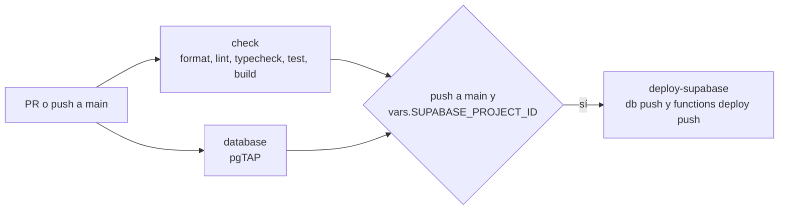

# Infraestructura y CI

Cómo se arranca el proyecto en local, qué hace cada script, qué variables de entorno existen, cómo se comprueba cada commit (CI), cómo se despliega la base de datos y qué versiones están fijadas. La guía para montar producción paso a paso es [produccion.md](../produccion.md); el arranque resumido está en el [README](../../README.md). Las reglas de flujo Git (commits a `main`, Conventional Commits, migraciones con la CLI) están en [CLAUDE.md](../../CLAUDE.md).

## Requisitos y arranque local

- **Node 24** ([.nvmrc](../../.nvmrc) vale `24`; `engines.node` pide `>=24`). Los scripts de `scripts/` son `.mts` y los ejecuta Node directamente (sin compilar): solo admiten sintaxis TS "borrable" y las importaciones llevan extensión (`./lib/supabase-admin.mts`).
- **pnpm 12** (`packageManager: pnpm@12.11.2`).
- **Docker Desktop** en marcha, para Supabase local. La CLI de Supabase es una `devDependency` de la raíz (`pnpm exec supabase ...`), sin instalación global.

```sh
pnpm install
pnpm db:start                         # levanta Supabase en Docker; muestra URL y claves
pnpm db:seed                          # carga supabase/seed/questions.json (es/en)
cp .env.example apps/web/.env.local   # rellena con los valores de `pnpm exec supabase status`
pnpm dev                              # http://localhost:3000
```

Puertos locales (de `supabase/config.toml`): API 54321, BD 54322 (la BD "shadow" de `db diff`, 54320), Studio 54323, correo de pruebas 54324, analytics 54327 y pooler 54329 (desactivado).

- Tras reiniciar el equipo: abre Docker Desktop, espera y ejecuta `pnpm db:start` antes de `pnpm dev`. `ERR_CONNECTION_REFUSED` en `127.0.0.1:54321` significa que Supabase no está en marcha.
- Abre la web en `http://localhost:3000`, no en `127.0.0.1` (las cookies de sesión dependen del host).
- `pnpm db:reset` recrea la BD (migraciones y seed) y borra los secretos del Vault de los avisos push: hay que volver a crearlos ([README > Avisos push](../../README.md)).
- Login social en local: credenciales de Google en `supabase/.env` y reinicio (`pnpm db:stop && pnpm db:start`). Pasos en [README > Login social en local](../../README.md).

## Scripts

Raíz ([package.json](../../package.json)):

| Comando | Qué hace |
| --- | --- |
| `pnpm dev` | `pnpm --filter @trivia/web dev`: servidor de desarrollo de la web. |
| `pnpm build` / `lint` / `typecheck` / `test` | `pnpm -r <script>`: lo ejecuta en cada paquete que lo tenga. Hoy `build` solo existe en la web. |
| `pnpm format` / `pnpm format:check` | `prettier --write .` / `prettier --check .`. El CI usa `format:check`. |
| `pnpm db:start` / `pnpm db:stop` | `supabase start` / `supabase stop`. |
| `pnpm db:reset` | `supabase db reset && pnpm db:seed`. |
| `pnpm db:seed` | `node scripts/import-questions.mts supabase/seed/questions.json --local`. |
| `pnpm db:test` | `supabase test db`: pgTAP de `supabase/tests`. Necesita la BD en marcha. |
| `pnpm db:types` | `supabase gen types typescript --local > apps/web/src/lib/supabase/database.types.ts` y Prettier sobre el resultado. Necesita Supabase local en marcha. Commitea el archivo tras cambiar el esquema. |
| `pnpm db:backup` | `node scripts/backup-db.mts`: copia de la BD ([Copias](#copias-de-seguridad)). |
| `pnpm questions <comando>` | `node scripts/questions.mts`: parte mecánica de los procesos de preguntas (`status`, `to-translate`, `to-review`, `import`, `untranslatable`, `apply-reviews`, `existing`). Ver [contenido-y-admin.md](contenido-y-admin.md). |
| `pnpm push:keys` | `node scripts/vapid-keys.mts`: claves VAPID ([Claves VAPID](#claves-vapid)). |

Por paquete:

| Paquete | `dev` / `build` / `start` | `lint` | `typecheck` | `test` |
| --- | --- | --- | --- | --- |
| `@trivia/web` ([package.json](../../apps/web/package.json)) | `next dev` / `next build` / `next start` | `eslint .` | `next typegen && tsc --noEmit` | `vitest run --passWithNoTests` |
| `@trivia/game-core` ([package.json](../../packages/game-core/package.json)) | (sin scripts: se transpila desde la web) | `eslint .` | `tsc --noEmit` | `vitest run --passWithNoTests` |

## Supabase local (`supabase/config.toml`)

[config.toml](../../supabase/config.toml) es el archivo que genera la CLI con pocos cambios. Lo relevante para este proyecto:

| Sección | Valor | Nota |
| --- | --- | --- |
| `project_id` | `trivia_web` | |
| `[api]` | schemas `public` y `graphql_public`; `max_rows = 1000` | Tope de filas por respuesta de la API. |
| `[db]` | Postgres 17 (`major_version`) | Debe coincidir con el proyecto remoto. |
| `[db.seed]` | `sql_paths = ["./seed.sql"]` | Ese archivo no existe: el seed real es `pnpm db:seed`. |
| `[auth]` | `site_url = http://localhost:3000`, redirección permitida `http://localhost:3000/auth/callback`, JWT de 3600 s, rotación de refresh tokens, sin anónimos | |
| `[auth.email]`, `[auth.sms]` | `enable_signup = false` | Solo login social: el `enable_signup = true` general de `[auth]` permite el alta por OAuth. |
| `[auth.external.*]` | `google` activado; `discord`, `apple` y `facebook` desactivados | Credenciales por variables (abajo). Discord sigue desactivado hasta tener credenciales. |
| `[functions.push]` | `verify_jwt = false` | La función se autentica con un secreto compartido con el trigger, no con un JWT. |
| `[edge_runtime]` | Deno 2, política `per_worker` | |
| `[realtime]` | activado | Lo usan los avisos y el duelo relámpago. |
| `[storage]`, `[analytics]`, `[studio]`, `[local_smtp]` | activados (valores por defecto) | Storage no se usa todavía. |

## Variables de entorno

Los valores nunca van al repo: solo existen los `.env.example`. `.gitignore` ignora `.env` y `.env.*` (menos `.env.example`), así que también quedan fuera `apps/web/.env.local`, `supabase/.env`, `supabase/functions/.env` y `supabase/functions/.env.production`.

| Variable | Dónde se define | Para qué | ¿Obligatoria? |
| --- | --- | --- | --- |
| `NEXT_PUBLIC_SUPABASE_URL` | `apps/web/.env.local`; Vercel (Production) | URL del API de Supabase (en local, la del puerto 54321). | Sí: la web lanza un error al primer uso si falta. |
| `NEXT_PUBLIC_SUPABASE_PUBLISHABLE_KEY` | ídem | Clave publicable de Supabase. Es la única clave que ve la web. | Sí |
| `NEXT_PUBLIC_VAPID_PUBLIC_KEY` | ídem | Clave pública VAPID. Sin ella no se ofrecen avisos push. | No |
| `NEXT_PUBLIC_SENTRY_DSN` | ídem | DSN de Sentry. Sin él no se envía ningún error. | No |
| `SENTRY_AUTH_TOKEN`, `SENTRY_ORG`, `SENTRY_PROJECT` | Vercel (build) | Subir los source maps a Sentry al compilar. No están en `.env.example`. | No |
| `ENABLE_EXPERIMENTAL_COREPACK` | Vercel (valor `1`) | Que Vercel use la versión de pnpm del `package.json`. | En Vercel |
| `CI` | GitHub Actions lo define | `next.config.ts` deja de ser silencioso con Sentry (`silent: !process.env.CI`). | No |
| `SUPABASE_AUTH_EXTERNAL_GOOGLE_CLIENT_ID`, `..._SECRET` | `supabase/.env` | Credenciales del login con Google; `config.toml` las referencia con `env(...)`. En el CI se usan valores de relleno (`ci`). | Para entrar con Google |
| `SUPABASE_AUTH_EXTERNAL_DISCORD_CLIENT_ID`, `..._SECRET` | `supabase/.env` | Login con Discord (desactivado). | No |
| `VAPID_PUBLIC_KEY`, `VAPID_PRIVATE_KEY` | `supabase/functions/.env`; en producción, `supabase secrets set` | Claves del par VAPID con las que la función firma los push. | Para el push |
| `VAPID_SUBJECT` | ídem | Contacto (`mailto:`) que exige el protocolo VAPID. | Para el push |
| `PUSH_WEBHOOK_SECRET` | ídem | Secreto que debe enviar el trigger a la función; el mismo valor que el secreto `push_webhook_secret` del Vault. | Para el push |
| `SUPABASE_URL`, `SUPABASE_SERVICE_ROLE_KEY` | Los inyecta Supabase en la función | Cliente de la función `push` para leer y limpiar `push_subscriptions`. | Automática |
| `SUPABASE_URL`, `SUPABASE_SECRET_KEY` | Entorno de la terminal o `env` de `.claude/settings.local.json` | Los scripts de contenido (`import-questions`, `questions`) llaman a la BD con la clave secreta cuando no se usa `--local`. `questions.mts` usa producción si `SUPABASE_URL` está definida. | Solo fuera de local |
| `SUPABASE_DB_URL` | Entorno de la terminal; secreto de GitHub | Cadena de conexión (Session pooler) para `pnpm db:backup` y para `db push` en el CI. | Para copias y despliegue |
| `SUPABASE_ACCESS_TOKEN`, `SUPABASE_PROJECT_ID` | Secreto y variable de GitHub | Autorizar la CLI y elegir el proyecto en `deploy-supabase`. | Para el despliegue |

Además de las variables, el push usa dos secretos del Vault de Postgres, `push_function_url` y `push_webhook_secret`, que se crean a mano con SQL (local: [README](../../README.md); producción: [produccion.md > 4](../produccion.md)). `config.toml` referencia otras variables (`SUPABASE_AUTH_EXTERNAL_APPLE_*` y `_FACEBOOK_*`, `OPENAI_API_KEY`, `SUPABASE_AUTH_SMS_TWILIO_AUTH_TOKEN`, `S3_*`) que hoy no se necesitan.

## CI (`.github/workflows/ci.yml`)

Se ejecuta en cada pull request y en cada push a `main`. Permisos `contents: read`. La concurrencia agrupa por rama y solo cancela ejecuciones anteriores en pull requests (en `main` cortaría un despliegue a medias).



Todos los jobs usan `ubuntu-latest`, `actions/checkout@v7`, `pnpm/action-setup@v6` y `actions/setup-node@v7` con `node-version-file: .nvmrc` y caché de pnpm, y empiezan con `pnpm install --frozen-lockfile`.

| Job | Qué hace |
| --- | --- |
| `check` | Sin variables de entorno. En orden: `pnpm format:check`, `pnpm lint`, `pnpm typecheck`, `pnpm test` (Vitest de `game-core` y de la web) y `pnpm build` (la web). |
| `database` | Con credenciales de Google de relleno (`config.toml` las referencia). `pnpm exec supabase db start` (solo Postgres, aplica las migraciones) y `pnpm db:test` (pgTAP en `supabase/tests`). |
| [`deploy-supabase`](../../.github/workflows/ci.yml#L53) | Solo si el evento es un push a `main` **y** existe la variable `vars.SUPABASE_PROJECT_ID`; necesita que `check` y `database` pasen. Aplica las migraciones nuevas con `pnpm exec supabase db push --db-url "$SUPABASE_DB_URL" --yes` y despliega la función con `pnpm exec supabase functions deploy push --project-ref <id>`. No usa `supabase link` a propósito: pediría al token más permisos (leer las claves del proyecto) de los que hacen falta. |

`deploy-supabase` usa el secreto `SUPABASE_ACCESS_TOKEN` (permisos mínimos y caducidad: [produccion.md > 7](../produccion.md)), el secreto `SUPABASE_DB_URL` (Session pooler: los servidores de GitHub no tienen IPv6) y la variable `SUPABASE_PROJECT_ID`. Sin la variable, el job se salta. La web no se despliega desde el CI: lo hace Vercel en cada push a `main`, en paralelo, así que durante uno o dos minutos la web nueva puede convivir con la BD anterior; las migraciones deben añadir antes de quitar.

## Producción

Resumen de [produccion.md](../produccion.md) (guía completa, en este orden): proyecto Supabase en la UE (plan Free en la beta, Pro antes del lanzamiento público), `supabase db push` inicial (sin seed: las preguntas de ejemplo son públicas), login con Google y URL de redirección, claves VAPID y función `push` con sus secretos y los del Vault, Vercel (raíz `apps/web`, Node 24, variables solo en _Production_), Sentry (UE) y el despliegue automático de arriba. Después: cuenta de administrador por SQL, generar el contenido con los procesos de preguntas contra producción, textos legales reales y probar la PWA en móviles reales.

Qué está creado y qué falta se lleva en [CLAUDE.md > Estado y pendientes](../../CLAUDE.md), no aquí. Límites de los planes gratis: Supabase Free se pausa tras 7 días sin actividad y no da copias; Vercel Hobby no permite uso comercial; Sentry Developer, 5.000 errores al mes. La retención D1/D7 se consulta con `select * from public.retention_stats()` en el SQL Editor.

## Copias de seguridad

[scripts/backup-db.mts](../../scripts/backup-db.mts) (`pnpm db:backup [--local]`):

- Necesita Docker en marcha (la CLI vuelca desde un contenedor) y `SUPABASE_DB_URL` en el entorno, salvo con `--local`.
- Guarda `roles.sql`, `schema.sql` y `data.sql` (`--data-only --use-copy`) en `.backups/<fecha UTC>/`, ejecutando la CLI con `node node_modules/supabase/dist/supabase.js` y sin shell (la URL lleva la contraseña y caracteres especiales).
- Borra las carpetas de más de 30 días (`KEEP_DAYS`), como promete la política de privacidad. `.backups/` está en `.gitignore`: las copias llevan datos personales y sesiones, no se suben ni se comparten.
- Cómo restaurar y cómo obtener la cadena de conexión: [produccion.md > Copias de seguridad](../produccion.md).

## Claves VAPID

[scripts/vapid-keys.mts](../../scripts/vapid-keys.mts) (`pnpm push:keys`) genera con `node:crypto` un par EC P-256 y escribe en la salida estándar `VAPID_PUBLIC_KEY=...` (punto sin comprimir en base64url, el formato que esperan los navegadores) y `VAPID_PRIVATE_KEY=...`. No guarda nada. La pública va a la web (`NEXT_PUBLIC_VAPID_PUBLIC_KEY`) y a la función; la privada, solo a la función. Producción usa un par distinto del local. Detalle del flujo en [avisos-pwa-y-push.md](avisos-pwa-y-push.md).

## Versiones fijadas

| Qué | Versión | Dónde / motivo |
| --- | --- | --- |
| Node | 24 | `.nvmrc`, `engines`; también el CI y Vercel. |
| pnpm | 12.11.2 | `packageManager`. |
| TypeScript | `~6.0.0` | `typescript-eslint` aún no admite TS 7 (CLAUDE.md, 2026-10-15). |
| ESLint | `^9` | Los plugins de `eslint-config-next` aún no admiten ESLint 10. |
| Next / React / Tailwind / Motion / next-intl | `^16` / `^19` / `^4` / `^14` / `^4` | `apps/web/package.json`. |
| Vitest | `^5` | Ambos paquetes. |
| `@supabase/ssr` / `supabase-js` / `@sentry/nextjs` | `^0.12` / `^2` / `^11.8.0` | `apps/web/package.json`. |
| Prettier / plugin Tailwind / CLI de Supabase | `^3.9.10` / `^0.8.1` / `^2.121.0` | `package.json` de la raíz. |
| Postgres / Deno | 17 / 2 | `supabase/config.toml`. La función fija `npm:web-push@3.6.7`. |

[pnpm-workspace.yaml](../../pnpm-workspace.yaml) declara `apps/*` y `packages/*` y, en `allowBuilds`, solo deja ejecutar scripts de instalación a `supabase` (descarga el binario de la CLI); `@parcel/watcher`, `@swc/core` y `unrs-resolver` están a `false`. Se mantiene la edad mínima de publicación por defecto de pnpm como protección de la cadena de suministro (CLAUDE.md).

## Formato, lint y tipos

- **Prettier** ([.prettierrc.json](../../.prettierrc.json)): punto y coma, comillas dobles, `trailingComma: "all"`, `printWidth: 100`, `endOfLine: "lf"` y el plugin `prettier-plugin-tailwindcss` apuntando a `apps/web/src/app/globals.css` (ordena las clases conociendo los tokens propios). [.prettierignore](../../.prettierignore): `pnpm-lock.yaml`, `.next/`, `coverage/`, `supabase/.temp/` y `docs/` (esta carpeta no se formatea ni se comprueba).
- **Finales de línea LF** forzados con [.gitattributes](../../.gitattributes) (`* text=auto eol=lf`) y Prettier, para evitar diferencias fantasma entre Windows y otros sistemas.
- **ESLint 9** (configuración plana). Web: `eslint-config-next/core-web-vitals` y `eslint-config-next/typescript`, ignorando `.next/`, `out/`, `build/`, `next-env.d.ts` y `database.types.ts` ([eslint.config.mjs](../../apps/web/eslint.config.mjs)); incluye las reglas de React Hooks (el código tiene `eslint-disable` puntuales de `react-hooks/set-state-in-effect`). `game-core`: `@eslint/js` recomendado y `typescript-eslint` en modo `strict`.
- **TypeScript** ([tsconfig.base.json](../../tsconfig.base.json)): ES2022, `moduleResolution: Bundler`, `strict`, `noUncheckedIndexedAccess`, `noImplicitOverride`, `isolatedModules`, `noEmit`. La web añade `dom`, `jsx: react-jsx`, el plugin de Next y el alias `@/*`; `typecheck` ejecuta antes `next typegen` para generar los tipos de rutas.
- **Vitest** sin configuración propia. Tests de TS: cinco archivos en `game-core` y `features/profile/username.test.ts` en la web. Tests de BD: 12 archivos pgTAP en [supabase/tests](../../supabase/tests).
- `.gitignore` deja fuera `.env*`, `.next/`, `*.tsbuildinfo`, `next-env.d.ts`, `supabase/.temp/`, `supabase/snippets/`, `.vercel/`, `.claude/settings.local.json`, `.content/` (trabajo de los procesos de preguntas: lleva respuestas y el repo es público) y `.backups/`.

## Detalles a tener en cuenta

- **`[db.seed]` apunta a un archivo inexistente** ([`./seed.sql`](../../supabase/config.toml#L72)). Es inocuo porque `pnpm db:reset` encadena `pnpm db:seed`, pero confunde.
- **Nada comprueba que `database.types.ts` esté al día con las migraciones.** El CI hace `typecheck`, que solo valida el uso de los tipos que ya existen; si alguien olvida `pnpm db:types`, los tipos antiguos siguen compilando y el desfase pasa desapercibido hasta que falla una llamada. Una comprobación en el CI sería una mejora (a proponer, no aplicada).
- **`pnpm db:test` y `pnpm db:types` necesitan Supabase local en marcha**; en el CI, `db start` solo levanta Postgres.
- **[`scripts/import-questions.mts`](../../scripts/import-questions.mts#L7)** acepta `--local` solo como segundo argumento (`<archivo> --local`); `scripts/questions.mts` lo acepta en cualquier posición.
- **La tabla de scripts del README es parcial**: faltan `db:start`, `db:stop`, `format:check`, `questions` y `push:keys` (están descritos en otras secciones).
- **`docs/` queda fuera de Prettier**, por lo que `format:check` no valida estos documentos.
- **Despliegue de BD y de web son independientes.** El orden de despliegue no está garantizado: las migraciones deben ser compatibles con la versión anterior de la web ([produccion.md > 7](../produccion.md)).
- **El script de copias depende de la ruta interna de la CLI** (`node_modules/supabase/dist/supabase.js`).
