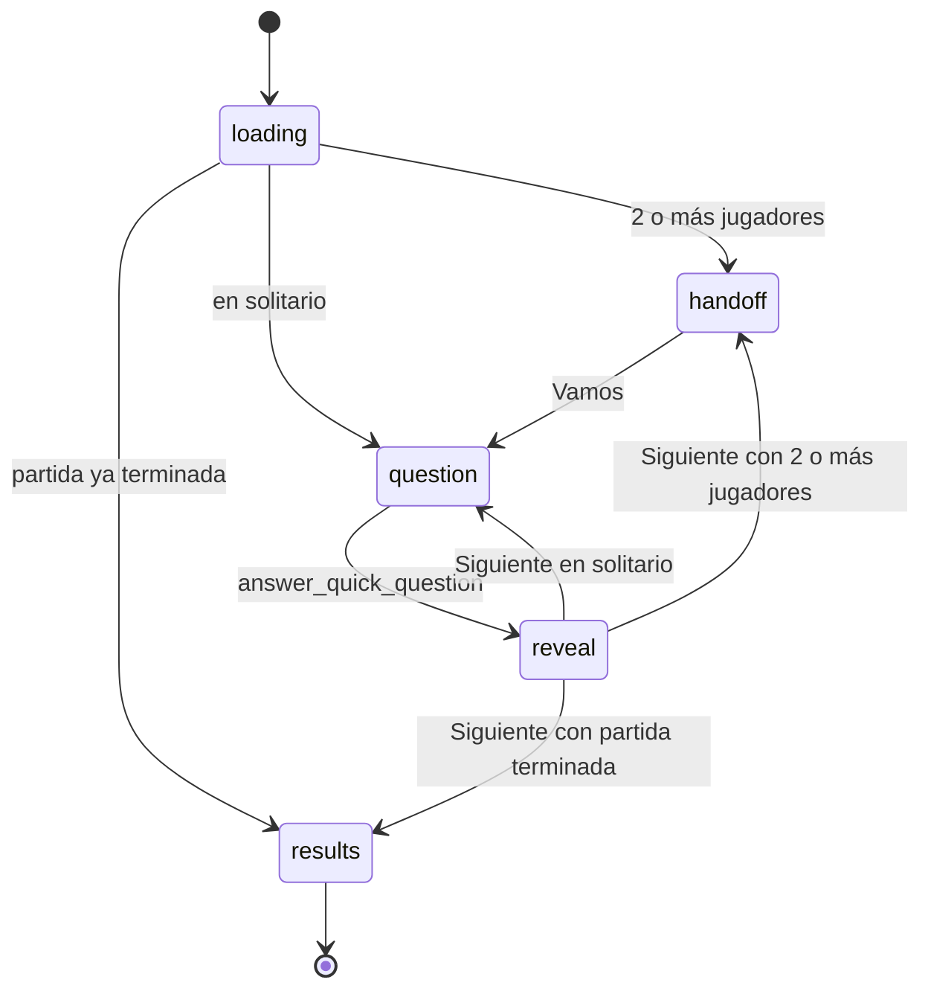

# Modo rápido (Preguntas rápidas)

Partida corta de preguntas con temporizador, en solitario o por turnos en un solo dispositivo (el anfitrión y hasta 5 invitados). El servidor elige las preguntas, cronometra y puntúa en Postgres; el cliente solo muestra y envía la elección. Vive en `apps/web/src/features/game/quick/` (partida, formulario y resultados), las pantallas `apps/web/src/app/play/quick/*`, los componentes compartidos de `features/game/` y [question-card.tsx](../../apps/web/src/components/question-card.tsx), las constantes de cliente de [game-core](game-core.md) y las tablas `quick_match*` de Postgres. El [reto diario](reto-diario.md) es una partida rápida especial que reutiliza todo esto.

Las reglas aprobadas están en [CLAUDE.md](../../CLAUDE.md) ("Reglas del modo rápido aprobadas", 2026-10-16, y "XP y niveles aprobados").

## Reglas

| Regla | Valor | Dónde se aplica |
| --- | --- | --- |
| Jugadores | De 1 a 6: el anfitrión (asiento 0) y hasta 5 invitados | `QUICK.maxPlayers`; checks de `quick_matches` y `quick_match_players`; `start_quick_match` |
| Preguntas | 7 por jugador (7 x jugadores en total) | `start_quick_match`, `get_quick_match` |
| Tiempo | 15 s por pregunta | `serve_quick_question`, `answer_quick_question` |
| Dificultad | `easy`, `medium` o `hard`, la misma en toda la partida. La UI ofrece Fácil, Normal y Difícil, con Normal marcada por defecto | `setup-form.tsx`; check de `quick_matches.difficulty` |
| Categorías | Mezcladas al azar. No se equilibran: una partida puede repetir categoría | `start_quick_match` |
| Idioma | El del perfil del anfitrión al empezar. Solo salen preguntas jugables (`is_playable`), traducidas a ese idioma y de categorías activas con traducción | `start_quick_match` |
| Puntos | Fallo o tiempo agotado: 0. Acierto: 10; 15 si se responde en menos de 3 s; si no, 12 en menos de la mitad del tiempo (7,5 s) | `answer_points` |
| Margen de latencia | Una respuesta correcta que llega hasta 2 s después de los 15 s aún acierta (10 puntos, sin bonus) | `answer_quick_question` |
| Gracia de cliente | 0,5 s invisibles tras llegar a 0 antes de dar el tiempo por agotado, para un toque justo al final | `use-question-timer.ts` |
| Turnos | La posición global `p` la juega el asiento `p % jugadores`; ronda = `p / jugadores + 1` (división entera) | `seatOf`, `roundOf` y SQL |
| Pase de dispositivo | Con 2 o más jugadores, antes de cada turno sale "Pasa el dispositivo a..." con el marcador | `phaseAfterReveal`, `QuickGame` |
| Tras responder | Se revela la correcta y la partida espera a "Siguiente": no avanza sola | `QuickGame` |
| Preguntas no repetidas | Primero las que la cuenta nunca ha visto en una partida rápida o reto (solo cuentan las servidas); luego las vistas hace más tiempo | `start_quick_match` |
| Límite de partidas | 60 por hora y cuenta (error con hint `rate_limited`) | trigger `quick_matches_rate_limit` |
| XP | Al terminar: 10 + la mitad (redondeada a la baja) de los puntos del anfitrión. En local solo cuentan sus turnos; una partida a medias no da nada | trigger `quick_matches_grant_xp` |
| Final | Ranking con empates y revancha. Con 2 o más jugadores, animación de final | `rankPlayers`, `localOutcome` |

## Cómo funciona

### 1. Preparar la partida

1. **Portada** ([app/page.tsx](../../apps/web/src/app/page.tsx)): tarjeta "Preguntas rápidas" (el texto usa `QUICK.questionsPerPlayer` y `QUICK.secondsPerQuestion`) con enlace a `/play/quick`.
2. **`/play/quick`** ([page.tsx](../../apps/web/src/app/play/quick/page.tsx), servidor): `requireProfile()`, avatares activos y los invitados recientes, leídos directamente de `guests` (ordenados por `last_used_at desc`; la tabla permite `select` con RLS). Pinta `SetupForm`.
3. **[SetupForm](../../apps/web/src/features/game/quick/setup-form.tsx)**: elegir dificultad ([DifficultyPicker](../../apps/web/src/features/game/difficulty-picker.tsx)), añadir invitados (nombre de hasta 20 caracteres y avatar, o uno de los recientes) y quitarlos. El orden de la lista es el orden de turno. No admite dos invitados con el mismo nombre (sin distinguir mayúsculas) ni más de `QUICK.maxPlayers - 1`.
4. **[startQuickMatch](../../apps/web/src/features/game/quick/actions.ts#L17)** (server action con `useActionState`; también la usa la revancha):
   - Valida dificultad, número de invitados, nombres (1 a 20 caracteres) y avatar; si algo falla devuelve `generic`, o `nameTaken` si hay nombres repetidos.
   - Llama a `remember_guest` por cada invitado ([perfil.md](perfil.md)) y recoge su id.
   - Llama a `start_quick_match(match_difficulty, guest_ids)`. Si falla con hint `not_enough_questions` devuelve `notEnoughQuestions`; cualquier otro error (incluido `rate_limited`) sale como `generic`.
   - Si va bien, `redirect('/play/quick/<id>')`.

### 2. Jugar

[`/play/quick/[matchId]`](../../apps/web/src/app/play/quick/[matchId]/page.tsx) monta [QuickGame](../../apps/web/src/features/game/quick/quick-game.tsx#L27) con `key={matchId}` (la revancha navega a otra partida y debe empezar limpia). La página no comprueba que la partida sea del jugador: lo hacen las RPC.

El bucle de juego llama a las RPC **desde el navegador** (`createClient` de `lib/supabase/client`) con la sesión del jugador. Solo la creación de la partida pasa por una server action.



- **`loading`**: [`start`](../../apps/web/src/features/game/quick/quick-game.tsx#L111) llama a `get_quick_match`. Un id mal formado (SQLSTATE `22P02`) o sin datos (la partida no existe o no es suya) da el error `notFound`; cualquier otro fallo, `generic` (con botón "Reintentar" que recarga). Si `nextPosition` es `null` va a `results`; con más de un jugador, a `handoff`; en solitario, sirve la primera pregunta.
- **`handoff`**: muestra al siguiente jugador (avatar, nombre, ronda y marcador con su turno resaltado) y el botón "¡Vamos!", que llama a `serve_quick_question`. El reloj no empieza hasta ese momento.
- **`question`**: [QuestionCard](../../apps/web/src/components/question-card.tsx#L31) con categoría (color e icono), insignia "Actualidad" si la pregunta es `topical`, barra de tiempo y las respuestas. Se responde tocando una opción o con las teclas 1, 2, 3... El reloj ([useQuestionTimer](../../apps/web/src/features/game/use-question-timer.ts#L18)) se para al elegir, sin esperar al servidor; si llega a 0 más 0,5 s se envía `choice = null` (tiempo agotado). Un `ref` impide enviar dos respuestas (doble toque o toque justo al agotarse).
- **`reveal`**: se pintan la correcta (verde) y la elegida si fue errónea (roja). [AnswerFeedback](../../apps/web/src/features/game/answer-feedback.tsx#L51) enseña la pegatina de acierto (normal, rápido o muy rápido según `speedTier(points)`), fallo o tiempo agotado, con su sonido y vibración al fallar, y "Acierta el X % de los jugadores" si el servidor lo devuelve. Debajo, "Reportar pregunta" ([ReportQuestion](../../apps/web/src/features/game/report-question.tsx#L16): cuatro motivos, `report_quick_question`) y "Siguiente" (con foco automático, Enter lo activa).
- **"Siguiente"**: `phaseAfterReveal(result.finished, jugadores)`. Si terminó, vuelve a pedir `get_quick_match` (puntuaciones definitivas y XP) y pasa a `results`; si no, a `handoff` (2 o más jugadores) o sirve la siguiente.
- **Salir**: la cruz de la cabecera pide confirmación y enlaza a `/`. No llama al servidor: la partida queda sin terminar (sin XP) y solo se puede retomar volviendo a abrir su URL. No hay acceso a partidas a medias desde la portada.
- **Recargar** en mitad de la partida es seguro: `get_quick_match` da `nextPosition` y `serve_quick_question` devuelve la misma pregunta con el tiempo ya transcurrido, así que recargar no da tiempo extra. En local, tras recargar se vuelve a pasar por `handoff`.

### 3. Resultados

[QuickResults](../../apps/web/src/features/game/quick/quick-results.tsx#L19):

- Título: "¡Partida terminada!" en solitario, "¡Empate!" si hay varios primeros o "¡Gana {nombre}!".
- Ranking con `rankPlayers` (puesto solo con 2 o más jugadores), aciertos "X de 7" y puntos.
- Final: en solitario suena `win`; con 2 o más, [MatchOutcome](../../apps/web/src/features/game/match-outcome.tsx#L35) con `localOutcome(jugadores, legendaryThreshold(7))`, una vez por partida y dispositivo (`useOutcomeOnce("quick:<id>")`). Reglas en [game-core.md](game-core.md).
- XP: `XpGain` ("+N XP", barra y subida de nivel) con el `xp` de `get_quick_match`, después de la animación si la hay. Ver [progresion-y-estadisticas.md](progresion-y-estadisticas.md).
- "Revancha": un formulario con la misma dificultad y los mismos invitados en el mismo orden, que vuelve a llamar a `startQuickMatch` (y por tanto refresca `last_used_at` de los invitados).

### 4. Reloj y puntuación autoritativos

1. `serve_quick_question` busca la primera ronda sin responder. Si su `served_at` es `null`, lo fija con `clock_timestamp()`; si ya estaba, la devuelve igual con `elapsedMs` actualizado. No incluye la respuesta correcta.
2. `answer_quick_question` calcula `elapsed_ms = ahora - served_at` y la posición de la correcta en pantalla (`array_position(answer_order, 1) - 1`).
3. Es acierto si la elección coincide con la correcta **y** `elapsed_ms <= 15000 + 2000`. Los puntos salen de `answer_points(hit, elapsed_ms, 15000)`.
4. Guarda `answered_at`, `chosen`, `is_correct` y `points`. Si no quedan rondas sin responder, pone `quick_matches.finished_at`, lo que dispara el trigger de XP.
5. Devuelve la correcta, si acertó, los puntos, si terminó y el `hitRate` de la pregunta.

Si el jugador deja una pregunta servida sin responder y vuelve más tarde, el cliente ve que ya ha vencido y envía `null` al primer tic: se registra como tiempo agotado.

### 5. Selección de preguntas

Migración [quick_match_fresh_questions](../../supabase/migrations/20261016154009_quick_match_fresh_questions.sql) (versión vigente de `start_quick_match` en [question_pipeline](../../supabase/migrations/20261018150834_question_pipeline.sql#L249)). Candidatas: preguntas jugables de la dificultad pedida, con traducción al idioma del perfil, de categorías activas que también tienen traducción. Se ordenan por `seen.last_seen nulls first, random()` y se toman `7 x jugadores`:

- `seen.last_seen` es el último `served_at` de esa pregunta en partidas (rápidas o retos) de la cuenta anfitriona. Las asignadas pero nunca servidas no cuentan como vistas, y el historial nunca impide empezar: si no hay bastantes nuevas, se completa con las vistas hace más tiempo.
- Solo cuenta el historial de partidas rápidas y retos: lo visto en duelos no se evita.
- Las posiciones se numeran con `row_number() over ()` sobre el resultado ordenado; en la práctica siguen ese orden (primero las nunca vistas, al azar; luego las vistas, de más antigua a más reciente).
- Cada ronda recibe un `answer_order` barajado (`array_agg(i order by random())`).
- La función hace un `order by` sobre todas las candidatas (atajo anotado en el código; vale para decenas de miles de preguntas).

### 6. Invitados en partida

Los jugadores añadidos en local son invitados: solo tienen nombre y avatar, no cuenta, y pertenecen a la cuenta del anfitrión (tabla `guests`, documentada en [perfil.md](perfil.md)).

- El formulario envía pares `guestName` y `guestAvatar` en orden de turno. `startQuickMatch` los guarda con `remember_guest` (alta o refresco de `last_used_at`; la cuenta conserva solo los 10 usados más recientemente) y pasa sus ids a `start_quick_match`.
- `start_quick_match` vuelve a validar: como mucho 5, sin repetidos y todos del anfitrión (`invitados no válidos`). Los coloca en los asientos 1 a 5 en el orden recibido y copia nombre y avatar a `quick_match_players`: la partida no cambia si luego se renombra o se borra un invitado.
- Lo que acumula la cuenta es solo del anfitrión: la XP (turnos del asiento 0), las estadísticas por categoría (la vista `question_answers` marca los turnos de invitados con `guest`) y el historial de preguntas vistas. Las respuestas de los invitados sí entran en el % de acierto global de cada pregunta.
- Con 2 o más jugadores hay pantalla de pase, ranking con puestos y animación de final.

## Base de datos

Las tres tablas están en [quick_matches](../../supabase/migrations/20261016143214_quick_matches.sql) (tabla de partidas en L7, jugadores en L19, rondas en L29). Patrón de permisos común del proyecto ([base-de-datos.md](base-de-datos.md)): RLS activada **sin políticas** y `revoke all` a `anon` y `authenticated`. El cliente no lee ni escribe nada directamente; todo pasa por funciones `security definer` que comprueban que la partida es suya. Sin Realtime ni `pg_cron`.

### `quick_matches`

Una fila por partida, rápida o de reto diario.

| Columna | Tipo | Notas |
| --- | --- | --- |
| `id` | `uuid` | PK, `gen_random_uuid()` |
| `owner_id` | `uuid` | Anfitrión. FK a `auth.users` con `on delete cascade` (borrar la cuenta borra sus partidas, rondas y jugadores) |
| `locale` | `text` | `es` o `en`. Copia del idioma del perfil al empezar |
| `difficulty` | `text` | `easy`, `medium` o `hard`. `null` solo en el reto diario |
| `player_count` | `smallint` | De 1 a 6. Siempre 1 en el reto diario |
| `created_at` | `timestamptz` | `now()` |
| `finished_at` | `timestamptz` | `null` hasta responder la última pregunta |
| `daily_day` | `date` | `null` en partidas normales; en el reto diario, su día (FK a `daily_challenges.day`). Añadida en [daily_challenge](../../supabase/migrations/20261021155309_daily_challenge.sql#L18) |

- **Restricciones**: `quick_matches_daily_check` (con `daily_day` nulo, `difficulty` es obligatoria; con `daily_day`, `difficulty` es nula y `player_count = 1`).
- **Índices**: `quick_matches_owner_idx (owner_id, created_at desc)` y el único parcial `quick_matches_daily_idx (daily_day, owner_id) where daily_day is not null` (un reto por jugador y día).
- **Escriben**: `start_quick_match` y `start_daily_match` (alta) y `answer_quick_question` (`finished_at`).
- **Triggers**:
  - `quick_matches_rate_limit`, antes de insertar: 60 por hora y cuenta con la acción `start_quick_match` ([username_moderation_and_rate_limits](../../supabase/migrations/20261018175651_username_moderation_and_rate_limits.sql#L65)). También cuenta el alta del reto diario.
  - `quick_matches_grant_xp`, tras actualizar `finished_at` de nulo a no nulo ([xp_and_levels](../../supabase/migrations/20261020233725_xp_and_levels.sql#L70)): llama a `grant_xp` con `10 + (puntos del asiento 0) / 2` (división entera). La fórmula vigente está en [quick_xp_halved](../../supabase/migrations/20261021124431_quick_xp_halved.sql#L3). `grant_xp` es idempotente por jugador y partida (`xp_events`).

### `quick_match_players`

Jugadores de una partida.

| Columna | Tipo | Notas |
| --- | --- | --- |
| `match_id` | `uuid` | FK a `quick_matches` con `on delete cascade`. PK junto con `seat` |
| `seat` | `smallint` | De 0 a 5. 0 = anfitrión; el resto, invitados en el orden elegido |
| `name` | `text` | Copia al empezar (usuario o nombre del invitado): ni un cambio de perfil ni borrar un invitado la alteran |
| `avatar_id` | `text` | FK a `avatars(id)`. Copia al empezar |

### `quick_match_rounds`

Una fila por pregunta de la partida, creadas todas al empezar.

| Columna | Tipo | Notas |
| --- | --- | --- |
| `match_id` | `uuid` | FK a `quick_matches` con `on delete cascade`. PK junto con `position` |
| `position` | `smallint` | `>= 0`. Orden global de juego; la juega el asiento `position % player_count` |
| `question_id` | `uuid` | FK a `questions(id)` sin cascada (las preguntas no se borran). Índice `quick_match_rounds_question_idx` |
| `answer_order` | `smallint[]` | Orden mostrado. La respuesta que se ve en la posición `i` (base 1) es `answers[answer_order[i]]` y `answers[1]` es la correcta |
| `served_at` | `timestamptz` | `null` hasta servirse; se fija una sola vez con `clock_timestamp()` |
| `answered_at` | `timestamptz` | `null` hasta responder |
| `chosen` | `smallint` | Índice en pantalla (base 0) elegido; `null` = tiempo agotado (o sin responder aún) |
| `is_correct` | `boolean` | `null` hasta responder |
| `points` | `smallint` | `null` hasta responder |

Estas filas alimentan la vista `question_answers` (estadísticas por categoría y % de acierto, `picked = answer_order[chosen + 1]`): ver [preguntas.md](preguntas.md) y [progresion-y-estadisticas.md](progresion-y-estadisticas.md). Los invitados quedan marcados con `guest` en esa vista.

### Funciones RPC

Todas con `search_path = ''`. Las que llama el cliente tienen `execute` solo para `authenticated`; `answer_points` no es llamable por el cliente.

| Función | Argumentos | Devuelve | Quién la llama | Qué hace |
| --- | --- | --- | --- | --- |
| `start_quick_match` ([vigente](../../supabase/migrations/20261018150834_question_pipeline.sql#L203)) | `match_difficulty text`, `guest_ids uuid[] default '{}'` | `uuid` (id de la partida) | Server action `startQuickMatch` | Valida sesión, perfil e invitados; crea la partida, los jugadores (anfitrión en el asiento 0, invitados desde el 1 en el orden recibido) y las `7 x jugadores` rondas |
| `get_quick_match` ([vigente](../../supabase/migrations/20261020233725_xp_and_levels.sql#L132)) | `match_id uuid` | `jsonb`, o `null` si no existe o no es suya | `QuickGame` (al empezar y al terminar) | Estado de la partida: jugadores con puntos y aciertos, siguiente posición por jugar y XP. `stable` |
| `serve_quick_question` ([vigente](../../supabase/migrations/20261021155309_daily_challenge.sql#L216)) | `match_id uuid` | `jsonb` | `QuickGame` | Sirve la primera pregunta sin responder y arranca su reloj (una sola vez) |
| `answer_quick_question` ([vigente](../../supabase/migrations/20261021152204_question_stats.sql#L75)) | `match_id uuid`, `question_position integer`, `choice integer` (nulo = tiempo agotado) | `jsonb` | `QuickGame` | Registra y puntúa la respuesta, revela la correcta y cierra la partida si era la última |
| `report_quick_question` ([definición](../../supabase/migrations/20261018173937_question_reports_and_admin.sql#L43)) | `match_id uuid`, `question_position integer`, `reason text` | `void` | `QuickGame` | Solo preguntas **ya respondidas** de una partida propia (así no se reporta para ver la correcta). Delega en `file_question_report` (un reporte por jugador y pregunta, 30 al día): ver [contenido-y-admin.md](contenido-y-admin.md) |
| `answer_points` ([definición](../../supabase/migrations/20261016192719_scoring_10_points.sql#L5)) | `hit boolean`, `elapsed_ms integer`, `time_limit_ms integer` | `integer` | `answer_quick_question` y `answer_duel_question` | 0 si falla; 15 si `elapsed_ms < 3000`; 12 si `elapsed_ms < time_limit_ms / 2`; 10 si no. `immutable`, `execute` revocado a todos los roles de cliente |

Formas JSON (tipos de la web en [types.ts](../../apps/web/src/features/game/quick/types.ts); los tipos generados de Supabase dicen solo `Json`):

```text
get_quick_match       { id, difficulty, total, nextPosition, players: [{ seat, name, avatarId, score, correct }], xp: { gained, total } o null }
serve_quick_question  { position, seat, timeLimitMs, elapsedMs, category: { id, name, color }, topical, prompt, answers: [texto] }
answer_quick_question { correctIndex, isCorrect, points, finished, hitRate }
```

`nextPosition` es `null` al terminar y `xp` es `null` hasta terminar; `difficulty` es `null` en el reto diario; `hitRate` es `null` con menos de 20 respuestas a la pregunta (todos los modos e idiomas, invitados incluidos).

Errores (`raise exception`; el cliente lee `error.hint`):

| Mensaje | SQLSTATE / hint | Cuándo |
| --- | --- | --- |
| `no autenticado` | `42501` | `start_quick_match` sin `auth.uid()` (comprobación defensiva: `anon` ya no tiene `execute`) |
| `perfil no creado` | `42501` | `start_quick_match` sin perfil (onboarding sin completar) |
| `invitados no válidos` | `23514` | Más de 5, repetidos o que no son del anfitrión |
| `no hay suficientes preguntas` | `P0001`, hint `not_enough_questions` | Menos de `7 x jugadores` candidatas (también se deshace la partida) |
| `demasiadas peticiones` | `P0001`, hint `rate_limited` | Más de 60 partidas en una hora (trigger) |
| `partida no encontrada` | `P0002` | `serve`/`answer` de una partida inexistente o ajena |
| `partida terminada` | `P0001`, hint `match_finished` | `serve_quick_question` sin rondas pendientes |
| `reto caducado` | `P0001`, hint `daily_expired` | `serve_quick_question` de un reto de un día pasado ([reto-diario.md](reto-diario.md)) |
| `pregunta no disponible` | `P0001`, hint `question_unavailable` | Responder una pregunta inexistente, no servida o ya respondida |
| `respuesta no válida` | `23514` | `choice` fuera de `0 .. respuestas - 1` |
| `pregunta no encontrada` | `P0002` | `report_quick_question` de una pregunta sin responder o ajena |

## Código

Web:

- [app/play/quick/page.tsx](../../apps/web/src/app/play/quick/page.tsx): pantalla de preparación (servidor).
- [app/play/quick/[matchId]/page.tsx](../../apps/web/src/app/play/quick/[matchId]/page.tsx): monta la partida.
- [features/game/quick/actions.ts](../../apps/web/src/features/game/quick/actions.ts): server action `startQuickMatch` y tipo `StartState`.
- [features/game/quick/setup-form.tsx](../../apps/web/src/features/game/quick/setup-form.tsx): dificultad e invitados.
- [features/game/quick/quick-game.tsx](../../apps/web/src/features/game/quick/quick-game.tsx): `QuickGame` (fases, llamadas a las RPC, `GameHeader` con salida confirmada, marcador). Lo reutiliza el reto diario con `daily`.
- [features/game/quick/quick-results.tsx](../../apps/web/src/features/game/quick/quick-results.tsx): ranking, animación de final, XP y revancha.
- [features/game/quick/types.ts](../../apps/web/src/features/game/quick/types.ts): `QuickMatch`, `QuickPlayer`, `ServedQuestion`, `AnswerResult`.
- [features/game/use-question-timer.ts](../../apps/web/src/features/game/use-question-timer.ts): cuenta atrás (tic de 250 ms, gracia de 500 ms, sonido "tic" en los últimos 3 s). La comparten el duelo y el relámpago.
- [features/game/answer-feedback.tsx](../../apps/web/src/features/game/answer-feedback.tsx): mensaje, animación, sonido y vibración tras responder.
- [features/game/difficulty-picker.tsx](../../apps/web/src/features/game/difficulty-picker.tsx): `SegmentedPicker` y `DifficultyPicker`.
- [features/game/report-question.tsx](../../apps/web/src/features/game/report-question.tsx): botón y motivos de reporte (`wrong_answer`, `ambiguous`, `typo`, `offensive`).
- [features/game/match-outcome.tsx](../../apps/web/src/features/game/match-outcome.tsx): animación de final y `useOutcomeOnce`.
- [features/game/sfx.ts](../../apps/web/src/features/game/sfx.ts): sonidos sintetizados y vibración; se desactivan en el perfil ([sistema-visual.md](sistema-visual.md)).
- [components/question-card.tsx](../../apps/web/src/components/question-card.tsx): tarjeta de pregunta (presentacional; teclas 1 a n; barra de tiempo con animación CSS). La usan también el duelo y el relámpago.
- Textos: espacios `Quick`, `Report` y `Outcome` de `apps/web/messages/{es,en}.json`.

Reglas de cliente: [quick.ts](../../packages/game-core/src/quick.ts) y [outcome.ts](../../packages/game-core/src/outcome.ts) ([game-core.md](game-core.md)).

## Tests

- pgTAP [quick_matches.test.sql](../../supabase/tests/quick_matches.test.sql) (`pnpm db:test`, 37 comprobaciones): importación; tramos de `answer_points` (15, 12, 12, 10, 0); el cliente no lee `questions`, `question_translations` ni `quick_match_rounds`; partida en solitario (sin preguntas suficientes no empieza, 7 preguntas, la pregunta servida no incluye la correcta, volver a pedirla devuelve la misma, no se responde una no servida ni dos veces, índice fuera de rango, acierto en menos de 3 s = 15, tiempo agotado = 0, respuesta fuera de plazo no cuenta, la partida termina a las 7, la puntuación suma las rondas); solo salen preguntas aprobadas del idioma de la partida; se evitan las ya vistas; partida local con invitado (asientos y turnos alternos, invitado repetido, invitados ajenos); otro usuario no ve ni juega la partida; sin perfil no se puede jugar.
- pgTAP relacionados: [xp.test.sql](../../supabase/tests/xp.test.sql) (XP de la rápida: la mitad de los puntos del anfitrión + 10, una sola vez), [question_stats.test.sql](../../supabase/tests/question_stats.test.sql) (`hitRate` en la respuesta), [question_reports_admin.test.sql](../../supabase/tests/question_reports_admin.test.sql) (`report_quick_question`) y [question_pipeline.test.sql](../../supabase/tests/question_pipeline.test.sql) (la pregunta servida incluye `topical`; solo se asignan jugables).
- Vitest: [quick.test.ts](../../packages/game-core/src/quick.test.ts) y [outcome.test.ts](../../packages/game-core/src/outcome.test.ts).
- Sin cubrir: el límite de 60 partidas por hora, y todo el cliente (`QuickGame`, formulario, temporizador).

## Detalles a tener en cuenta

- **Las reglas están copiadas, no centralizadas.** El 7 y el 15000 aparecen en cuatro funciones (cada una en la migración que la redefinió por última vez). Para cambiarlos hay que redefinir todas en una migración nueva. [game-core.md](game-core.md) tiene la tabla de espejos. CLAUDE.md dice que viven en la migración `quick_matches`; hoy las versiones vigentes están en `question_pipeline`, `xp_and_levels`, `question_stats` y `daily_challenge`.
- **La correcta no viaja antes de contestar.** Las preguntas se sirven sin marca; `answer_order` solo lo ve el servidor (el cliente recibe las respuestas ya en el orden mostrado) y `correctIndex` llega con la respuesta.
- **`served_at` solo lo fija `serve_quick_question`** y solo para la primera pregunta pendiente, así que solo esa puede estar servida y sin responder. `answer_quick_question` no comprueba que sea "la actual" porque no hace falta.
- **No se vuelve a comprobar que la pregunta siga siendo jugable al servirla.** Una pregunta rechazada o caducada después de crear la partida se sigue sirviendo en ella (coherente con "una pregunta reportada se sigue jugando hasta su revisión").
- **Invitados sin identidad.** No tienen cuenta: la XP, las estadísticas por categoría y el historial de preguntas vistas son del anfitrión. Sus respuestas sí cuentan en el % de acierto global de cada pregunta. La validación de nombres solo compara a los invitados entre sí: uno puede llamarse igual que el anfitrión.
- **Partidas abandonadas.** Al salir o cerrar la pestaña la partida queda abierta en la BD, sin límite de tiempo ni limpieza, y la portada no ofrece reanudarla. El aviso de salida ("Perderás el progreso") describe lo que ve el usuario: no hay forma de volver a ella desde la interfaz.
- **Contenido mínimo.** Una partida de 6 jugadores necesita 42 preguntas jugables de esa dificultad e idioma; el seed trae justo 6 por categoría y dificultad (42), según CLAUDE.md. Con menos, `not_enough_questions`.
- **Errores genéricos.** `QuickGame` convierte cualquier fallo de RPC en el mensaje genérico (incluidos `rate_limited` y `daily_expired`), y el formulario no distingue `rate_limited`. Tampoco se explica el fallo de `remember_guest` con un avatar de invitado retirado, que también sale como genérico (ver [perfil.md](perfil.md)); la revancha reutiliza los mismos avatares.
- **Sonido y vibración** se reproducen desde el cliente tras la respuesta del servidor; son preferencias del dispositivo (`features/preferences`).
