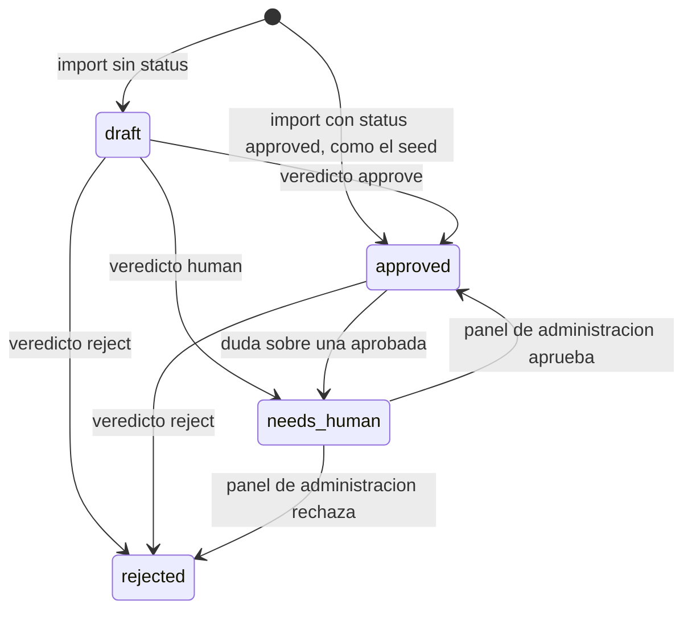

# Preguntas

Modelo de datos de categorías y preguntas con sus traducciones, y el camino que siguen hasta el jugador sin revelar la correcta antes de contestar. Vive en Postgres (migraciones desde [`20261016143211_questions.sql`](../../supabase/migrations/20261016143211_questions.sql)), se carga con [`scripts/import-questions.mts`](../../scripts/import-questions.mts) y solo se lee a través de las RPC de cada modo de juego. Cómo se generan, traducen y revisan está en [contenido-y-admin.md](contenido-y-admin.md); lo que se calcula con las respuestas (estadísticas, XP), en [progresion-y-estadisticas.md](progresion-y-estadisticas.md). Reglas generales y decisiones: [CLAUDE.md](../../CLAUDE.md) (principio "servidor autoritativo" y "Preguntas solo vía RPC").

## Reglas

| Concepto | Valor |
| --- | --- |
| Categorías | Datos en BD, nunca un enum. Hoy 7 (tabla en "Base de datos"). Solo se sirven las `is_active`. |
| Dificultad | `easy`, `medium`, `hard` (en la interfaz: Fácil, Normal, Difícil). |
| Estado | `draft` (por defecto al importar), `approved`, `rejected`. Aparte, el indicador `needs_human` (ver diagrama). |
| Origen | `ai`, `manual` o `user`. Hoy se usan `ai` (los skills de generación) y `manual` (el seed); `user` está reservado y ningún flujo lo usa. |
| Jugable | `is_playable`: `status = 'approved'` y (`expires_at` nulo o futuro). Es la única definición de "se puede servir en una partida nueva". |
| Actualidad | `topical = true`: la tarjeta muestra el distintivo "Actualidad" / "In the news". Exige `expires_at`; al importar sin `expiresAt` caduca a los 90 días. |
| Idioma | `es` y `en`. Una pregunta solo se sirve en un idioma si existe su traducción **y** la categoría tiene nombre en ese idioma. En duelos tiene que existir en los idiomas de los dos jugadores. |
| Respuestas | La BD admite de 2 a 6 por traducción; los criterios de contenido exigen 4 (1 correcta + 3 incorrectas). La **primera** es la correcta. Cada una, como mucho 120 caracteres; el enunciado, como mucho 300. No se admiten repetidas (sin distinguir mayúsculas). |
| % de acierto de la pregunta | Se muestra tras responder si la pregunta tiene al menos 20 respuestas (todos los jugadores, modos e idiomas, invitados incluidos). |

Ciclo de vida de una pregunta (los veredictos y el panel están en [contenido-y-admin.md](contenido-y-admin.md)):



`needs_human` es un estado de `draft` con `needs_human = true` (no se juega y entra en la cola de `/admin`). La caducidad no cambia el estado: `is_playable` la evalúa al elegir las preguntas de cada partida, sin cron.

## Cómo funciona

### 1. Entrada

1. Seed de desarrollo: `pnpm db:seed` ejecuta `node scripts/import-questions.mts supabase/seed/questions.json --local` (también lo hace `pnpm db:reset`). Producción no usa el seed (el repo es público): su contenido sale de los procesos de [contenido-y-admin.md](contenido-y-admin.md).
2. Todo lo que entra pasa por la RPC `import_questions` (solo `service_role`): `scripts/lib/supabase-admin.mts` envía lotes de 500 elementos (`BATCH_SIZE`), cada lote es una transacción y la importación es idempotente por `externalId`.
3. El panel de administración corrige textos y dificultad con `admin_update_question`, que reutiliza `import_questions` (mismas validaciones).

### 2. Elegir las preguntas de una partida

Cada modo las elige **al crear** la partida (o la ronda) con sus RPC; todas exigen `is_playable`, categoría activa y traducciones (de pregunta y de categoría) en el idioma del juego. El detalle de cada selección está en el documento del modo.

| Modo | Elige | Sirve | Responde | Documento |
| --- | --- | --- | --- | --- |
| Rápida (solitario y local) | `start_quick_match`: de la dificultad elegida; primero las que la cuenta nunca ha visto servidas (al azar) y luego las vistas hace más tiempo | `serve_quick_question` | `answer_quick_question` | [modo-rapido.md](modo-rapido.md) |
| Reto diario | `start_daily_match` (con `ensure_daily_challenge`): 7 preguntas, una por categoría, solo las traducidas a todos los idiomas | las mismas de la rápida | las mismas de la rápida | [reto-diario.md](reto-diario.md) |
| Duelo por turnos | `spin_duel_round` con `duel_candidates`: traducidas a los idiomas de ambos y no usadas antes en ese duelo | `serve_duel_question` | `answer_duel_question` | [amigos-y-duelo.md](amigos-y-duelo.md) |
| Duelo relámpago | `invite_live_duel`: reserva de 60 (mínimo 20), mismas y en el mismo orden para los dos | `serve_live_question` | `answer_live_question` | [duelo-relampago.md](duelo-relampago.md) |

El idioma queda fijado al empezar: `quick_matches.locale`, `duel_plays.locale` (por jugador, al girar) y `live_duels.challenger_locale` / `opponent_locale`. Cambiar el idioma del perfil no altera partidas ya creadas.

### 3. Servir sin la correcta

- En BD la correcta es siempre `answers[1]` de cada traducción.
- Al asignar una pregunta a una ronda, el servidor guarda `answer_order smallint[]`: una permutación aleatoria de `1..N` (`array_agg(i::smallint order by random())`). La respuesta que se ve en la posición `i` (base 1) es `answers[answer_order[i]]`. En el duelo por turnos cada jugador tiene su propio orden; en el relámpago es uno por pregunta, común a los dos (`live_duel_questions.answer_order`).
- `serve_*` devuelve solo textos en el orden mostrado:

  ```sql
  -- serve_quick_question; el duelo usa p.answer_order y el relámpago lq.answer_order
  select jsonb_agg(t.answers[o.idx] order by o.ord)
  from unnest(r.answer_order) with ordinality as o (idx, ord)
  ```

  Sin ids de respuesta, sin índice de la correcta, sin banderas. Servir una pregunta ya servida (p. ej. al recargar) devuelve la misma con el `elapsedMs` ya transcurrido: no da tiempo extra.
- Forma de lo servido:

  | RPC | Campos |
  | --- | --- |
  | `serve_quick_question` | `position`, `seat`, `timeLimitMs` (15000), `elapsedMs`, `category` {`id`, `name`, `color`}, `topical`, `prompt`, `answers` |
  | `serve_duel_question` | `round`, `slot`, `timeLimitMs` (15000), `elapsedMs`, `category`, `topical`, `prompt`, `answers` |
  | `serve_live_question` | `position`, `timeLimitMs` (6000), `elapsedMs`, `remainingMs`, `category`, `topical`, `prompt`, `answers` |

### 4. Responder y revelar

1. El cliente envía `choice`: índice en pantalla (base 0), o `null` si se agotó el tiempo.
2. El servidor calcula `correct_choice = array_position(answer_order, 1) - 1`, valida el reloj (con margen de latencia) y guarda `chosen`, `is_correct` y `points`.
3. Solo entonces devuelve la correcta:

   | RPC | Respuesta |
   | --- | --- |
   | `answer_quick_question` | `correctIndex`, `isCorrect`, `points`, `finished`, `hitRate` |
   | `answer_duel_question` | `correctIndex`, `isCorrect`, `points`, `turnEnded`, `finished`, `hitRate` |
   | `answer_live_question` | `correctIndex`, `isCorrect`, `points`, `remainingMs`, `done` |

4. `hitRate` es `question_hit_rate` de esa pregunta (o `null` con menos de 20 respuestas); el relámpago no lo devuelve. [`AnswerFeedback`](../../apps/web/src/features/game/answer-feedback.tsx#L133) lo muestra como "Acierta el X % de los jugadores".
5. Las estadísticas de revisión (`export_questions`: `correct` y `topWrong`) cuentan por la **posición original** (`answer_order[chosen + 1]`, columna `picked` de `question_answers`: 1 = la correcta, `null` = tiempo agotado). Por eso la traducción debe conservar el orden de `wrong`.

## Base de datos

Las cuatro tablas tienen RLS activado, **sin políticas**, y `revoke all` a `anon` y `authenticated`: el cliente no puede leerlas ni escribirlas (los tests lo comprueban). Solo las RPC `security definer` de los modos y `service_role` (scripts) las usan. `categories` y `category_translations` solo las escriben las migraciones. `questions` y `question_translations` las escriben únicamente `import_questions` (alta y edición), `review_questions` y `mark_untranslatable` (campos de revisión) y el trigger `questions_set_updated_at`; no hay otra escritura (ver [contenido-y-admin.md](contenido-y-admin.md)).

### `categories`

Categorías de juego. Inicial en [`questions.sql`](../../supabase/migrations/20261016143211_questions.sql#L5).

| Columna | Tipo | Notas |
| --- | --- | --- |
| `id` | text | PK. Formato `^[a-z0-9-]{1,40}$`. Es la clave de los iconos (`components/category-icon.tsx`) |
| `color` | text | `#RRGGBB` en mayúsculas (`^#[0-9A-F]{6}$`) |
| `sort_order` | integer | Por defecto 0. Ordena la ruleta y las estadísticas |
| `is_active` | boolean | Por defecto `true`. Inactiva = no se sirve ni se lista |
| `created_at` | timestamptz | `now()` |

Datos iniciales (en la misma migración; colores aprobados, ver CLAUDE.md):

| `id` | es | en | `color` | `sort_order` |
| --- | --- | --- | --- | --- |
| `geography` | Geografía | Geography | `#2ECC8F` | 1 |
| `history` | Historia | History | `#D9964A` | 2 |
| `science` | Ciencia y Naturaleza | Science & Nature | `#2EC4E6` | 3 |
| `art-literature` | Arte y Literatura | Art & Literature | `#9B7BFF` | 4 |
| `entertainment` | Entretenimiento | Entertainment | `#FF7A45` | 5 |
| `sports` | Deportes | Sports | `#F5C431` | 6 |
| `technology` | Tecnología | Technology | `#5C7CFA` | 7 |

### `category_translations`

[Migración](../../supabase/migrations/20261016143211_questions.sql#L13).

| Columna | Tipo | Notas |
| --- | --- | --- |
| `category_id` | text | FK a `categories(id)`, `on delete cascade` |
| `locale` | text | `es` o `en` |
| `name` | text | Sin espacios en los extremos, 1 a 40 caracteres |

PK `(category_id, locale)`.

### `questions`

Una fila por pregunta, independiente del idioma. Tabla original en [`questions.sql`](../../supabase/migrations/20261016143211_questions.sql#L20); columnas añadidas en [`question_pipeline.sql`](../../supabase/migrations/20261018150834_question_pipeline.sql#L4) y [`question_untranslatable.sql`](../../supabase/migrations/20261018151706_question_untranslatable.sql#L4).

| Columna | Tipo | Notas |
| --- | --- | --- |
| `id` | uuid | PK, `gen_random_uuid()` |
| `external_id` | text | Único, 1 a 100 caracteres. Identidad estable en el origen: permite reimportar sin duplicar. El seed usa `seed-<abreviatura de categoría>-<dificultad>-<n>`; `pnpm questions import` asigna `ai-<uuid>` si falta |
| `category_id` | text | FK a `categories(id)` (sin cascada) |
| `difficulty` | text | `easy`, `medium`, `hard` |
| `status` | text | `draft` (por defecto), `approved`, `rejected` |
| `source` | text | `ai`, `manual`, `user` |
| `topical` | boolean | Por defecto `false` |
| `expires_at` | timestamptz | Nulo = no caduca. `questions_topical_expiry`: si `topical`, no puede ser nulo |
| `reviewed_at` | timestamptz | Lo fija `review_questions` en cada veredicto |
| `needs_human` | boolean | Por defecto `false`. Lo fija `review_questions` (`true` solo con veredicto `human`) |
| `review_note` | text | Hasta 500 caracteres |
| `untranslatable` | text[] | Por defecto `{}`; subconjunto de `{es, en}`. Idiomas a los que no se traduce (ver [contenido-y-admin.md](contenido-y-admin.md)) |
| `created_at` | timestamptz | `now()` |
| `updated_at` | timestamptz | Trigger `questions_set_updated_at` (`set_updated_at()`) |

Índices: `external_id` único; `questions_playable_idx` sobre `(difficulty)` donde `status = 'approved'` ([L32](../../supabase/migrations/20261016143211_questions.sql#L32)). Trigger `questions_set_updated_at` ([L34](../../supabase/migrations/20261016143211_questions.sql#L34)).

### `question_translations`

[Migración](../../supabase/migrations/20261016143211_questions.sql#L38).

| Columna | Tipo | Notas |
| --- | --- | --- |
| `question_id` | uuid | FK a `questions(id)`, `on delete cascade` |
| `locale` | text | `es` o `en` |
| `prompt` | text | Sin espacios en los extremos, 1 a 300 caracteres |
| `answers` | text[] | 1 dimensión, de 2 a 6 elementos, sin nulos. **La primera es la correcta** |

PK `(question_id, locale)`. El límite de 120 caracteres y la ausencia de repetidas se comprueban en `import_questions`, no con `check`.

### Vista `question_answers`

Todas las respuestas dadas en los tres modos (columnas `player_id`, `guest`, `question_id`, `picked`, `is_correct`). Definida en [`question_stats.sql`](../../supabase/migrations/20261021152204_question_stats.sql#L10) con `security_invoker = true` y `revoke all` para el cliente; solo la leen funciones internas. Es la base de `question_hit_rate`, `export_questions` y `category_stats` (este último en [progresion-y-estadisticas.md](progresion-y-estadisticas.md)). `picked` = posición original elegida (1 = correcta, `null` = tiempo agotado); en la rápida, `guest` marca los turnos de los invitados.

### Funciones

Las demás funciones del dominio (`review_questions`, `mark_untranslatable`, reportes y panel) están en [contenido-y-admin.md](contenido-y-admin.md).

| Función | Argumentos | Devuelve | Quién la llama | Qué hace |
| --- | --- | --- | --- | --- |
| `import_questions` | `items jsonb` | `integer`: elementos procesados | `service_role` (scripts, seed); `admin_update_question` por dentro | Alta o actualización por `externalId`. Versión vigente: [`question_pipeline.sql`](../../supabase/migrations/20261018150834_question_pipeline.sql#L31) |
| `export_questions` | ninguno | `jsonb` | `service_role` (`scripts/questions.mts`) | Todas las preguntas en formato de importación más metadatos, reportes abiertos y estadísticas. Versión vigente: [`question_stats.sql`](../../supabase/migrations/20261021152204_question_stats.sql#L220) |
| `is_playable` | `q public.questions` | `boolean` | Interna (`start_quick_match`, `duel_candidates`, `invite_live_duel`, `ensure_daily_challenge`) | `status = 'approved' and (expires_at is null or expires_at > now())`. [`question_pipeline.sql`](../../supabase/migrations/20261018150834_question_pipeline.sql#L15) |
| `question_hit_rate` | `question_id uuid` | `integer` o `null` | Interna (`answer_quick_question`, `answer_duel_question`) | `round(100 * aciertos / respuestas)` sobre `question_answers`; `null` con menos de 20. [`question_stats.sql`](../../supabase/migrations/20261021152204_question_stats.sql#L29) |

Permisos: `import_questions` y `export_questions` solo para `service_role` (un cliente recibe `42501`); `is_playable` y `question_hit_rate` sin `execute` para el cliente.

**Errores de `import_questions`** (todos anulan el lote entero y se envuelven como `pregunta <externalId>: <mensaje>`):

| Mensaje | Causa |
| --- | --- |
| `se esperaba un array de preguntas` | `items` no es un array |
| `faltan las traducciones` | `translations` no existe, no es un objeto o está vacío |
| `[<locale>] "wrong" debe ser un array` | `wrong` ausente o de otro tipo |
| `[<locale>] respuestas vacías o de más de 120 caracteres` | alguna respuesta vacía o demasiado larga |
| `[<locale>] respuestas repetidas` | duplicadas ignorando mayúsculas |
| violaciones de `check` / FK | categoría inexistente, dificultad, estado, origen o idioma fuera de lo permitido, enunciado de más de 300, menos de 2 o más de 6 respuestas |

**Formato de importación** (array; ejemplo con valores genéricos, ver [`supabase/seed/questions.json`](../../supabase/seed/questions.json) para el formato real):

```json
[
  {
    "externalId": "ejemplo-001",
    "category": "science",
    "difficulty": "medium",
    "status": "approved",
    "source": "ai",
    "topical": false,
    "expiresAt": "2026-12-31T00:00:00Z",
    "translations": {
      "es": { "prompt": "¿Enunciado?", "correct": "Correcta", "wrong": ["Mala 1", "Mala 2", "Mala 3"] },
      "en": { "prompt": "Prompt?", "correct": "Right", "wrong": ["Wrong 1", "Wrong 2", "Wrong 3"] }
    }
  }
]
```

Qué ocurre con cada campo al **reimportar** un `externalId` existente:

| Campo | Comportamiento |
| --- | --- |
| `externalId`, `category`, `difficulty`, `source`, `translations` | Obligatorios |
| `status` | Opcional. Sin la clave: alta como `draft` y, si ya existe, **conserva** el estado. Con la clave, lo sustituye |
| `topical`, `expiresAt` | Opcionales pero **siempre se sustituyen**: omitirlos deja `topical = false` y sin caducidad; con `topical` y sin `expiresAt`, caduca a `now() + 90 days` |
| `translations` | Solo se sustituyen (borrar y reinsertar) los idiomas incluidos; los demás se conservan |

**Formato de `export_questions`** (ordenado por `created_at`): cada elemento lleva `externalId`, `category`, `difficulty`, `status`, `source`, `topical`, `expiresAt`, `createdAt`, `reviewedAt`, `needsHuman`, `reviewNote`, `untranslatable`, `translations` (por idioma: `prompt`, `correct`, `wrong`), `reports` (solo reportes sin resolver: `reason`, `locale`) y `stats`: `answered` (todas las respuestas, también tiempo agotado), `correct` (elegida la posición original 1) y `topWrong` (veces que se eligió la incorrecta más votada). Cuenta los tres modos, incluido el relámpago.

## Código

| Archivo | Para qué |
| --- | --- |
| [`supabase/migrations/20261016143211_questions.sql`](../../supabase/migrations/20261016143211_questions.sql) | Tablas, categorías iniciales y `import_questions` v1 |
| [`supabase/migrations/20261018150834_question_pipeline.sql`](../../supabase/migrations/20261018150834_question_pipeline.sql) | Actualidad y caducidad, `is_playable`, `import_questions` v2, `export_questions`, `review_questions`, y las versiones de `start_quick_match`, `duel_candidates` y `serve_*` que usan `is_playable` y `topical` |
| [`supabase/migrations/20261018151706_question_untranslatable.sql`](../../supabase/migrations/20261018151706_question_untranslatable.sql) | `untranslatable` y `mark_untranslatable` |
| [`supabase/migrations/20261021152204_question_stats.sql`](../../supabase/migrations/20261021152204_question_stats.sql) | `question_answers`, `question_hit_rate`, `hitRate` en las respuestas y `export_questions` vigente |
| [`supabase/seed/questions.json`](../../supabase/seed/questions.json) | Seed de desarrollo: 126 preguntas (7 categorías x 3 dificultades x 6), `es` y `en`, estado `approved`, origen `manual` |
| [`scripts/import-questions.mts`](../../scripts/import-questions.mts) | Importación masiva: `node scripts/import-questions.mts <archivo.json> [--local]`. Sin `--local` usa `SUPABASE_URL` y `SUPABASE_SECRET_KEY` |
| [`scripts/lib/supabase-admin.mts`](../../scripts/lib/supabase-admin.mts) | `rpc()` con la clave secreta y `importQuestions()` por lotes de 500 |
| [`apps/web/src/components/question-card.tsx`](../../apps/web/src/components/question-card.tsx) | Tarjeta de pregunta (presentacional): categoría, distintivo de actualidad (`badge`), respuestas, teclas 1-4 |
| [`apps/web/src/features/game/answer-feedback.tsx`](../../apps/web/src/features/game/answer-feedback.tsx) | Pegatina de acierto o fallo y el % de acierto de la pregunta |
| [`apps/web/src/components/category-icon.tsx`](../../apps/web/src/components/category-icon.tsx) | Icono SVG por `categories.id` (con uno genérico si falta) |
| [`packages/game-core/src/quick.ts`](../../packages/game-core/src/quick.ts) | `DIFFICULTIES` y el tipo `Difficulty` |
| `apps/web/messages/*.json` | `Quick.difficulties`, `Quick.topical` y `Quick.hitRate` |

Tipos de lo que devuelven las RPC: [`features/game/quick/types.ts`](../../apps/web/src/features/game/quick/types.ts) y [`features/duel/types.ts`](../../apps/web/src/features/duel/types.ts) (los generados solo dicen `Json`).

## Tests

- [`supabase/tests/quick_matches.test.sql`](../../supabase/tests/quick_matches.test.sql) (pgTAP, 37): importación (lote, reimportar sin duplicar, respuestas repetidas, categoría inexistente, la correcta se guarda la primera); el cliente no lee `questions`, `question_translations` ni las rondas y no importa; `serve_quick_question` no incluye la correcta (claves exactas), sirve 4 respuestas y la categoría en el idioma del perfil; re-servir devuelve la misma; solo salen aprobadas en el idioma de la partida; se evitan las ya vistas.
- [`supabase/tests/question_pipeline.test.sql`](../../supabase/tests/question_pipeline.test.sql) (19): actualidad caduca a 90 días, reimportar sin `status` conserva el estado, importar un idioma no borra los demás, `is_playable`, formato y estadísticas de `export_questions`, veredictos, `mark_untranslatable`, lo servido indica `topical`, las partidas nuevas solo usan jugables.
- [`supabase/tests/question_stats.test.sql`](../../supabase/tests/question_stats.test.sql) (12): `question_hit_rate` (sin % con menos de 20, 18 de 20 = 90 %), las respuestas devuelven `hitRate`, `export_questions` cuenta también el relámpago, el cliente no lee la vista ni llama a `question_hit_rate`.
- Ningún test de duelo ni de relámpago comprueba que lo servido omita la correcta: solo la rápida lo hace.

## Detalles a tener en cuenta

- **`is_playable` solo cuenta al elegir.** Rechazar, devolver a borrador o dejar caducar una pregunta no la saca de lo ya asignado: las rondas de partidas rápidas y retos ya creados, las jugadas de duelo ya giradas y la reserva de un relámpago ya enviado la siguen sirviendo, porque `serve_*` no vuelve a comprobar el estado.
- **Cambiar una pregunta en uso.** `answer_order` se fija al asignar la pregunta. Si una reimportación o corrección cambia el **número** de respuestas de una pregunta ya asignada a una partida o duelo en curso, el orden guardado deja de encajar (con menos respuestas, el servidor serviría huecos nulos; con más, las nuevas no se mostrarían). Corregir solo textos no afecta. Los idiomas que no se incluyen en la importación no se tocan.
- **Reimportar pierde la actualidad** si no se envían `topical` y `expiresAt`. Los procesos de `scripts/questions.mts` los reenvían siempre (`importable()`); `import-questions.mts` envía el JSON tal cual.
- **Los criterios exigen 4 respuestas, la BD admite 2 a 6.** Una pregunta con otro número entra igual: solo la revisión lo detectaría.
- **Duplicados dentro de un lote.** Dos elementos con el mismo `externalId` se sobrescriben en silencio (el segundo gana). Cada elemento corre en una subtransacción (`begin ... exception`).
- **Cada respuesta revela la correcta** (es necesario para el feedback). Un bot podría recopilar el banco jugando; los frenos son los límites de peticiones por cuenta (60 partidas rápidas por hora, 20 duelos por hora, 30 invitaciones relámpago por hora).
- **Añadir un idioma** toca más de lo que lista [procesos-de-preguntas.md](../procesos-de-preguntas.md): además de las restricciones que enumera, las columnas `live_duels.challenger_locale` y `opponent_locale` y los dos `= 2` fijos de `ensure_daily_challenge` ([`daily_challenge.sql`](../../supabase/migrations/20261021155309_daily_challenge.sql#L71)), o el reto diario dejaría de poder formarse.
- **Añadir una categoría:** migración con `insert` en `categories` y `category_translations` (todos los idiomas), icono en `components/category-icon.tsx` (sin él sale el genérico) y sus ids en los skills. Los pasos están en [procesos-de-preguntas.md](../procesos-de-preguntas.md).
- **Una categoría sin nombre en el idioma del juego** deja fuera sus preguntas en ese idioma (lo exigen `start_quick_match`, `invite_live_duel`, `ensure_daily_challenge` y `duel_candidates`).
- **Rendimiento (`shortcut` conocido):** `start_quick_match` e `invite_live_duel` ordenan todas las candidatas de la dificultad; `export_questions` devuelve el banco entero en un solo JSON y cada comando de `scripts/questions.mts` lo descarga. Basta para decenas de miles; muestrear o paginar si crece.
- **Cambiar las constantes** (15 s, margen de 2 s, reserva de 60) exige migración nueva con la función completa; `QUICK` y `SCORING` en `game-core` son espejos que hay que mantener a mano.
