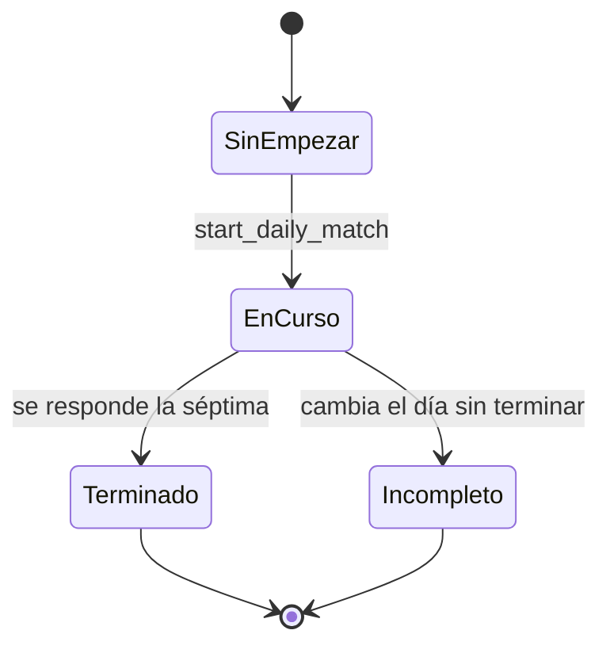

# Reto diario

Un reto por día con las mismas 7 preguntas para todos los jugadores: una por categoría, de más fácil a más difícil. Cada jugador lo juega como una partida rápida en solitario enlazada al día (`quick_matches.daily_day`), así que reutiliza el reloj, la puntuación, la XP y las estadísticas del [modo rápido](modo-rapido.md). Al terminar ve su resultado en cuadritos de colores, sus amigos que ya lo han jugado y puede compartirlo como imagen. Vive en `apps/web/src/features/daily/*`, `apps/web/src/app/daily/*` y las funciones `ensure_daily_challenge`, `start_daily_match` y `get_daily` de Postgres ([daily_challenge](../../supabase/migrations/20261021155309_daily_challenge.sql)).

Las reglas aprobadas están en [CLAUDE.md](../../CLAUDE.md) ("Reto diario aprobado", 2026-10-21).

## Reglas

| Regla | Valor |
| --- | --- |
| Cambio de día | 00:00 hora de España (`Europe/Madrid`), igual para todos los jugadores (`daily_today()`) |
| Numeración | "Reto diario #N". El #1 es el primer día que tuvo reto; los días sin jugar también cuentan |
| Preguntas | 7, la misma lista y en el mismo orden para todos. Una de cada categoría (7 categorías activas elegidas al azar; con 7 activas, todas) y en orden de categorías al azar |
| Dificultad por posición | `easy`, `easy`, `medium`, `medium`, `medium`, `hard`, `hard` (2 + 3 + 2, de menos a más) |
| Qué preguntas entran | Jugables (`is_playable`) y con traducción a todos los idiomas de la app (hoy `es` y `en`). Dentro de cada categoría: primero la de la dificultad que toca; entre esas, la que nunca salió en un reto o hace más tiempo que no sale; desempate al azar |
| Tiempo y puntos | Como la rápida: 15 s por pregunta; acierto 10, +5 en menos de 3 s o +2 en menos de la mitad del tiempo; el % de jugadores que aciertan, igual |
| Intento | Uno por jugador y día. Se puede seguir el mismo día (portada: "Continuar") |
| Día nuevo sin terminar | Queda incompleto: no se puede seguir, no da XP y no aparece |
| XP | Como una rápida en solitario: 10 + la mitad de los puntos |
| Estadísticas | Cuenta en las estadísticas por categoría y en el % de acierto de cada pregunta |
| Amigos | "Tus amigos hoy": los amigos aceptados que ya lo han terminado hoy, ordenados por puntos. Solo se ven cuando tú también lo has terminado |
| Compartir | Imagen cuadrada (ajolote, título, cuadritos y resultado) y el texto "Reto diario #N: X/7 y P puntos. ¿Me superas? {enlace a la web}" |

Estados de un jugador en el día:



| Estado | Cómo se sabe | Portada | `/daily` |
| --- | --- | --- | --- |
| Sin empezar | `get_daily().match` es `null` | Resumen y "Jugar" | Redirige a `/` |
| En curso | `match.finished` es `false` | "Continuar" | Se juega con `QuickGame` |
| Terminado | `match.finished` es `true` | Cuadritos, resultado y "Ver resultado" | `DailyResults` |
| Incompleto | Partida con `daily_day` pasado y `finished_at` nulo | No aparece: `get_daily` solo mira el reto de hoy | Sin acceso; `serve_quick_question` da `daily_expired` |

## Cómo funciona

1. **Portada** ([app/page.tsx](../../apps/web/src/app/page.tsx)): llama a `get_daily()` junto con `list_duels` y `list_friends`. Si responde, la primera tarjeta es [DailyCard](../../apps/web/src/features/daily/daily-card.tsx#L10); si falla (por ejemplo, sin preguntas suficientes) no hay tarjeta. Sin partida enseña el resumen y "Jugar"; con la partida sin terminar, "Continuar"; terminada, los cuadritos, "X/7 · P puntos" y "Ver resultado".
2. **"Jugar" o "Continuar"** envía el formulario a la server action [startDaily](../../apps/web/src/features/daily/actions.ts#L7), que llama a `start_daily_match` y hace `redirect('/daily')`. Si la RPC falla lanza un `Error`: sale la página de error global de Next ([global-error.tsx](../../apps/web/src/app/global-error.tsx), que también avisa a Sentry).
3. **`/daily`** ([page.tsx](../../apps/web/src/app/daily/page.tsx#L8), servidor): `requireProfile()` y `get_daily`. Sin partida, redirige a `/`; sin terminar, monta [QuickGame](../../apps/web/src/features/game/quick/quick-game.tsx#L27) con `daily`; terminada, pinta [DailyResults](../../apps/web/src/features/daily/daily-results.tsx#L18).
4. **Jugar**: es el [modo rápido](modo-rapido.md) con 1 jugador (sin pantalla de pase): `get_quick_match`, `serve_quick_question` y `answer_quick_question` sobre la partida del reto. `QuickGame` recibe `daily` y cambia el final: al llegar a `results` no pinta `QuickResults`, sino que hace `router.refresh()` y enseña la mascota botando hasta que la página vuelve a pedirse al servidor y muestra `DailyResults`.
5. **Resultados** (`DailyResults`): mascota, cuadritos grandes, "X/7 · P puntos", `XpGain` con la XP ganada, "Tus amigos hoy" (avatar, nombre con su nivel, cuadritos pequeños y puntos; o "Ninguno de tus amigos lo ha jugado todavía") y el botón de compartir. El sonido `win` suena solo la primera vez que se ve (`useOutcomeOnce("daily:<id>")`); no hay animación de pantalla completa.
6. **Compartir** ([ShareButton](../../apps/web/src/features/daily/share-button.tsx#L13)):
   - Al montarse pide `GET /daily/image` y guarda el PNG como `reto-<número>.png`. Se pide de antemano porque Safari solo deja abrir el menú de compartir justo al tocar, sin esperas entre medias.
   - Al pulsar: si `navigator.canShare({ files })` lo admite, abre el menú del sistema con la imagen y el texto; si no, descarga la imagen, copia el texto al portapapeles y avisa ("Imagen descargada y texto copiado").
   - Cerrar el menú sin elegir nada (`AbortError`) no es un error. Si la imagen no carga, el botón queda desactivado y sale "No se ha podido compartir".
   - El texto lleva `window.location.origin` como enlace; no hay enlace al reto concreto.
7. **Imagen** ([app/daily/image/route.tsx](../../apps/web/src/app/daily/image/route.tsx#L7)): `GET` que llama a `get_daily` con la sesión de quien pide y responde 404 si no hay partida terminada. Solo sale el resultado propio. [dailyImage](../../apps/web/src/features/daily/daily-image.tsx#L18) la dibuja con `ImageResponse` (1080 x 1080, fondo `BRAND_BG`, ajolote, título, cuadritos de 118 px y resultado) y responde con `Cache-Control: private, no-store`.

### Cuadritos

[DailySquares](../../apps/web/src/features/daily/daily-squares.tsx#L6) pinta un cuadrito por pregunta, en orden: el acierto, relleno con el color de la categoría y su icono; el fallo, apagado (fondo oscuro, icono atenuado) con el borde del color de la categoría. Cada uno lleva texto solo para lectores de pantalla ("{categoría}: acierto" o "fallo"). Un `correct` nulo (sin responder) se ve como fallo, pero solo se enseñan partidas terminadas. Tamaños: 36 px en la portada, 42 en el resultado, 20 en la lista de amigos. La imagen de compartir los redibuja por su cuenta con los mismos colores.

## Base de datos

### `daily_challenges`

El reto de cada día. Lo crea perezosamente el primero que lo pide ([tabla](../../supabase/migrations/20261021155309_daily_challenge.sql#L5)).

| Columna | Tipo | Notas |
| --- | --- | --- |
| `day` | `date` | PK. El día del reto en hora de España |
| `number` | `integer` | Único, `> 0`. El "#N" |
| `question_ids` | `uuid[]` | Exactamente 7 (check), en orden de juego. Sin FK por elemento: las preguntas no se borran, como mucho se rechazan |
| `created_at` | `timestamptz` | `now()` |

- **Escribe**: solo `ensure_daily_challenge` (`security definer`).
- **Permisos**: RLS activada sin políticas y `revoke all` a `anon` y `authenticated`; el cliente no la lee (lo prueba el test). Patrón común en [base-de-datos.md](base-de-datos.md).

### `quick_matches.daily_day`

La partida del reto es una fila de `quick_matches` con estas diferencias respecto a una rápida (tabla completa en [modo-rapido.md](modo-rapido.md)):

- `daily_day` (`date`, FK a `daily_challenges.day`) con el día del reto; `difficulty` nula; `player_count = 1`. Lo exige el check `quick_matches_daily_check` ([migración](../../supabase/migrations/20261021155309_daily_challenge.sql#L18)): o bien `daily_day` es nulo y hay `difficulty`, o hay `daily_day`, `difficulty` nula y un solo jugador.
- Índice único parcial `quick_matches_daily_idx (daily_day, owner_id) where daily_day is not null` ([L26](../../supabase/migrations/20261021155309_daily_challenge.sql#L26)): un intento por jugador y día. También sirve para buscar los resultados de los amigos.
- Sus rondas (`quick_match_rounds`) se crean con las 7 preguntas del reto, en su orden, y un `answer_order` barajado **por jugador**.
- Todo lo demás (reloj, puntos, `finished_at`, trigger de XP, límite de 60 partidas por hora, vista `question_answers`) es el de la rápida.

### Funciones

Todas con `search_path = ''`. Definidas en [daily_challenge](../../supabase/migrations/20261021155309_daily_challenge.sql).

| Función | Argumentos | Devuelve | Quién la llama | Qué hace |
| --- | --- | --- | --- | --- |
| `daily_today()` ([L29](../../supabase/migrations/20261021155309_daily_challenge.sql#L29)) | ninguno | `date` | Las demás funciones del reto | `(now() at time zone 'Europe/Madrid')::date`. `stable`. Sin `execute` para el cliente |
| `ensure_daily_challenge()` ([L43](../../supabase/migrations/20261021155309_daily_challenge.sql#L43)) | ninguno | fila de `daily_challenges` | `start_daily_match` y `get_daily` | Devuelve el reto de hoy; si no existe, lo crea (ver abajo). `security definer`. Sin `execute` para el cliente |
| `start_daily_match()` ([L104](../../supabase/migrations/20261021155309_daily_challenge.sql#L104)) | ninguno | `uuid` (id de la partida) | Server action `startDaily` | Empieza o retoma el reto de hoy del jugador. `security definer` |
| `daily_result(m, viewer_locale)` ([L148](../../supabase/migrations/20261021155309_daily_challenge.sql#L148)) | `m quick_matches`, `viewer_locale text` | `jsonb` | `get_daily` | Resultado de una partida del reto. `stable`. Sin `execute` para el cliente |
| `get_daily()` ([L172](../../supabase/migrations/20261021155309_daily_challenge.sql#L172)) | ninguno | `jsonb` | Portada, `/daily` y `/daily/image` | Número del reto, partida del jugador y amigos que ya lo terminaron. `security definer`; `execute` para `authenticated` |
| `serve_quick_question(match_id)` ([L216](../../supabase/migrations/20261021155309_daily_challenge.sql#L216)) | `match_id uuid` | `jsonb` | `QuickGame` | Redefinida: ahora rechaza un reto de un día pasado con `daily_expired`. El resto, igual que en el [modo rápido](modo-rapido.md) |

`start_daily_match` y `get_daily` tienen `execute` solo para `authenticated`.

**`ensure_daily_challenge`**:

1. Si ya existe la fila de hoy, la devuelve (camino rápido, sin bloqueo).
2. Toma `pg_advisory_xact_lock(hashtext('daily_challenge'))` y vuelve a mirar: dos peticiones simultáneas no crean dos retos; la segunda espera y lee el de la primera.
3. Elige hasta 7 categorías: activas, con exactamente 2 traducciones, en orden al azar.
4. Para la categoría `i` elige 1 pregunta jugable con exactamente 2 traducciones, ordenando por: dificultad igual a la que toca en esa posición primero; después, la más antigua en un reto (`max(day)` de los retos que la contienen; las nunca usadas, primero); después, al azar. La dificultad es una preferencia, no un filtro.
5. Si no llega a 7, falla con `not_enough_questions`.
6. Inserta `(hoy, hoy - min(day) + 1, preguntas)`: el número cuenta desde el primer reto que existió (1 si es el primero).

**`start_daily_match`**:

1. Obtiene el reto de hoy (`ensure_daily_challenge`).
2. Si el jugador ya tiene su partida de hoy, devuelve su id.
3. Si no, inserta en `quick_matches` (idioma del perfil, sin dificultad, 1 jugador, `daily_day`) con `on conflict (daily_day, owner_id) do nothing`; si otra petición la acaba de crear, devuelve esa.
4. Inserta al jugador en el asiento 0 y las 7 rondas en el orden del reto, con `answer_order` aleatorio.

**`get_daily`** devuelve (tipos en [types.ts](../../apps/web/src/features/daily/types.ts)):

```text
{ number,
  match: null o { score, correct, rounds: [{ categoryId, name, color, correct }], id, finished, xp: { gained, total } o null },
  friends: [{ score, correct, rounds, id, username, avatarId, xp }] }
```

- `rounds[].correct` es `null` hasta responder; `name` va en el idioma de quien mira (no en el de la partida del amigo).
- `match.xp` sale de `xp_gain` y es `null` hasta terminar ([progresion-y-estadisticas.md](progresion-y-estadisticas.md)).
- `friends` está vacío mientras el jugador no ha terminado. Después incluye a los amigos aceptados (en cualquier sentido de la amistad) con su partida de hoy terminada, ordenados por puntos (desc.) y nombre. Su `xp` es el total del perfil (para la insignia de nivel), no la ganada en el reto.

Errores:

| Mensaje | SQLSTATE / hint | Cuándo |
| --- | --- | --- |
| `perfil no creado` | `42501` | `start_daily_match` o `get_daily` sin sesión o sin perfil (`current_player_id()`) |
| `no hay suficientes preguntas` | `P0001`, hint `not_enough_questions` | `ensure_daily_challenge` no reúne 7 preguntas |
| `reto caducado` | `P0001`, hint `daily_expired` | `serve_quick_question` de un reto de un día pasado |
| (check de `quick_matches_daily_check`) | `23514` | Un reto con dificultad o con más de un jugador |

No hay Realtime ni `pg_cron`: el reto se crea cuando alguien lo pide.

## Código

- [features/daily/actions.ts](../../apps/web/src/features/daily/actions.ts): `startDaily` (server action).
- [features/daily/daily-card.tsx](../../apps/web/src/features/daily/daily-card.tsx): tarjeta de la portada.
- [features/daily/daily-results.tsx](../../apps/web/src/features/daily/daily-results.tsx): pantalla del reto terminado.
- [features/daily/daily-squares.tsx](../../apps/web/src/features/daily/daily-squares.tsx): cuadritos.
- [features/daily/share-button.tsx](../../apps/web/src/features/daily/share-button.tsx): compartir.
- [features/daily/daily-image.tsx](../../apps/web/src/features/daily/daily-image.tsx): imagen (`ImageResponse`).
- [features/daily/types.ts](../../apps/web/src/features/daily/types.ts): `Daily`, `DailyResult`, `DailyRound`.
- [app/daily/page.tsx](../../apps/web/src/app/daily/page.tsx) y [app/daily/image/route.tsx](../../apps/web/src/app/daily/image/route.tsx): la pantalla y la imagen.
- [app/page.tsx](../../apps/web/src/app/page.tsx): llama a `get_daily` y pinta la tarjeta la primera.
- Reutiliza: `QuickGame` con `daily` ([modo-rapido.md](modo-rapido.md)), `useOutcomeOnce` y el sonido `win`, `XpGain` y `LevelBadge` ([progresion-y-estadisticas.md](progresion-y-estadisticas.md)), `CategoryIcon`, `Mascot` y `BRAND_BG` (de [brand-icon.tsx](../../apps/web/src/features/pwa/brand-icon.tsx)).
- Textos: espacio `Daily` de `apps/web/messages/{es,en}.json`. Los cuadritos de ejemplo están en `/dev/ui` > "Reto diario: cuadritos" (solo en desarrollo).
- La ruta `/daily` y `/daily/image` están protegidas por la denegación por defecto de `src/proxy.ts` (sin sesión redirige a `/`).

## Tests

- pgTAP [daily_challenge.test.sql](../../supabase/tests/daily_challenge.test.sql) (`pnpm db:test`, 17 comprobaciones): el número cuenta desde el primer reto (hoy es el #2 si ayer hubo el #1) y sin partida; una pregunta de cada una de las 7 categorías; dificultades 2 + 3 + 2 de fácil a difícil; no se repiten las preguntas del reto anterior ni entran las que no están en todos los idiomas; un solo intento (empezar dos veces devuelve la misma partida); misma lista y orden de preguntas para dos jugadores de distinto idioma; 7 cuadritos al terminar, con el nombre de la categoría en el idioma de quien mira; terminado y con XP; los amigos solo salen a quien ya terminó, solo si ellos terminaron y solo si son amigos; un reto de ayer sin terminar da `reto caducado`; un reto no admite dificultad; el cliente no lee `daily_challenges`.
- Lo común con la rápida (reloj, puntos, XP) se prueba en [quick_matches.test.sql](../../supabase/tests/quick_matches.test.sql) y [xp.test.sql](../../supabase/tests/xp.test.sql) ([modo-rapido.md](modo-rapido.md)).
- Sin cubrir: el relleno de dificultad cuando falta una pregunta de la que toca, la concurrencia del bloqueo, responder pasada la medianoche, y todo el cliente (tarjeta, cuadritos, compartir, imagen).

## Detalles a tener en cuenta

- **La primera persona del día crea el reto**, incluso solo con abrir la portada (`get_daily` llama a `ensure_daily_challenge`). Es una escritura dentro de una consulta de lectura; es idempotente y está protegida por el bloqueo.
- **No borrar filas de `daily_challenges`.** El número se calcula respecto al día más antiguo (`min(day)`); borrar los primeros renumeraría los nuevos y podría chocar con el `unique` de `number`.
- **Idiomas fijos en el filtro.** Las dos subconsultas de `ensure_daily_challenge` comparan con `= 2` traducciones ([L71](../../supabase/migrations/20261021155309_daily_challenge.sql#L71) y [L80](../../supabase/migrations/20261021155309_daily_challenge.sql#L80)). Al añadir un tercer idioma habría que cambiarlo: con 3 traducciones ninguna categoría ni pregunta cumpliría el filtro y no se podría crear el reto.
- **Menos de 7 categorías válidas = sin reto.** Si se desactiva una categoría (quedan menos de 7 activas con las dos traducciones) `ensure_daily_challenge` falla con `not_enough_questions`: la portada se queda sin tarjeta y `/daily` redirige a `/`.
- **La dificultad es una preferencia.** Si una categoría no tiene ninguna pregunta jugable de la dificultad de su posición, el reto coge otra y deja de ser 2 + 3 + 2.
- **Mismas preguntas y orden, distinto orden de respuestas.** El `answer_order` se baraja por jugador al crear su partida.
- **Una pregunta rechazada después sigue en el reto de hoy.** `start_daily_match` copia `question_ids` sin volver a comprobar `is_playable`.
- **Medianoche en mitad de la partida.** `serve_quick_question` ya no sirve la siguiente (`daily_expired`; en la web sale el error genérico, y al recargar `/daily` redirige a `/` porque hoy no hay partida). `answer_quick_question` no comprueba el día: una pregunta servida antes de las 00:00 aún se puede responder después, y si era la séptima la partida termina y da XP aunque ya sea otro día (no sale en "Tus amigos hoy", que solo mira el reto de hoy).
- **Partidas incompletas.** Nunca se limpian. Sus respuestas ya dadas cuentan en las estadísticas y en la retención.
- **Límite de peticiones compartido.** El alta de la partida del reto cuenta para el límite de 60 partidas por hora de la rápida (trigger de `quick_matches`); en la práctica es 1 al día.
- **Privacidad de los amigos.** Solo ven tu resultado quienes son tus amigos y lo han terminado; tú ves el suyo (aciertos por pregunta incluidos) solo tras terminar el tuyo. La imagen de compartir es siempre la del propio jugador.
- **Imagen de compartir.** Usa la fuente por defecto de `ImageResponse` (no Fredoka) y repite los colores de los tokens como constantes ([daily-image.tsx](../../apps/web/src/features/daily/daily-image.tsx#L7)): si cambian en `globals.css`, hay que cambiarlos aquí. Se genera cada vez que se abren los resultados (el botón la pide al montarse), se comparta o no, sin caché; y si la petición falla, no se reintenta hasta recargar.
- **El 7 del reto no es el de la rápida, pero comparten cuenta.** El reto tiene 7 preguntas porque hay 7 categorías (check `cardinality(question_ids) = 7`), y `Daily.summary` dice "7 preguntas" a mano en `messages/*.json`. Pero la pantalla de juego del reto saca "Ronda X de N" de `get_quick_match.total`, que se calcula como `player_count * 7` ([xp_and_levels](../../supabase/migrations/20261020233725_xp_and_levels.sql#L142)) en lugar de contar las rondas: si se cambia `QUICK.questionsPerPlayer` en SQL, el reto mostraría un total que no es el suyo.
