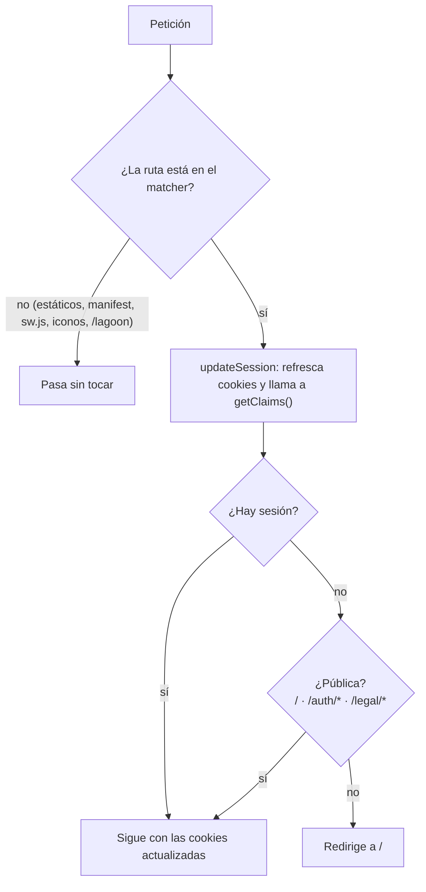

# Aplicación web (`apps/web`)

La web es una app Next.js 16 (App Router, React 19, TypeScript estricto, Tailwind v4) en [apps/web](../../apps/web), paquete `@trivia/web`. Este documento cubre lo transversal: rutas, layout raíz, proxy y sesión, clientes de Supabase, i18n, Sentry, configuración de Next, iconos y el muestrario `/dev/ui`. Cada feature tiene su propio documento (índice en [arquitectura.md](arquitectura.md)) y los componentes visuales están en [sistema-visual.md](sistema-visual.md).

Next 16 cambia convenciones respecto a versiones anteriores (por ejemplo `proxy.ts` sustituye a `middleware.ts`). [AGENTS.md](../../apps/web/AGENTS.md) pide leer la documentación local en `apps/web/node_modules/next/dist/docs/` antes de tocar código de Next; ese bloque lo escribe y reañade `next dev`, así que conviene commitearlo y no borrarlo.

## Rutas

Las páginas son Server Components asíncronos y casi todas empiezan con `requireProfile()` (sesión y onboarding completado). Excepciones: `/` (la sesión es opcional), `/onboarding` (aún no hay perfil) y las públicas o estáticas. Las dinámicas pasan `key={id}` al componente cliente para que otra partida (revancha) empiece con estado limpio.

| Ruta | Archivo | Qué muestra | Feature | RPC / acciones principales |
| --- | --- | --- | --- | --- |
| `/` | [app/page.tsx](../../apps/web/src/app/page.tsx) | Pública. Sin sesión: portada con login y enlaces legales. Con sesión: enlaces a amigos (con contador de solicitudes) y perfil (con nivel), tarjeta del reto diario, tarjetas de Rápida, Duelo y Relámpago, lista "Tus duelos" y cerrar sesión. Sin perfil redirige a `/onboarding`. | `home`, `auth`, `daily`, `duel` | `list_duels`, `list_friends`, `get_daily`; acciones `signInWithProvider`, `signOut`, `startDaily` |
| `/auth/callback` | [app/auth/callback/route.ts](../../apps/web/src/app/auth/callback/route.ts) | Pública (GET). Cambia el `code` OAuth por una sesión, copia el idioma del perfil a la cookie `NEXT_LOCALE` y redirige a `/` (o a `/?error=auth`). | `auth` | `auth.exchangeCodeForSession`, lectura de `profiles.locale` |
| `/onboarding` | [app/onboarding/page.tsx](../../apps/web/src/app/onboarding/page.tsx) | Crear el perfil: nombre sugerido, avatar, idioma y casilla de edad y términos. Si ya hay perfil, redirige a `/`. | `profile` | `is_username_available`, tabla `avatars`; acción `saveProfile` |
| `/profile` | [app/profile/page.tsx](../../apps/web/src/app/profile/page.tsx) | Nivel, estadísticas, edición del perfil, preferencias del dispositivo, avisos push, interruptor "en línea", borrar cuenta, enlaces legales y, si es admin, enlace a `/admin`. | `profile`, `progress`, `stats`, `preferences`, `pwa`, `presence` | `is_admin`, `category_stats`; acciones `saveProfile`, `deleteAccount`; `profiles.show_online` directo |
| `/friends` | [app/friends/page.tsx](../../apps/web/src/app/friends/page.tsx) | Búsqueda de jugadores, solicitudes y lista de amigos con sus retos. | `friends` | `list_friends`; desde el cliente `search_players`, `send_friend_request`, `respond_friend_request`, `remove_friend`, `start_duel`, `invite_live_duel` |
| `/play/quick` | [app/play/quick/page.tsx](../../apps/web/src/app/play/quick/page.tsx) | Preparar una partida rápida: jugadores locales (invitados recientes) y dificultad. | `game/quick` | lectura de `guests` y `avatars`; acción `startQuickMatch` (`remember_guest`, `start_quick_match`) |
| `/play/quick/[matchId]` | [app/play/quick/[matchId]/page.tsx](../../apps/web/src/app/play/quick/[matchId]/page.tsx) | La partida (`QuickGame`) y sus resultados. | `game/quick` | `get_quick_match`, `serve_quick_question`, `answer_quick_question`, `report_quick_question` |
| `/daily` | [app/daily/page.tsx](../../apps/web/src/app/daily/page.tsx) | El reto de hoy: si no está terminado, `QuickGame` en modo `daily`; si lo está, `DailyResults`. Sin reto, redirige a `/`. | `daily` | `get_daily` |
| `/daily/image` | [app/daily/image/route.tsx](../../apps/web/src/app/daily/image/route.tsx) | Route handler: PNG de 1080x1080 con el resultado propio (404 si no ha terminado). | `daily` | `get_daily` |
| `/duel/[duelId]` | [app/duel/[duelId]/page.tsx](../../apps/web/src/app/duel/[duelId]/page.tsx) | Duelo por turnos (`DuelGame`). | `duel` | `get_duel`, `serve_duel_question`, `spin_duel_round`, `answer_duel_question`, `report_duel_question`, `surrender_duel`, `decline_duel`, `start_duel` (revancha) |
| `/live` | [app/live/page.tsx](../../apps/web/src/app/live/page.tsx) | Amigos conectados (los `offline` se filtran en la página) para retar en vivo. | `live` | `list_friends`; `invite_live_duel` |
| `/live/[duelId]` | [app/live/[duelId]/page.tsx](../../apps/web/src/app/live/[duelId]/page.tsx) | Duelo relámpago (`LiveGame`). | `live` | `get_live_duel`, `serve_live_question`, `answer_live_question`, `answer_live_invite`, `cancel_live_duel`; Realtime `live_duels` |
| `/admin` | [app/admin/page.tsx](../../apps/web/src/app/admin/page.tsx) | Cola de revisión de preguntas. `notFound()` si no es admin. | `admin` | `is_admin`, `admin_review_queue`; desde el cliente `admin_review_question`, `admin_update_question` |
| `/legal/terms`, `/legal/privacy` | [app/legal/terms](../../apps/web/src/app/legal/terms/page.tsx), [privacy](../../apps/web/src/app/legal/privacy/page.tsx) | Públicas. Texto legal en el idioma de la petición. | `legal` | ninguna |
| `/dev/ui` | [app/dev/ui/page.tsx](../../apps/web/src/app/dev/ui/page.tsx) | Muestrario de componentes. `notFound()` salvo en `NODE_ENV === "development"`. | (varios) | ninguna |
| `/manifest.webmanifest` | [app/manifest.ts](../../apps/web/src/app/manifest.ts) | Manifiesto de la PWA. | `pwa` | ninguna |
| `/icon/192`, `/icon/512` | [app/icon.tsx](../../apps/web/src/app/icon.tsx) | Iconos PNG de la app. | `pwa` | ninguna |
| `/apple-icon` | [app/apple-icon.tsx](../../apps/web/src/app/apple-icon.tsx) | Icono de 180 px para iOS. | `pwa` | ninguna |
| `/sw.js` | [app/sw.js/route.ts](../../apps/web/src/app/sw.js/route.ts) | Service worker generado desde `messages/*.json`. | `pwa` | ninguna |
| `/lagoon` | (no es un archivo de la app) | Túnel de errores a Sentry que crea el plugin (ver Sentry). | - | - |

No hay `error.tsx`, `not-found.tsx` ni `loading.tsx` en `app/`: se usan las páginas por defecto de Next. Solo existe [global-error.tsx](../../apps/web/src/app/global-error.tsx), que manda el error a Sentry y muestra la página de error por defecto.

### Server actions

Las usan formularios que necesitan cookies o `redirect`. Todas vuelven a validar lo que llega del cliente.

| Acción | Archivo | Qué hace |
| --- | --- | --- |
| `signInWithProvider(provider)` | [auth/actions.ts](../../apps/web/src/features/auth/actions.ts) | Comprueba que el proveedor está habilitado, pide a Supabase la URL OAuth con `redirectTo = <origin>/auth/callback` y redirige a ella; ante cualquier fallo, `/?error=auth`. |
| `signOut()` | ídem | `auth.signOut()` y redirige a `/`. `SignOutButton` antes da de baja el push de este dispositivo. |
| `saveProfile(prev, formData)` | [profile/actions.ts](../../apps/web/src/features/profile/actions.ts) | Crea (con `terms_version`, exige la casilla legal) o actualiza `profiles`, fija la cookie `NEXT_LOCALE` y redirige a `/`. Errores: `usernameInvalid`, `usernameTaken` (código `23505`), `usernameNotAllowed`, `termsRequired`, `rateLimited`, `generic`. |
| `deleteAccount()` | ídem | RPC `delete_own_account`, cierra la sesión local y redirige a `/`. |
| `startQuickMatch(prev, formData)` | [game/quick/actions.ts](../../apps/web/src/features/game/quick/actions.ts) | Valida dificultad e invitados (máximo `QUICK.maxPlayers - 1`, nombres de hasta 20 caracteres y sin repetir), guarda cada invitado con `remember_guest`, crea la partida con `start_quick_match` y redirige a `/play/quick/<id>`. Errores: `notEnoughQuestions`, `nameTaken`, `generic`. También hace de revancha. |
| `startDaily()` | [daily/actions.ts](../../apps/web/src/features/daily/actions.ts) | RPC `start_daily_match` y redirige a `/daily`; lanza un error si la RPC falla. |

## Sesión, proxy y protección de rutas

- [proxy.ts](../../apps/web/src/proxy.ts) exporta `proxy()` (Next 16 lo ejecuta por defecto en el runtime de Node) y `config.matcher`. Es una denegación por defecto: una ruta nueva queda protegida sin hacer nada. Solo son públicas `/`, `/auth/*` y `/legal/*` ([`isPublicPath`](../../apps/web/src/proxy.ts#L5)).
- El [`matcher`](../../apps/web/src/proxy.ts#L19) deja **fuera** del proxy: `_next/static`, `_next/image`, `/favicon.ico`, `/manifest.webmanifest`, `/sw.js`, `/lagoon`, todo lo que empiece por `icon/` o `apple-icon`, y cualquier ruta que acabe en `.svg`, `.png`, `.jpg`, `.jpeg`, `.gif` o `.webp`. Son lo que el navegador pide para instalar la PWA y recibir avisos, y los errores de Sentry de quien no tiene sesión. Una ruta nueva de este tipo debe añadirse al `matcher`.
- [lib/supabase/proxy.ts](../../apps/web/src/lib/supabase/proxy.ts) (`updateSession`) crea un cliente de servidor con las cookies de la petición, propaga las cookies renovadas a petición y respuesta, acumula las cabeceras anti-caché que devuelve `@supabase/ssr` (para que una CDN no sirva la sesión de uno a otro) y llama a `getClaims()` justo después de crear el cliente (cualquier código intermedio provoca cierres de sesión aleatorios, según el propio comentario). Devuelve `{ response, isAuthenticated }`.
- Segunda barrera en las páginas: [`requireProfile()`](../../apps/web/src/features/profile/queries.ts) redirige a `/` sin sesión y a `/onboarding` sin perfil. `/admin` añade `is_admin` y `notFound()`. Tercera barrera: cada RPC vuelve a comprobarlo en SQL.

## Clientes de Supabase (`lib/supabase`)

| Archivo | Para qué |
| --- | --- |
| [env.ts](../../apps/web/src/lib/supabase/env.ts) | `getSupabaseEnv()`: lee `NEXT_PUBLIC_SUPABASE_URL` y `NEXT_PUBLIC_SUPABASE_PUBLISHABLE_KEY` con acceso literal a `process.env` (así Next las incrusta en el navegador) y lanza error si faltan. Solo variables públicas. |
| [server.ts](../../apps/web/src/lib/supabase/server.ts) | `createClient()` asíncrono con `createServerClient` y `cookies()`. Uno por petición, nunca global. Su `setAll` ignora el error de escribir cookies desde un Server Component (el proxy ya las renueva). |
| [client.ts](../../apps/web/src/lib/supabase/client.ts) | `createClient()` con `createBrowserClient`. Los componentes lo crean con `const [supabase] = useState(createClient)`. |
| [proxy.ts](../../apps/web/src/lib/supabase/proxy.ts) | `updateSession()` para `src/proxy.ts`. |
| [database.types.ts](../../apps/web/src/lib/supabase/database.types.ts) | Tipos generados con `pnpm db:types` (no editar a mano; ESLint lo ignora). Las RPC que devuelven `jsonb` salen como `Json`: cada feature declara la forma real en su `types.ts`. |

Las lecturas de sesión para páginas están en [features/profile/queries.ts](../../apps/web/src/features/profile/queries.ts): `getAuthContext()` (`{ supabase, claims }`, memoizado por petición con `cache`), `getOwnProfile()` (`username, avatar_id, locale, xp, show_online`), `requireProfile()`, `getActiveAvatarIds()` y `suggestUsername()`. Los tres clientes usan solo la clave publicable; la secreta no existe en la web.

## Layout raíz

[app/layout.tsx](../../apps/web/src/app/layout.tsx):

- **Fuentes:** Fredoka (titulares) y Nunito (texto) con `next/font/google`, subconjunto `latin`; Next las descarga al compilar y las sirve desde el dominio propio. Exponen `--font-fredoka` y `--font-nunito` en `<html>`.
- **Metadatos:** `generateMetadata` con el espacio `Metadata` (título y descripción en el idioma de la petición) y `appleWebApp: { capable: true }` (iOS abre la app instalada a pantalla completa, requisito de los push). `viewport.themeColor` es `BRAND_BG`.
- **`<html>`:** `lang` con el idioma resuelto y `data-text-size` con la cookie `TEXT_SIZE` (`normal` por defecto) para que el servidor pinte ya el tamaño elegido.
- **Proveedor:** `NextIntlClientProvider` sin props (hereda idioma y mensajes de `i18n/request.ts`).
- **Siempre montado:** `RegisterServiceWorker`. **Solo con sesión:** `NotificationToasts` (avisos en vivo por Realtime, ver [avisos-pwa-y-push.md](avisos-pwa-y-push.md)) y `PresenceHeartbeat` (latido cada 20 s con la pestaña visible; marca "ocupado" en `/play/quick/<id>`, `/duel/<id>` y `/live/<id>`, no en `/daily`).
- Como el layout lee cookies, todas las páginas son dinámicas.

## i18n

- [i18n/config.ts](../../apps/web/src/i18n/config.ts): `locales` (`es`, `en`), `defaultLocale` (`es`), `LOCALE_NAMES` (cada idioma en su lengua), `LOCALE_COOKIE` (`NEXT_LOCALE`) y sus opciones (ruta `/`, 1 año, `sameSite: lax`), `isLocale()`.
- [i18n/request.ts](../../apps/web/src/i18n/request.ts): sin prefijo en la URL. Idioma = cookie `NEXT_LOCALE` válida, o el primer idioma soportado de `Accept-Language`, o `es`. Carga `messages/<idioma>.json` con `import()` dinámico. La cookie se fija desde el idioma del perfil al volver del login (`/auth/callback`) y al guardar el perfil (`saveProfile`), para no consultar la BD en cada petición.
- [global.d.ts](../../apps/web/src/global.d.ts): declara `Locale` y `Messages` (`typeof es.json`) para `next-intl`; `t("clave")` queda tipado y una clave inexistente en `es.json` falla en `pnpm typecheck`. `en.json` no está tipado: sus claves faltantes no las detecta nadie hoy (ahora ambos archivos tienen las mismas 296).
- Uso: `getTranslations("Espacio")` en servidor, `useTranslations("Espacio")` en componentes (también sin `"use client"`). Hay texto enriquecido (`t.rich`: `Home.title` con `<accent>`, `Legal.accept` con `<terms>` y `<privacy>`), plurales ICU (`Stats`, `Admin.summary`) y fechas (`Legal.updated`).
- El proveedor envía **todos** los mensajes al cliente en cada página: por eso los textos legales, largos, viven fuera de `messages/` ([legal-y-privacidad.md](legal-y-privacidad.md)).

Espacios de nombres de `messages/{es,en}.json`:

| Espacio | Dónde se usa |
| --- | --- |
| `Metadata` | Título y descripción (metadatos, manifest y service worker). |
| `Home` | Portada: título, subtítulo, enlaces, "Tus duelos". |
| `Auth` | Botones de entrar y salir, error de login. |
| `Profile`, `Account` | Onboarding y edición del perfil; borrar cuenta. |
| `Quick` | Modo rápido y textos compartidos de toda partida (dificultades, acierto, fallo, puntos, "Siguiente", `% de acierto`). |
| `Friends`, `Duel`, `Live` | Amigos y presencia; duelo por turnos; duelo relámpago. |
| `Daily` | Reto diario. |
| `Progress`, `Stats` | XP, niveles y títulos; estadísticas. |
| `Notifications` | Avisos in-app; el service worker también los usa para el push. |
| `Outcome` | Finales animados. |
| `Report` | Reportar pregunta. |
| `Admin` | Panel de revisión. |
| `Push`, `Presence`, `Preferences` | Avisos push, interruptor "en línea", preferencias del dispositivo. |
| `Legal` | Marco de las páginas legales y casilla del onboarding. |

## Sentry

Solo errores: sin trazas de rendimiento, sin grabación de sesión y sin datos personales. Sin `NEXT_PUBLIC_SENTRY_DSN` no se envía nada (por eso en local no hace falta). Montaje en producción: [produccion.md](../produccion.md).

- [instrumentation.ts](../../apps/web/src/instrumentation.ts): `register()` inicia Sentry en el servidor y `onRequestError = Sentry.captureRequestError`.
- [instrumentation-client.ts](../../apps/web/src/instrumentation-client.ts): inicia Sentry en el navegador.
- [global-error.tsx](../../apps/web/src/app/global-error.tsx): captura los errores de renderizado (sin él, Next los atrapa y Sentry no se entera) y muestra la página de error por defecto.
- [next.config.ts](../../apps/web/next.config.ts): `withSentryConfig` con `tunnelRoute: "/lagoon"` (las peticiones salen por el dominio propio porque los bloqueadores cortan las directas; nombre neutro porque las listas de bloqueo incluyen rutas como `/monitoring`), `silent: !process.env.CI` y `telemetry: false`. Los source maps se suben al compilar si hay `SENTRY_AUTH_TOKEN`, `SENTRY_ORG` y `SENTRY_PROJECT` (en Vercel).
- `/lagoon` está fuera del `matcher` del proxy para que también lleguen los errores de quien no ha iniciado sesión.

## Configuración de Next

[next.config.ts](../../apps/web/next.config.ts) hace tres cosas: `transpilePackages: ["@trivia/game-core"]` (el paquete exporta TS sin compilar), `createNextIntlPlugin("./src/i18n/request.ts")` y el envoltorio de Sentry. No define cabeceras, redirecciones ni imágenes. PostCSS solo carga `@tailwindcss/postcss` ([postcss.config.mjs](../../apps/web/postcss.config.mjs)). El alias `@/*` apunta a `src/*` en [tsconfig.json](../../apps/web/tsconfig.json).

## Iconos y manifest

La mascota dibuja los iconos de la app con `ImageResponse` ([features/pwa/brand-icon.tsx](../../apps/web/src/features/pwa/brand-icon.tsx): fondo `BRAND_BG` y mascota al 60 % central, para que sirva como icono "maskable"). [icon.tsx](../../apps/web/src/app/icon.tsx) genera 192 y 512 px con `generateImageMetadata`; [apple-icon.tsx](../../apps/web/src/app/apple-icon.tsx), 180 px. [manifest.ts](../../apps/web/src/app/manifest.ts) usa `Metadata.title` como `name` y `short_name`, `display: standalone`, `start_url: "/"` y los dos tamaños con propósito `any` y `maskable`. Cómo funcionan la instalación, el service worker y el push: [avisos-pwa-y-push.md](avisos-pwa-y-push.md).

## `/dev/ui`

Muestrario para trabajar estilos: [page.tsx](../../apps/web/src/app/dev/ui/page.tsx) responde 404 salvo en `NODE_ENV === "development"` y pinta [showcase.tsx](../../apps/web/src/app/dev/ui/showcase.tsx), que lleva datos de ejemplo sin i18n a propósito. Como el resto de rutas, exige sesión. Secciones: Botones, Tarjeta de pregunta, Ruleta, Mensaje de acierto, Reto diario (cuadritos), Estadísticas, XP y niveles, Duelo relámpago (reloj con deslizador), Finales de partida y Avatares. Detalle en [sistema-visual.md](sistema-visual.md).

## Detalles a tener en cuenta

- **Páginas de error por defecto.** `/admin` para un no admin y cualquier ruta inexistente muestran el 404 de Next (en inglés y sin el tema oscuro); `global-error.tsx` tampoco pone `lang` ni estilos. Cambiarlo es decisión de diseño: preguntar.
- **Idioma de la interfaz y de las preguntas pueden divergir.** La interfaz usa la cookie `NEXT_LOCALE` (se fija al iniciar sesión y al guardar el perfil), pero las partidas se sirven en `profiles.locale`. Si cambias el idioma en un dispositivo, los demás conservan su cookie hasta volver a iniciar sesión o guardar el perfil.
- **El proxy y las rutas estáticas.** Cualquier ruta nueva que el navegador deba poder pedir sin sesión necesita su entrada en el `matcher` además de (si es una página) en `isPublicPath`.
- **Formas del JSON a mano.** Las páginas convierten con `as unknown as Tipo`; no hay validación en ejecución (ver [arquitectura.md](arquitectura.md)).
- **`PresenceHeartbeat` también corre en `/onboarding`.** Sin perfil, `touch_presence` falla en cada latido; el cliente ignora el error.
- **`/daily` no cuenta como "jugando".** El patrón de ruta ocupada del latido ([`BUSY_PATH`](../../apps/web/src/features/presence/presence-heartbeat.tsx#L10)) no lo incluye, así que quien juega el reto diario figura "en línea" y puede recibir invitaciones en vivo.
- **Sin `hover:`.** La interfaz está pensada para táctil; no hay estados de ratón.
- **`getAuthContext()` se llama dos veces en la portada** (líneas [24](../../apps/web/src/app/page.tsx#L24) y [44](../../apps/web/src/app/page.tsx#L44)): es inocuo porque está memoizado.
- **Entorno local.** Abre la web en `http://localhost:3000`, no en `127.0.0.1`: las cookies de sesión dependen del host ([README](../../README.md)).
